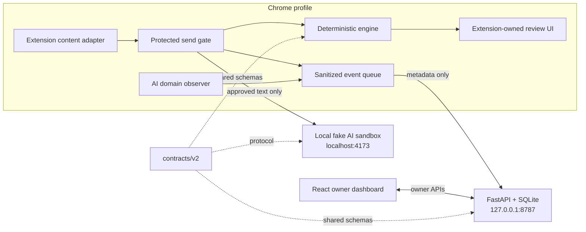

# ShadowShield Modular Architecture

**Status:** Proposed implementation architecture for the 24-hour local demo. This document translates the supplied implementation plan into module boundaries; it does not claim that any module is implemented or security-validated.

## Architecture at a glance



The browser gate and deterministic analysis run locally. The sandbox receives approved text only in memory. Telemetry contains sanitized metadata. The dashboard reads aggregate and event data from the loopback API. There is no local proxy and no cloud inference in P0.

## Repository shape and ownership

```text
contracts/v2/          Versioned JSON schemas, enums, fixtures, generated interfaces
packages/engine/        Pure deterministic detection, scoring, policy, redaction
apps/extension/         MV3 adapter, send gate, review UI, visit observer, queue
apps/api/               FastAPI routes, auth, validation, persistence, analytics
apps/dashboard/         React owner UI and API client
apps/sandbox/           Cooperative fake AI editor and receiver
scripts/                Generation, local run, integration and evaluation commands
tests/eval/             Curated and generated labeled cases
 tests/e2e/             Browser-to-receiver and API/dashboard integration checks
```

Path ownership follows the implementation plan: Group A owns `apps/extension/**`; Group B owns `contracts/**` and `packages/engine/**`; Group C owns `apps/api/**`, `scripts/**`, and `tests/e2e/**`; Group D owns `apps/sandbox/**`, `apps/dashboard/**`, and `tests/eval/**`. Treat the leading space above `tests/e2e/` as a formatting typo; the intended path is `tests/e2e/`.

## Module responsibilities

| Module | Owns | Must not own |
|---|---|---|
| `contracts/v2` | Event variants, analysis input/output, policy shape, enums, schema validation fixtures, generated TS/Python types | Runtime policy logic or persistence |
| `packages/engine` | Normalization with source offsets, detectors, findings, severity/tier, policy decision, redaction operations | DOM access, network calls, logging, storage |
| Extension adapter | Supported sandbox selectors and gesture recognition; exact origin check | Generic interception claims or site-specific behavior in the engine |
| Extension send gate | Synchronous cancellation, dedupe/IME handling, evaluate locally, fail-safe state transition | Releasing original text after block/failure |
| Review UI | Render findings/actions, capture explicit user acknowledgment in extension-owned UI | Page-controlled approval or silent bypass |
| Sanitized queue | Allowlisted metadata events, retry and bounded session handling | Raw prompt, matched text, file/name, prompt hash, full URL/query, dictionary terms |
| Domain observer | Top-frame committed navigation to static AI domain registry | Inferring prompt submission or user intent from a visit |
| API | Bearer-authenticated ingestion, strict atomic validation, server timestamps, SQLite constraints, owner/device APIs and analytics | Receiving raw prompt content or weakening local gate decisions |
| Dashboard | AI inventory, visit and guard metrics, dispositions, device freshness, trend views | Claiming enterprise-wide coverage or equating visits with submissions |
| Sandbox | Fake editor, defined events, in-memory receiver, observable receiver text | Actual LLM calls, network submission, or presenting itself as a production AI integration |

## Core data flow

1. The content adapter recognizes a supported user gesture only on the configured sandbox origin.
2. The gate cancels that gesture synchronously, rejects duplicate/IME paths as specified, and sends text plus active local policy to the engine. Text remains in local memory.
3. The engine returns a complete versioned decision. `BLOCK`, `CANCELLED`, or `FAILED_SAFE` never releases text. WARN requires explicit acknowledgment; REDACT releases only the approved replacement after any remaining WARN is acknowledged.
4. For an allowed release, the gate provides approved text to the cooperative sandbox. A redaction is counted as page-attested only after the sandbox reads back the approved text and appends it to its in-memory receiver. A receipt is evidence of this sandbox path, not cryptographic proof for real sites.
5. The queue emits sanitized outcome metadata independently of release. API unavailability never changes the local decision; retry contains metadata only.
6. The observer emits a domain visit event for recognized top-frame navigation. It does not label that event as a prompt or risk event.
7. The API validates and persists events atomically, then exposes owner analytics to the dashboard. Local dictionary terms remain on-device.

## Contracts and dependency rules

- `contracts/v2` is the boundary shared by TypeScript and Python. Freeze schema, discriminators, enums, ports, selectors, and sandbox receipt protocol before dependent implementations.
- Generate language interfaces from the versioned schema; do not maintain hand-edited parallel definitions.
- Engine entry point is the specified `analyze({text, policy, customTerms?})`; return a fully populated result or a fail-safe `NOT_EVALUATED` result.
- Engine is a pure module: same input and versioned policy produce the same findings and decision. It has no browser or service dependencies.
- Extension and API may depend on contracts; API must not call the browser engine to reinterpret an already-recorded disposition.
- Events use explicit variants and allowlisted fields. Reject unknown fields and duplicate IDs safely; never put raw text, prompt hashes, snippets, full URLs, or local custom terms into telemetry.
- Keep detection severity distinct from aggregate tier and disposition. A `FAILED_SAFE` result is `NOT_EVALUATED`, not zero risk.

## Failure boundaries

| Failure | Local behavior | Reporting behavior |
|---|---|---|
| Engine exception, invalid policy, malformed result | Stop the guarded send; show safe error | Record `FAILED_SAFE` with `NOT_EVALUATED` if possible |
| API offline or timeout | Continue the already-decided local flow | Retain/retry only sanitized metadata; show backend offline |
| Unsupported page or gesture | Do not claim protection | Label visit as observed-only or flow as unsupported |
| Extension unavailable/disabled | No guarantee of interception | Dashboard cannot infer installation from missing heartbeat |
| Sandbox cannot verify approved receiver text | Do not claim a successful release/redaction receipt | Record unverified/failure disposition |

## Delivery sequence

1. **Contract freeze:** schemas, fixtures, generated types, selectors, origins, ports, ownership.
2. **Independent scaffolds:** engine, extension shell, API, sandbox, dashboard, evaluation harness against frozen contracts.
3. **Engine and gate:** detectors, policy, offsets, redaction, review and synchronous cancellation.
4. **Protected-path proof:** inspect actual in-memory receiver text for blocked, allowed, and redacted cases; prove original sensitive text is absent after redaction.
5. **Telemetry integration:** visit and outcome events, API validation/storage, dashboard reconciliation, offline behavior.
6. **Evaluation and rehearsal:** report measured results with denominators and limitations; preserve last known green revision.

P0 is the guarded cooperative sandbox path, privacy-safe telemetry, visit inventory, and honest dashboard. A verified real-provider adapter and owner-only local custom dictionary are P1. Other adapters, file/OCR extraction, signed policy enrollment, and remote multi-device deployment are P2. None should compromise P0 or be presented as delivered before implementation evidence exists.

## Explicit deployment boundary

This design is a single-machine, single-profile local demonstration. `127.0.0.1:8787` does not accept events from other machines. A stale heartbeat means the device was not recently observed; it does not prove an extension was uninstalled. Recognized AI-domain visits show navigation, not prompt submission. Supported interception applies only to the named cooperative sandbox gestures. Production multi-device operation requires authenticated HTTPS, enrollment, managed configuration, privacy governance, and additional security review.
