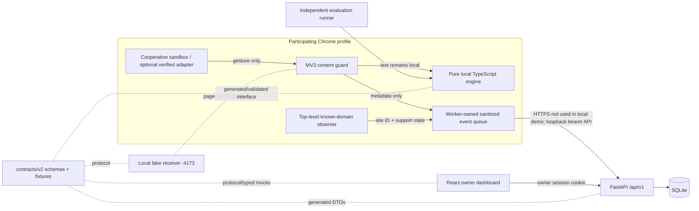
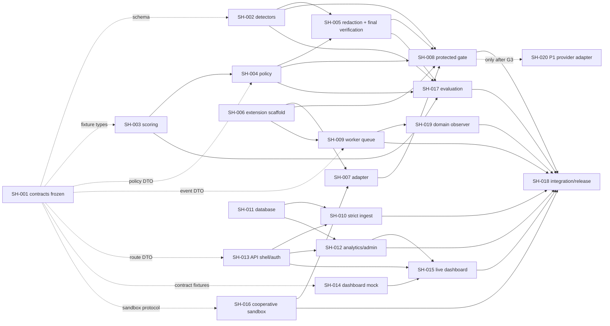
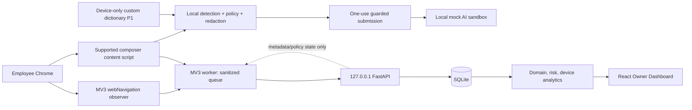
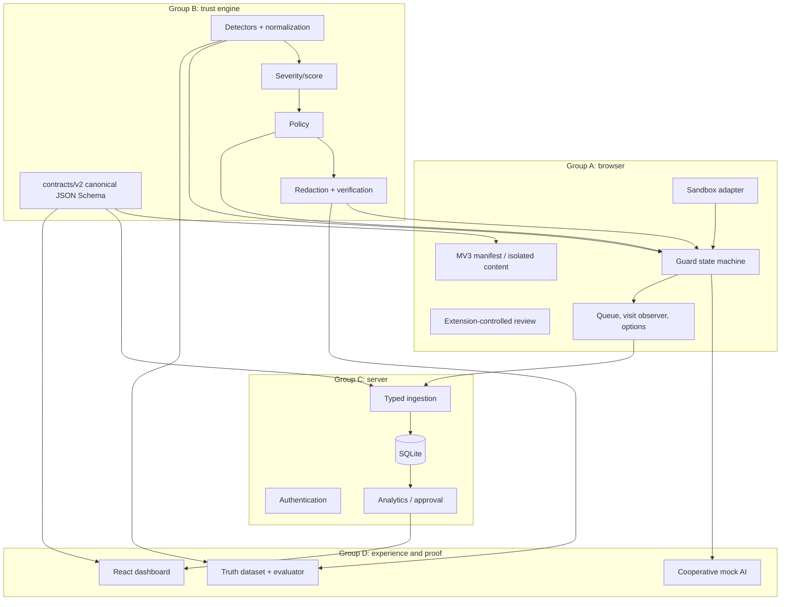
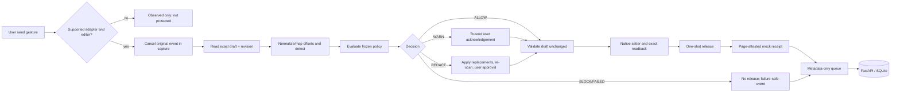
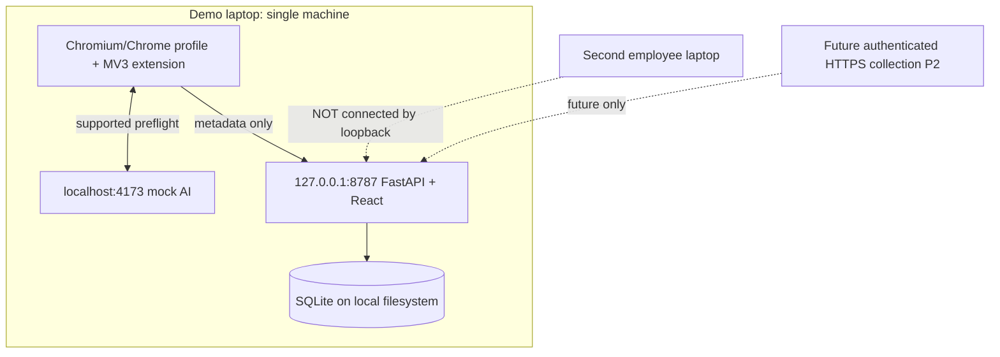
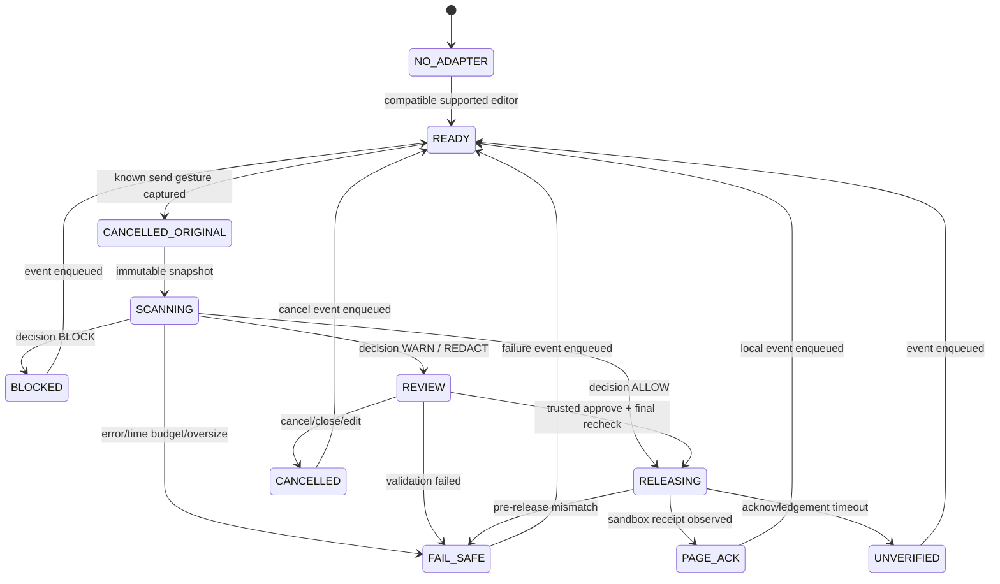
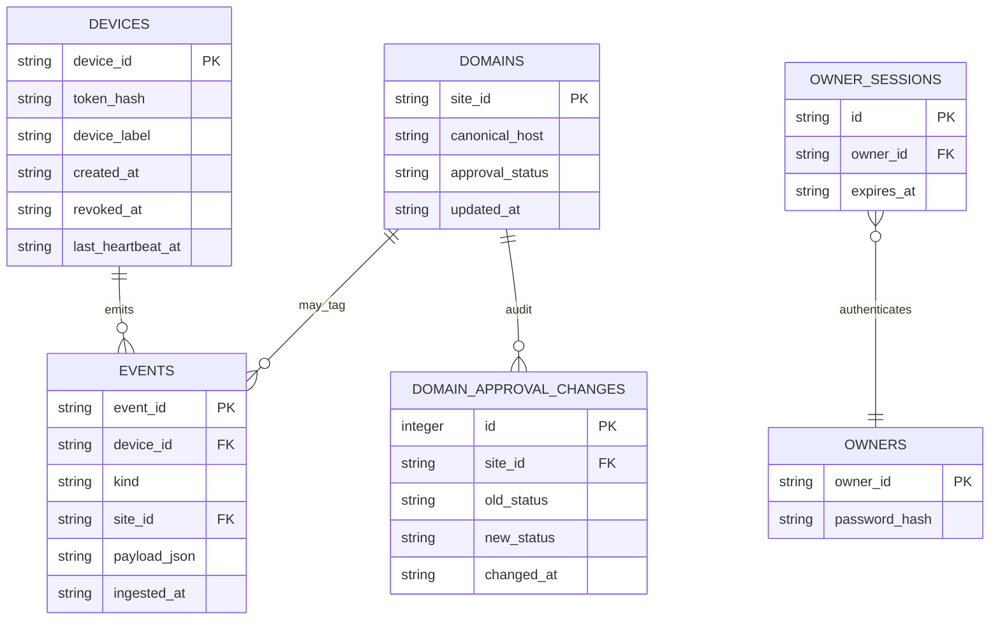
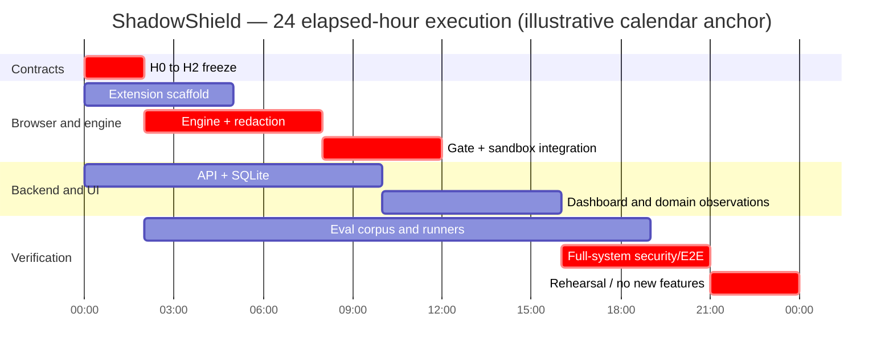

# SHADOW AI — MASTER IMPLEMENTATION PLAN V3 (MODULAR)

**Working name:** ShadowShield  
**Contract baseline:** `contracts/v2`; API path `/api/v1`  
**Planning horizon:** 24 elapsed hours  
**Team:** four human developers coordinating up to three coding agents each  
**Source:** V2 master implementation plan, reviewed 30 October 2026  
**Status:** implementation plan; no application code or test results are implied by this document.

> **Instruction precedence.** This V3 document is the modular execution plan. Normative V2 security, privacy, event, analysis, sandbox, API, analytics and evaluation semantics are retained unless an explicit V3 decision below refines ownership or scheduling. Existing issue IDs SH-001 through SH-020 remain stable. This plan does not authorize claims that the described software has been built or verified.

# MODULAR EXECUTION BLUEPRINT

## 1. Final architecture diagram



The deployment remains a single-machine demonstration. Browser text is examined by the local deterministic engine before a supported send gesture is released. The backend receives only schema-valid metadata. Domain visits, guarded attempts, page-attested redactions and heartbeat observations remain different measurements. The sandbox receipt is an observation from a cooperative page, not proof of network delivery.

## 2. Four-group responsibility matrix

| Group | Owned module boundary | Exports to other groups | Consumes | Must not own |
|---|---|---|---|---|
| A — Browser | MV3 manifest/content guard, sandbox adapter, local review, worker queue, domain observer, browser status | `ComposerAdapter`, `GatePort`, `TelemetrySink`, observer output; unpacked extension | B engine package; B1 contracts; D1 frozen sandbox protocol; C API contract | Engine logic, API persistence, dashboard, sandbox implementation |
| B — Engine/contracts | Authoritative JSON Schemas/OpenAPI/protocol/registry; TypeScript DTOs; pure analysis, scoring, policy, redaction | `analyze(AnalysisInput): AnalysisOutput`; verified redaction; schemas and fixtures | No browser, API, page or database runtime | Extension UI, Python routes, React UI, prompt storage |
| C — API/integration | FastAPI shell/auth, SQLite repository, strict ingestion, analytics/admin routes, integration harness and release evidence | `/api/v1`, generated Python DTO consumption, `DataClient` response shapes, integration evidence | B schemas; A sanitized events; D dashboard build and E2E selectors | Browser gate or engine algorithms; dashboard components; sandbox code |
| D — Experience/proof | Cooperative sandbox/receiver, dashboard presentation and typed mock, synthetic corpus/evaluator | Sandbox protocol implementation; dashboard `DataClient`; aggregate evaluation report | B contracts/engine; C API contract; A browser protocol | Extension implementation, backend routes/storage, engine detector internals |

## 3. Agent-to-module ownership

| Agent | Primary module | Exclusive write set | Contract supplied to peers | Coordination point |
|---|---|---|---|---|
| A1 | Extension shell + sandbox composer adapter + Options/popup | `apps/extension/manifest.json`, `package.json`, `src/content/bootstrap.ts`, `src/content/sandbox-adapter.ts`, `src/content/site-status.ts`, `src/options/**`, `src/popup/**`, `tests/adapter.test.ts` | `ComposerAdapter` and worker message declarations in `apps/extension/src/shared/messages.ts` | SH-007 adapter fixture; A2 consumes adapter interface |
| A2 | Guard state machine + review surface | `apps/extension/src/content/gate.ts`, `review.ts`, `gate-state.ts`, `tests/gate.test.ts` | `GatePort`; terminal disposition emission and one-shot release semantics | SH-008; does not edit bootstrap, adapter or worker |
| A3 | Worker, queue, API client and observer | `apps/extension/src/background/**`, `apps/extension/src/shared/messages.ts` (message contract only), `tests/queue.test.ts`, `tests/observer.test.ts` | `TelemetrySink.enqueue(event)` and observer event producer | SH-009/019; one coordinated worker composition commit |
| B1 | Contract authority + detector implementation | `packages/contracts/**`; `packages/engine/src/index.ts`, `types-internal.ts`, `detectors/**`, `normalize.ts`, `chunk.ts`; `tests/detectors.test.ts` | Generated contract DTOs; `scanText` implementation; final barrel composition | SH-001/002; barrel accepts PRs only at integration windows |
| B2 | Scoring and policy | `packages/engine/src/scoring.ts`, `policy.ts`; corresponding tests | `scoreFindings`, `evaluatePolicy`; no changes to DTOs | SH-003/004 against frozen fixtures; SH-002 implementation not required |
| B3 | Redaction and post-redaction verification | `packages/engine/src/redaction.ts`; redaction/property tests | `planRedaction`, `applyRedaction`, `verifyRedaction` | SH-005; starts on fixtures, final scan integration follows SH-002 |
| C1 | API shell/auth/config + Python DTO generation | `apps/api/pyproject.toml`, `main.py`, `config.py`, `security.py`, `dependencies.py`, `generated/**`, `routers/auth.py`, `tests/test_auth.py`, `.env.example` | app/router registration/dependency injection seam; auth/session behavior | SH-013; does not edit C2 router/repository files |
| C2 | SQLite + event ingestion | `apps/api/shadow_api/db/**`, `seed.py`, `routers/events.py`, `services/event_ingestion.py`, matching tests | repository protocol and transactional `ingest_batch` operation | SH-010/011; uses generated DTO import path fixed at G0 |
| C3 | Analytics/admin APIs + E2E/release integration | `routers/analytics.py`, `domains.py`, `devices.py`, `policy.py`; services analytics/devices; `tests/e2e/**`, `scripts/**`, README and release checklist | stable `/api/v1` analytics/admin endpoints; integration records | SH-012/018; schedules integration windows with all human leads |
| D1 | Controlled sandbox | `apps/sandbox/**` | selectors and v2 request/receipt protocol from B1 | SH-016; publishes fixture at G0, implementation can use stub page |
| D2 | Dashboard and presentation | `apps/dashboard/src/**` except `src/api/client.ts` and integration adapter | `DataClient` interface and typed mock | SH-014/015; SH-015 changes only dedicated API adapter and composition seam |
| D3 | Evaluation | `tests/eval/**` | aggregate-only evaluation report | SH-017; hand-authored/holdout fixtures frozen before engine tuning |

The C3 human integration lead does not personally implement every integration change. Each group lead owns review within its path; C3 sequences merges, keeps a known-green SHA, and owns only `tests/e2e/**`, `scripts/**`, README and its explicitly listed API analytics files. A shared file is never a simultaneous-edit surface.

## 4. Repository directory tree

```text
shadowshield/
├── README.md                                      # C3 after G0
├── package.json                                   # B1 until G0; C3 coordinated release scripts after
├── package-lock.json                              # B1 until G0; integration lead serializes later updates
├── tsconfig.base.json                             # B1 until G0
├── .gitignore                                     # B1 until G0
├── .env.example                                   # C1
├── packages/
│   ├── contracts/                                 # B1 only; canonical schemas/fixtures
│   │   ├── package.json
│   │   ├── domain-registry.json
│   │   ├── sandbox-protocol.md
│   │   ├── openapi.yaml
│   │   ├── schemas/{analysis,policy,event,analytics,domain,device}.schema.json
│   │   ├── src/generated/index.ts
│   │   ├── fixtures/{valid,invalid}/*.json
│   │   └── scripts/{generate-types,validate-contracts}.mjs
│   └── engine/                                    # B1/B2/B3 disjoint files
│       ├── src/index.ts                           # B1 integration-only barrel
│       ├── src/types-internal.ts                  # B1
│       ├── src/detectors/**                       # B1
│       ├── src/{normalize,chunk}.ts               # B1
│       ├── src/{scoring,policy}.ts                # B2
│       ├── src/redaction.ts                       # B3
│       └── tests/{detectors,scoring,policy,redaction,properties}.test.ts
├── apps/
│   ├── extension/                                 # Group A
│   │   ├── manifest.json, package.json
│   │   ├── src/shared/messages.ts                 # A3 contract; A1 consumes
│   │   ├── src/content/{bootstrap,sandbox-adapter,site-status}.ts # A1
│   │   ├── src/content/{gate,gate-state,review}.ts # A2
│   │   ├── src/content/adapters/real-provider.ts  # A1, P1
│   │   ├── src/background/**                      # A3
│   │   ├── src/options/**, src/popup/**           # A1
│   │   └── tests/**
│   ├── api/                                       # Group C
│   │   ├── pyproject.toml                         # C1
│   │   ├── shadow_api/{main,config,security,dependencies}.py # C1
│   │   ├── shadow_api/generated/**                # C1 generator output
│   │   ├── shadow_api/routers/{auth,events}.py    # C1 auth; C2 events
│   │   ├── shadow_api/routers/{analytics,domains,devices,policy}.py # C3
│   │   ├── shadow_api/db/**                       # C2
│   │   ├── shadow_api/services/{event_ingestion,analytics,devices}.py # C2/C3
│   │   └── tests/**
│   ├── dashboard/                                 # D2, with narrow SH-015 adapter seam
│   │   ├── src/App.tsx, main.tsx                  # D2; SH-015 may edit composition only by PR handoff
│   │   ├── src/api/{types,mock}.ts                # D2
│   │   ├── src/api/client.ts                      # SH-015 dedicated writer D2
│   │   ├── src/pages/**, src/components/**        # D2
│   │   └── tests/**
│   └── sandbox/                                   # D1 only
│       ├── package.json, index.html
│       ├── src/{main,composer,receipt,mode}.ts
│       └── tests/**
├── tests/
│   ├── eval/**                                    # D3 only
│   └── e2e/**                                     # C3 only
└── scripts/**                                     # C3 only after G0
```

Curly brace notation above means a set of individual files, not literal brace-named files. Optional files stay inside the named owner's directory. Root files, lockfiles, generated DTOs, engine barrel, worker composition, dashboard composition and route registry each have one writer at a time.

## 5. Frozen contract summary

Freeze at G0/H2: (a) JSON Schema Draft 2020-12 models and generated TS/Python import paths; (b) `analyze(input: AnalysisInput): AnalysisOutput` and typed `AnalysisFailure`; (c) finding offsets as original UTF-16 half-open ranges; (d) policy priority, fail-safe behavior and redaction verification semantics; (e) three disjoint metadata event variants and cross-field rules; (f) `/api/v1` paths and response DTOs; (g) domain ID/host registry; (h) sandbox selectors and v2 request/receipt event; (i) ports/hostnames and exact extension match/runtime origin; (j) worker message and `TelemetrySink` interface; (k) `DataClient` method names; (l) folder ownership and test commands. A freeze is a versioned commit and fixture set, not a meeting note.

The contract freeze does not claim every implementation is finished. A module can begin against a schema-validated fixture or local stub. It may not guess a field, use a fake alternate signature, or edit a peer-owned contract. Any required change is a short compatibility proposal with affected producers, consumers, fixture updates and issue links. All four group leads approve semantic changes; B1 is the sole schema editor and generator owner for TypeScript, while C1 runs the canonical Python generation.

### In-process seams to freeze alongside JSON schemas

These signatures are small coordination contracts, not new runtime packages. Place the TypeScript declarations in the existing owner paths shown in the tree. Import directions point inward: extension modules may import the engine and contracts; engine modules must not import extension/API/dashboard code.

```ts
// A1 owns the adapter implementation; A2 consumes it.
export interface ComposerAdapter {
  readonly siteId: SiteId;
  readonly coverageMode: CoverageMode;
  isSupportedTarget(target: EventTarget): boolean;
  readDraft(): { text: string; revision: number } | null;
  writeDraft(text: string): boolean; // true only after exact readback
  release(attemptId: string): void;  // sandbox protocol only; adapter never chooses policy
  restoreDraft(text: string): boolean;
}

// B1/B2/B3 implement the engine; A2 calls only this boundary.
export interface EnginePort {
  analyze(input: AnalysisInput): AnalysisOutput;
  verifyRedaction(input: VerifyRedactionInput): VerifyRedactionOutput;
}

// A2 emits terminal outcome; A3 persists only this contract event.
export interface TelemetrySink {
  enqueue(event: RiskEventV2): Promise<{ queued: boolean }>;
}

// A2 owns the state machine. A1 adapter supplies editor operations.
export interface GatePort {
  onSendGesture(event: Event, adapter: ComposerAdapter): void; // synchronously cancels supported original gesture
  cancelPending(reason: 'USER_CANCELLED' | 'EDITOR_CHANGED'): void;
  getCoverage(): CoverageMode;
}

// D2 owns views and mock; SH-015 implements this transport shape.
export interface DataClient {
  getSummary(days: number): Promise<SummaryV2>;
  getTimeseries(days: number, timezone: 'UTC' | 'Asia/Kolkata'): Promise<TimeseriesV2>;
  getEvents(limit: number, cursor?: string): Promise<EventPageV2>;
  getDomains(): Promise<DomainSummaryV2[]>;
  setApproval(siteId: SiteId, status: ApprovalStatus): Promise<DomainSummaryV2>;
  getDevices(): Promise<DeviceListV2>;
}

export interface DeviceListV2 {
  contractVersion: 'v2';
  items: DeviceSummaryV2[];
}
export interface DeviceSummaryV2 {
  deviceId: string; // pseudonymous UUID; never employee name
  lastHeartbeatAt: string | null; // server-ingested UTC timestamp
  lastEventAt: string | null;     // server-ingested UTC timestamp
  observation: 'RECENTLY_SEEN' | 'STALE' | 'NEVER_SEEN';
}

// A3 worker messages are typed, bounded, and never carry prompt text.
export type ExtensionMessageV2 =
  | { type: 'SET_DEVICE_CREDENTIAL'; deviceId: string; token: string }
  | { type: 'GET_CONNECTION_STATUS' }
  | { type: 'ENQUEUE_EVENT'; event: RiskEventV2 }
  | { type: 'GET_COVERAGE' };
```

`GatePort.onSendGesture` is synchronous through cancellation; analysis and review may continue asynchronously only after the browser's original event is prevented. `ComposerAdapter.release` must be one-shot and is valid only after the gate has stored an approved final string and checked exact editor readback. The worker message is a metadata boundary: there is no text, match value, filename, URL or prompt hash field. `DataClient` responses are exactly the v2 schemas.

### Verified contract clarification: device list DTO

V2 specifies `GET /api/v1/devices` as returning IDs and last-seen timestamps, and the dashboard must render freshness, but it does not define a response schema even though the repository contains a device schema and the dashboard needs a stable mock. This is a concrete interface gap. At G0, SH-001 adds `DeviceListV2` and `DeviceSummaryV2` to the existing v2 device schema and OpenAPI operation. The response includes only pseudonymous `deviceId`, server-ingested `lastHeartbeatAt` and `lastEventAt` (nullable), and an observation enum `RECENTLY_SEEN | STALE | NEVER_SEEN`. It must not include employee identity, browser history, or an assertion that a stale device is uninstalled. **No event format, route path, or `/api/v1` version changes; no database migration is required.** SH-012 implements it, SH-014 mocks it, SH-015 consumes it, and SH-001 adds valid/invalid fixtures and TS/Python generation checks.

## 6. Parallel GitHub issue matrix

| Phase | Concurrent issues | Gate / dependency type | Maximum useful agents |
|---|---|---|---:|
| H0–H2 contract freeze | SH-001; SH-006 scaffold; SH-013 shell; SH-016 protocol-first sandbox; SH-014 mock scaffold; SH-017 corpus labels | Contract definitions are blocking; scaffolds may use stubs and must not freeze invented fields | 8–10, with other agents writing tests/fixtures only |
| H2–H5 isolated modules | SH-002, SH-003, SH-004, SH-005 (fixture mode); SH-006 completion; SH-009 queue; SH-011 DB; SH-013 auth; SH-014 UI; SH-016 sandbox | All require frozen contracts; engine submodules have no shared implementation dependency | 10–12 briefly; practical throughput 7–9 |
| H5–H8 module verification | SH-002/003/004/005 real engine composition; SH-007; SH-010; SH-012; SH-017; SH-014; SH-009 | Some implementation dependencies begin integration; mocks remain valid for independent tests | 8–10 |
| H8–H12 protected vertical slice | SH-008 + SH-007 + SH-005 + SH-016; engine fixes; SH-018 harness | Actual implementation dependency for receiver proof | 4–6 on critical slice; others finish isolated tests |
| H12–H16 product slice | SH-009 + SH-019 integration; SH-010/011/012; SH-015; SH-017 | API and dashboard swap mocks for implementations by contract tests | 7–9 |
| H16–H21 stabilization | SH-018 full E2E/privacy; SH-017 final evaluation; bug fixes; optional SH-020 only if G3 green | Integration and release evidence; SH-020 remains P1 | 4–6 |
| H21–H24 rehearsal | Only release defects and demo rehearsal | Green SHA frozen | 4 humans; no parallel features |

## 7. Dependency graph

Solid arrows denote an implementation dependency for final acceptance. Dashed arrows denote contract/fixture dependencies that permit parallel work after G0.



SH-003 and SH-004 can be implemented against frozen findings and policy fixtures; SH-005 can implement span planning and operation properties before the real detector is ready. Final SH-005 verification and SH-008 acceptance still require the integrated SH-002 scanner. SH-011 and SH-013 are parallel implementations after a narrow DB dependency-injection seam is frozen. SH-014 can finish presentation against the canonical `DataClient` mock; SH-015 alone owns live transport integration. SH-019 can implement its pure URL-to-site mapping independently but must wait for SH-009's `enqueueSanitizedEvent` to be composed into the worker.

## 8. Critical-path tasks

The release-critical chain is **SH-001 → SH-002 + SH-003 → SH-004 → SH-005 → SH-008**, in parallel with **SH-006 + SH-016 → SH-007 → SH-008**. SH-018's harness starts early but the mandatory H12 evidence is actual receiver text. No API, analytics, dashboard, evaluation, domain-observation or optional real-site feature can substitute for G3. If G3 is red at H12, all P1 work stops and the team pairs on the gate until green or honestly downgrades the demo claims.

Secondary product chain: **SH-001 → SH-011 + SH-013 → SH-010 → SH-012 → SH-015**, alongside **SH-014**; and **SH-006 → SH-009 → SH-019**. These merge at G4/G5. The evaluation runner can be built against the stable engine signature, but final reported metrics wait for the release engine commit. SH-020 is never a P0 prerequisite.

## 9. Integration and merge sequence

1. **G0/H2:** merge SH-001; validate schemas, generators, golden fixtures, message/adapter/DataClient names, origins and sandbox selectors; tag contract SHA.
2. **G1/H5:** integrate SH-006, SH-013 shell, SH-016 baseline, SH-014 mock and engine module test harnesses. Confirm extension, health route, sandbox and dashboard mock each run independently.
3. **G2/H8:** integrate B engine modules in order detectors → scoring/policy → redaction → barrel; run local engine tests. Integrate DB and auth separately. Keep guard local even if API is down.
4. **G3/H12:** integrate SH-007 + SH-008 with the real local engine and SH-016. Read `#shadow-received` independently; assert exact approved string, blocked sample absent and failed scan does not release. Record browser build, SHA and test log; tag `g3-safe-receiver`.
5. **G4/H16:** integrate SH-009 and SH-019, then SH-010/011/012 and SH-015. Replace mock transport through `DataClient`; reconcile seeded counts. Repeat G3 to detect regression.
6. **G5/H19:** run SH-017 against the pinned engine SHA; execute privacy sentinels against queue/request/DB/log/dashboard artifacts and full E2E. Record true metrics and denominators.
7. **G6/H21:** freeze `demo-green-YYYYMMDD-HHMM`, verify clean startup and rollback. SH-020 may merge last only if its separate adapter verification passes and all P0 checks remain green.

## 10. First tasks each developer can start immediately

| Lead | Start now | Must wait for G0 before |
|---|---|---|
| A | A1 scaffolds manifest/build and exact origin check; A2 writes gate transition tests against typed mock decisions; A3 defines queue module tests around proposed event fixtures | API event serialization, domain registry integration, extension release behavior |
| B | B1 enumerates and freezes schema questions; B2 writes scoring/policy truth tables from V2 semantics; B3 writes offset/redaction property fixtures | Public type generation, final engine integration |
| C | C1 creates shell/auth skeleton and generator trial; C2 designs repository protocol/migrations against frozen event records; C3 scaffolds Playwright project and privacy sentinel harness | Final router DTOs, schema-bound DB constraints, complete E2E pass |
| D | D1 publishes sandbox selectors/protocol fixture; D2 builds dashboard screens from explicit mock types; D3 freezes labels, ambiguous exclusions and holdout ownership | Receipt E2E proof, final evaluation metrics, live API data |

## V2 → V3 Change Log

| V2 area | V3 change | Reason |
|---|---|---|
| Contract-first startup | Expanded freeze list includes `ComposerAdapter`, worker message, `TelemetrySink`, `DataClient`, ownership and import paths | V2 froze payload schemas and sandbox protocol but left several high-churn in-process interfaces implicit |
| Device API contract | Added exact `DeviceListV2`/`DeviceSummaryV2` response under the existing v2 device schema | V2 required a device dashboard and freshness label but did not specify the GET response shape; this is a verified mock/producer/consumer mismatch, with no route or event migration |
| Extension ownership | Split A1 adapter/bootstrap, A2 gate/review, A3 worker/observer; introduced `src/shared/messages.ts` as a single narrow message declaration | V2 assigns `bootstrap.ts`/worker composition and Options surface ambiguously across A1/A3; this creates avoidable merge conflicts |
| Dashboard ownership | SH-014 owns visual components and mock; SH-015 owns `client.ts` and an adapter seam, not the same pages/components | V2 SH-015 allowed edits to `App.tsx` and pages already owned by SH-014 |
| API ownership | SH-010 explicitly owns `routers/events.py` and `services/event_ingestion.py`; SH-011 owns DB/repository only; SH-013 owns shell/auth/generated DTOs; SH-012 owns analytics/admin routes | V2 SH-010's path list omitted its event router while C1/C2 route fences left the integration point ambiguous |
| Engine parallelism | Score and policy code may be authored from frozen fixtures while detectors are implemented; final composition still waits for real scanner | V2 dependency text alternately calls these implementation dependencies and fixture-parallel work |
| Redaction | Planning/offset work starts with fixtures; final residual verification remains gated on SH-002 | Preserves correctness while removing unnecessary idle time |
| Integration role | C3 coordinates serial merges but each group retains implementation and review ownership | Avoids treating one contributor as the owner of every cross-group fix |
| Agent count | Caps realistic simultaneous implementation at 7–9 despite 12 nominal slots | Four humans cannot review twelve independent streams at full throughput in 24 hours |
| No stack changes | Manifest V3, TypeScript engine, FastAPI/SQLite, React and sandbox retained | No demonstrated technical reason justified a redesign |

## 11. V3 issue-level ownership and dependency amendments

The detailed issue contracts and technical acceptance rules in the V2 issue descriptions remain normative except where this section explicitly assigns a path or classifies a dependency. Every issue retains its ID, priority and group. Each issue owner must keep changes within the V3 tree above. A path not explicitly listed remains forbidden by default. “Contract dependency” means an issue may start once the named schema/interface fixture is frozen, using a mock. “Implementation dependency” means final acceptance requires the named code to run.

| ID | Module and owner | Classification / dependencies | V3 exclusive files or boundary | Mock and integration rule |
|---|---|---|---|---|
| SH-001 | Contracts; B1 | No dependency; blocks G0 | `packages/contracts/**`, root TS workspace files and `packages/engine/src/types-internal.ts` only | Sole schema editor; publish generated TS + validated fixtures and request C1 Python generation |
| SH-002 | Detectors; B1 | Contract dependency SH-001 | Detector modules, normalize/chunk and detector tests | No scoring/policy edits; export only through B1 barrel at integration |
| SH-003 | Scoring; B2 | Contract dependency SH-001; detector implementation not required | `scoring.ts`, scoring tests | Frozen Finding fixtures; same signature used after SH-002 lands |
| SH-004 | Policy; B2 | Contract dependency SH-001; SH-003 interface required, implementation may be fixture-backed | `policy.ts`, policy tests | Fixture scores/findings; no schema edits; final rule coverage runs against detector corpus |
| SH-005 | Redaction; B3 | Contract dependency SH-001; SH-004 interface; final verify requires SH-002 implementation | `redaction.ts`, redaction/property tests | Hand-authored UTF-16 spans first; integrate final scan at G2; SH-008 consumes only complete result |
| SH-006 | Extension scaffold; A1 | No dependency for skeleton; typed messages require G0 | Manifest/package, bootstrap, sandbox adapter, status, options/popup; no worker | Stub `EnginePort`/message responses locally; exact origin check mandatory |
| SH-007 | Sandbox adapter; A1 | Contract dependencies SH-001, SH-006, SH-016 protocol; D1 implementation not required to unit test | `sandbox-adapter.ts`, adapter tests | Fixture DOM and fake page events; final acceptance uses real D1 page |
| SH-008 | Gate/review; A2 | Contract dependencies SH-001; implementation dependencies SH-002/004/005 and SH-006/007; SH-016 for G3 | `gate.ts`, `gate-state.ts`, `review.ts`, gate tests | Stub analysis and adapter allow parallel state-machine work; replace stubs at G2 without API change |
| SH-009 | Worker queue; A3 | Contract SH-001; shell SH-006 message declaration | `background/**`, A3 tests, shared messages declaration | Fake fetch/storage/browser APIs; API server not needed for queue acceptance; worker composition only A3 edits |
| SH-010 | Event ingest; C2 | Contract SH-001; implementation SH-011 repository and SH-013 app/auth seam | `routers/events.py`, `services/event_ingestion.py`, ingestion tests | Fake repository first; swap to SQLite by repository protocol; strict atomic validation |
| SH-011 | DB/repository; C2 | Contract SH-001; no completed API router dependency | `db/**`, `seed.py`, database tests | Implements frozen repository protocol; temporary SQLite; parallel with SH-013 |
| SH-012 | Analytics/admin; C3 | Contract SH-001; SH-011 repository and SH-013 app registration for final integration | analytics/domain/device/policy routes, analytics/devices services and tests | Seeded in-memory repository fixtures; final queries use SH-011 implementation |
| SH-013 | API shell/auth; C1 | May scaffold immediately; contract SH-001 for final generated DTO/router registration | API root/auth/config/security/dependencies/generated Python and auth tests | Stub route registration seam; no edits to event or analytics router modules |
| SH-014 | Dashboard presentation/mock; D2 | Contract SH-001; API implementation not needed | dashboard component/page/type/mock files, excluding `api/client.ts` | Canonical fixtures; no live fetch or backend dependency |
| SH-015 | Live adapter; D2 | Contract SH-001; SH-014 mock interface; SH-012 and SH-013 for live acceptance | `src/api/client.ts`, `src/api/live-data-source.ts`, adapter tests; one small composition hook file assigned by D2 before coding | Mock HTTP in tests; no edits to page/component presentation; swap `DataClient` provider only |
| SH-016 | Sandbox; D1 | Contract/protocol SH-001; no extension implementation dependency | `apps/sandbox/**` | Independent no-extension baseline and in-memory receiver; publishes protocol fixture at G0 |
| SH-017 | Evaluation; D3 | Contract SH-001; engine implementation SH-002–005 required for real results | `tests/eval/**` | Corpus and runner can use stub engine first; final metrics only against pinned release SHA |
| SH-018 | Integration; C3 | Harness scaffolding independent; G3 depends SH-008/016; G4/G5 depend on listed telemetry/API/dashboard/evaluation modules | `tests/e2e/**`, `scripts/**`, README/release checklist | Start with stubs and fixtures; final acceptance reads receiver and stores, not just page receipts |
| SH-019 | Domain observer; A3 | Contract SH-001; pure observer is mockable; worker composition requires SH-009 | `domain-observer.ts`, observer tests; no worker file edits | Observer returns typed event to injected `TelemetrySink`; A3 composes with worker once |
| SH-020 | Real provider adapter; A1 P1 | Requires SH-006/007/008/005 and green G3 | One feature-flagged adapter and its tests; manifest change coordinated by A1 | Exact provider/version only, separate E2E if stable; never required for P0 |

### SH-001 contract freeze checklist

Freeze the following exact interfaces before dependent implementation changes from stubs: `AnalysisInput`/`AnalysisOutput`/`AnalysisFailure`; `Finding` offsets and the `PolicyDecision` complete-output shape; all three event variants and failure cross-field semantics; API endpoint and analytics DTOs; the domain registry; sandbox DOM selectors and request/receipt; browser message union and `TelemetrySink`; `ComposerAdapter`/`GatePort`; dashboard `DataClient`; exact localhost origins; generated file paths; queue age/count bounds; and ownership map. A short function name without input/output semantics is not considered a frozen contract.

### Contract and implementation dependency matrix

| Consumer | Frozen contract needed | Implementation needed for coding | Implementation needed for final acceptance |
|---|---|---|---|
| SH-003 scoring | Finding, severity, category | No | SH-002 only for combined engine suite |
| SH-004 policy | PolicyConfig, score result | No; B2 can stub score result | SH-003 and integrated detector fixtures |
| SH-005 redaction | Finding offsets, operation type, analysis signature | No; span fixtures suffice | SH-002 scanner + SH-004 policy for residual verification |
| SH-008 gate | Engine and adapter signatures, event types | No; mock engine/adapter | SH-005 verified outputs + real sandbox receiver |
| SH-010 ingest | Event schemas, route DTO, repository protocol | No; fake repository | SH-011 DB + SH-013 app/auth |
| SH-012 analytics | response DTOs, repository protocol | No; seeded fake repository | SH-011/013 integration |
| SH-014 dashboard | response DTOs/DataClient | No; fixed mock | None until SH-015 |
| SH-019 observer | registry + SiteVisitEventV2 + TelemetrySink | No | SH-009 worker composition |

## 12. Shared-file and integration conflict matrix

| Shared surface | Authoritative writer | Readers | Conflict prevention |
|---|---|---|---|
| JSON Schemas/OpenAPI/registry/protocol | B1 (SH-001) | A, C, D | Change request and regenerated fixtures; no local copies |
| Root package config/lockfile | B1 through G0, then C3 coordinating with B1 | all TS groups | One lockfile PR per integration window |
| Engine public barrel | B1; module authors submit exports as PR notes | A, D eval | Do not have B2/B3 edit same barrel; integrate at G2 |
| Extension worker composition | A3 | A1/A2 message callers | A1/A2 expose typed requests only; A3 adds imports in one composition commit |
| Extension message union | A3 | A1/A2 | Freeze at G0, versioned additions through A3 only |
| API generated Python DTOs | C1 generator output | C2/C3 | Never hand edit generated code; regeneration only at contract merge |
| API route registration | C1 in `main.py` | C2/C3 | Router modules self-contained; C1 imports them at integration window |
| Dashboard live/mock selection | D2 owner, SH-015 adapter-only | dashboard pages | `DataClient` provider seam; SH-015 cannot refactor pages |
| Sandbox protocol selectors | B1 contract; D1 implementation | A1, C3 | Fixture is canonical; selector changes require contract change |
| README/scripts/e2e | C3 after G0 | all | No group edits integration paths; submit change request to C3 |

If two independent branches touch a shared file, merge the contract/owner branch first and rebase the other. Do not solve conflicts by accepting both versions without interface review. No agent commits generated SQLite files, browser profiles, build artifacts or secrets.

## 13. Module dependency matrix and test seams

| Module | Inbound interface | Outbound interface | Independent test seam | Live replacement point |
|---|---|---|---|---|
| Engine detectors | `text`, optional local terms | spans/categories/reason codes | pure fixtures and property tests | `analyze` composition in engine barrel |
| Scoring/policy | normalized findings + policy | score tier/action/reasons | fixture findings | same pure functions consume detector output |
| Redaction | original text + offsets | replacement operations + verified final decision | synthetic span fixtures | `analyze(approvedText)` after real detector integration |
| Browser adapter | DOM/editor + guarded origin | read/write/release/readback | fake textarea + event harness | sandbox protocol adapter |
| Gate/review | engine port + adapter + reviewer action | disposition and metadata event | fake engine/adapter; trusted-event simulation | inject actual engine and adapter; no interface change |
| Queue/API client | sanitized event | queued/sent/retry status | in-memory storage/fake fetch | loopback API |
| Domain observer | navigation record + registry | SITE_VISIT event | pure hostname fixtures | browser `webNavigation` event source |
| API ingest | validated batch + repository | accepted/duplicate counts | fake repository and schema fixtures | SQLite repository |
| Analytics | repository protocol + window | response DTOs | seeded repository fixture | SQLite-backed implementation |
| Dashboard | `DataClient` | owner screens | typed mock provider | live fetch client adapter |
| Sandbox | textarea event protocol | in-memory receiver/receipt | browser component tests | none; this is the controlled demo receiver |
| Evaluation | corpus + engine interface | aggregate report | stub engine for harness only | pinned production engine package |

Each mock must implement the same public interface and pass the same contract fixtures as the real implementation. A mock is never shipped as an unnoticed production fallback. The dashboard must display API-offline state. A queue outage must not change a local gate decision. An API ingest error must not echo its request body.

## 14. Critical path and realistic parallelism review

Twelve agent slots are organizational capacity, not twelve independent full-speed contributors. Four human leads cannot review and integrate twelve concurrent changes without queueing. At H0–H2, 7–9 useful contributors can work because several tasks are scaffolding or fixtures; during H8–H12, the critical gate uses 4–6 contributors while remaining agents finish independently testable work. After G3, 7–9 can work in parallel again. Peak concurrency above nine increases review latency and interface drift more than throughput.

| Phase | Blocking tasks | Can proceed in parallel | Realistic simultaneous agents |
|---|---|---|---:|
| G0 contract freeze | SH-001 semantic decisions | SH-006 shell, SH-013 shell, SH-016 protocol fixture, SH-014 mock scaffold, SH-017 label design | 7–9 |
| G1/G2 | Engine integrations at G2 | SH-002/003/004/005 modules, SH-011/013, SH-014/016, queue tests | 8–10 briefly; review throughput suggests 7–9 |
| G3 | SH-008 requires engine+adapter+sandbox | A2/A1/B3/D1/C3 pair on receiver; other modules finish isolated tests | 4–6 critical contributors |
| G4 | SH-009/019 composition; SH-010/012/015 live links | A3/C2/C3/D2 integrate while B/D3 finish proof | 7–9 |
| G5/G6 | E2E, privacy audit, release SHA | bug fixes only, evaluation report and rehearsal | 4–6 |

Do not leave idle agents inventing new DTOs. Assign additional test cases, fixture validation, documentation checks or a second review within the current owner's boundary. If an issue cannot proceed because an interface is missing, report the exact missing field/function and block only that interface consumer.

## 15. Adversarial architecture review and corrections

### Why the architecture fits a 24-hour hackathon

The modular monolith keeps one deterministic engine and one local API process; it avoids service discovery, deployment, distributed tracing and cross-service authentication work. The sandbox proves the user journey without transmitting sensitive-looking canaries to a real provider. The schema-first event contract permits API, dashboard, observer and queue work to proceed against fixtures. The core guard decision is local and remains available when loopback telemetry is offline. The release proof is concrete: inspect actual receiver text and compare it with the approved string.

### Strong counterarguments

| Counterargument | Assessment | V3 disposition |
|---|---|---|
| Twelve agents cannot safely work independently in one repo | Valid; four humans are the review bottleneck | Separate worktrees, strict write sets, cap realistic concurrent work at 7–9 and serialize integration merges |
| Contracts may be too large to freeze in two hours | Valid risk; JSON Schema generator compatibility is uncertain | Freeze only required P0 fields, run TS/Python fixture generation immediately, drop optional fields if G0 is late; do not invent an alternate schema |
| Shared integration files remain unavoidable | Valid for root lockfile, engine barrel, worker composition, router registration and dashboard provider | Assign a single writer and an integration-only window; module authors deliver exports/modules, not edits to shared composition files |
| Group C is overloaded by API and integration | Valid, especially at G4–G6 | C3 is merge coordinator and owns E2E/scripts; C1/C2 own their modules; D2 handles live dashboard adapter. C3 delegates gate evidence collection to group leads |
| Engine critical path may exceed deadline | Valid; detector quality and residual scanning are substantive | Keep the G3 minimum set: email, phone, payment-card, token, private-key, confidential marker, block/warn/redact; defer rare detectors and P1 dictionary if needed, without weakening failure-safe behavior |
| Twelve slot layout implies too much parallelism | Valid | Parallel matrix distinguishes nominal slots from useful throughput and requires fixture/test tasks during waits |
| Modular boundaries add abstractions | Some risk | Use interfaces only at genuine cross-group seams; engine remains a package, API remains one app, and no microservices/event bus are added |
| Worker restart can lose trust-critical state | Valid if globals are trusted | Pending attempt and review state remain in content-script closure; worker queue is durable only for sanitized telemetry; no safety decision relies on worker memory |
| Page can forge sandbox receipt or bypass ordinary handlers | Cannot be eliminated for arbitrary pages | Receipt is observational only; E2E reads actual receiver; no universal DLP or real-site guarantee |
| Synthetic evaluation is not field accuracy | Cannot be dismissed | Report measured synthetic/holdout denominators and limitations; do not claim production prevalence or accuracy |
| Localhost service cannot see remote staff | Cannot be dismissed | One-machine demo only; second device IDs are explicitly simulated |

### Fixable findings already reflected in this plan

1. SH-014 and SH-015 no longer write the same pages or composition files; SH-015 is limited to the live `DataClient` adapter.
2. SH-010 owns its event route and ingestion service; SH-011 owns persistence; SH-013 owns the API app/auth shell; SH-012 owns analytics/admin routes.
3. SH-019 never edits the worker. A3 composes it after the pure observer and queue independently pass.
4. B2/B3 can build against fixtures while B1 builds detectors, but final engine/gate acceptance requires real implementations.
5. B1 owns schemas and public barrel composition; C1 generates Python models; no generated artifact has two authors.
6. C3 integration ownership is narrowed to coordination/evidence and the explicit E2E/scripts files. C3 does not become a catch-all implementation owner.
7. Real provider work is strictly post-G3, time-boxed, and has an independent removal path.

### Unresolved limits that remain explicit

The extension cannot intercept every page script, arbitrary network request, upload, desktop AI tool or unsupported browser context. A cooperative page can mutate its editor and forge a receipt. A voluntary extension can be disabled. A regex and local heuristic engine cannot infer every confidential document. A loopback dashboard cannot represent remote workforce coverage. These are product boundaries rather than modularity defects; the demo must disclose them.

## 16. Execution order, merge policy, and recovery

The V2 G0–G6 checkpoints and rollback policy remain in force. V3 makes the merge ownership explicit:

1. Contract PR (B1) is first and contains schemas, fixtures, generator checks and file map.
2. Group leads merge independent module PRs into group branches; no cross-group direct commits.
3. C3 schedules one integration merge window; module owners attend only when their interface is changing.
4. For a shared composition file, its designated writer creates one small merge commit after peer module PRs are green.
5. At each gate, record commit SHA, browser/OS, commands, actual output and approver. A failed gate leaves `integration` at its previous green SHA; revert the failing merge, do not rewrite shared branch history.
6. The G3 proof must be rerun after telemetry and dashboard integration to demonstrate those modules cannot alter local release behavior.

The full gate definitions, sandbox truth table, seeded API accounting fixture, privacy audit, demo story, limitations and technical references from V2 follow and remain normative. Any command shown as illustrative must be implemented and executed before advertised as passing.

---


# RETAINED DETAILED TECHNICAL SPECIFICATION FROM V2

This material preserves the reviewed technical requirements, schemas, algorithms, issue acceptance details, verification gates, 24-hour roadmap and limitations. Read it with the V3 blueprint above: **V3 sections 11–13 govern issue ownership, shared-file writers, module seams and dependency classification**. Where an individual V2 issue repeats an older file list or says an implementation must be complete before fixture-backed work can start, the V3 matrix is authoritative. Technical/security semantics and acceptance criteria remain in force. This retained specification is included so agents have one complete working document.

---
# SHADOW AI — MASTER IMPLEMENTATION PLAN (REVISED)

**Canonical deliverable:** `SHADOW_AI_MASTER_IMPLEMENTATION_PLAN.md`  
**Working name:** ShadowShield  
**Edition:** 2.0; contract baseline `v2` (supersedes the incompatible v1 and v1.1 drafts)  
**Review date:** 30 October 2026  
**Team:** Four developers, up to three subordinate coding agents per developer  
**Deadline:** 24 elapsed hours  
**Document status:** Architecture/implementation specification, **not** proof of a working security product.

> **Single source of truth.** This document supersedes both the original master plan and the architectural remediation checklist. No implementation agent should follow an earlier example when it conflicts with this document. All contract and issue references below are normative for the hackathon. No application code has been implemented by producing this plan.

# EXECUTION SUMMARY — START HERE

| Decision | Binding choice |
|---|---|
| Build | **Manifest V3 Chrome extension**, deterministic TypeScript engine inside extension, **FastAPI + SQLite** loopback service, **React** owner dashboard, local controlled AI sandbox. **No local proxy.** |
| Deployment reality | **One-machine/single-profile demonstration.** `127.0.0.1:8787` cannot receive employee events from other machines. Use a simulated second device only if deliberately labeled. A production distributed rollout would require an authenticated HTTPS server and enrollment. |
| P0 guarantee | Correctly intercept the **two specified send gestures** in the cooperative local sandbox, perform local detection, enforce ALLOW/WARN/REDACT/BLOCK, stop original draft release on failure, show only approved text in its in-memory receiver, send sanitized metadata to backend, observe known AI-domain visits, show tools/approval state/dashboard. |
| P0 non-guarantee | Not an enterprise-wide discovery system; no interception of arbitrary page scripts, uploads, desktop AI apps, mobile browsers, other browsers, private/disabled extension contexts or unsupported real-site submission paths. A visit is not a prompt submission. |
| P1 first | Owner's **local-only custom dictionary** for client/project terms; one **verified** real-provider adapter, after G3; conservative upload metadata warning; enhanced detectors if gate remains green. |
| P2 | Additional site adapters, URL/base64-decoding with provenance, OCR/file contents, managed policy signing/enrollment, remote HTTPS multi-device deployment. |
| Group A | Extension scaffold, adapter, protected gate, secure review, domain observer, sanitized queue. Owns `apps/extension/**`. |
| Group B | `contracts/v2` schema + generated TS/Python interfaces, deterministic detection, severity, policy, redaction. Owns `packages/contracts/**` and `packages/engine/**`. |
| Group C | FastAPI/SQLite, authenticated APIs, per-device ingestion, analytics, owner approval state, integration scripts and final merge coordination. Owns `apps/api/**`, `scripts/**`, `tests/e2e/**`. |
| Group D | Sandbox, React dashboard, synthetic dataset, evaluation and honest metric reporting. Owns `apps/sandbox/**`, `apps/dashboard/**`, `tests/eval/**`. |
| Freeze | **H2:** IDs, JSON Schema, enums, event variants, sandbox protocol, ports, ownership. Agents may scaffold before this; no dependent implementation uses guessed contracts. |
| First tasks | B1: SH-001 contracts; A1: SH-006 scaffold; C1: SH-013 FastAPI; D1: SH-016 sandbox; D2: SH-014 mocked dashboard; D3: SH-017 hand-authored cases. |
| Gates | G0 H2 contract freeze; G1 H5 package/API mocks; G2 H8 engine/redaction unit pass; **G3 H12 actual safe sandbox receiver**; G4 H16 domain observation + real API/dashboard; G5 H19 evaluation + security tests; G6 H21 green tag; H22–24 rehearsal. |
| Critical path | SH-001 → SH-002/003 → SH-004 → SH-005 → SH-008 (+ SH-006/007 and SH-016) → SH-018 G3 → ingestion/dashboard integration. |
| Demo baseline | Explicit **UNPROTECTED — LOCAL DEMO ONLY** mode receives only known fake canary data; switch to PROTECTED mode, prove prevented original, approved redaction and live dashboard counters. |
| Non-negotiable privacy | Raw prompts, matches, files, filenames, prompt hashes, full URLs, URLs' query strings, local dictionary terms and snippets never go to the backend, event queue or persistent logs. |
| Decision on time pressure | If G3 is red at H12, stop SH-020, policy editing, fancy charts, optional detectors and advanced enrollment. Do not claim protection without actual receiver proof. |

**Ten-minute kickoff:** name the four human owners; reserve one C-group human as integration lead; inspect this summary and §4 schemas; freeze golden test cases and sandbox selectors; create four group branches plus separate per-agent worktrees; pin Node/Python versions; verify actual ports; explicitly assign SHA-validated integration merges. Every agent must cite the exact issue ID and is forbidden to modify another group's owned paths. The working application need not remain operational continuously during coding, but the main integration branch must always have a recorded last-known-green revision.

# 1. PROBLEM COVERAGE, THREAT MODEL AND SCOPE

## 1.1 Translate the problem statement into independently demonstrable outcomes

The problem is *Shadow AI usage and data loss*, not merely a sensitive-text regex demo. The business owner needs evidence of **which known AI tools were visited by participating browser profiles**, whether those tools are owner-approved, which supported submissions were protected, how frequently risk appeared, and when devices last contacted the service. The employee needs an understandable local check before a supported submission crosses a known send-handler boundary. The security engineer needs the original text never logged to a secondary system. The evaluator needs labeled entity spans and outcomes, not only pretty dashboard counts.

| PS requirement | P0 implementation | Evidence | Honest limitation |
|---|---|---|---|
| Browser extension or local proxy | MV3 content script and background worker | Manifest loaded, guarded sandbox send | No HTTPS proxy or arbitrary request-body capture |
| PII, secrets, confidentiality | Deterministic recognizers + safe contextual rules | Detector fixtures, exact original offsets | Unmarked proprietary text cannot be reliably inferred |
| Warn/redact/allow | Versioned local policy, separate BLOCK/fail-safe | Receiver text and state-machine tests | Guaranteed only for cooperative sandbox gestures |
| Owner AI usage visibility | `webNavigation` top-frame visits to static domain registry | Per-domain visit counter + support/approval flags | Does not prove an actual AI prompt, full device coverage, or employee intent |
| Risk dashboard | Live submission/disposition and visit metrics + stale-device indicator | API/SQLite/dashboard reconciling counts | One local machine, no enterprise deployment |
| Synthetic evaluation | 120+ curated cases; 1,000+ generated cases; entity-level and enforcement measures | CLI report with real denominators | Synthetic/test-set results are not real-world accuracy |

## 1.2 Explicit threat boundary

We protect accidental exposure on *guarded workflows*, not malicious employees or sites with arbitrary script execution. Page code can observe its own editor and initiate network requests without a user gesture. Chrome extension content scripts run in an isolated JS world, but isolation **does not make a page's DOM confidential from its page scripts**. A local loopback process can impersonate an API if the legitimate port is unbound. A local machine administrator can disable or inspect any extension. Therefore avoid terms such as “universal data leakage prevention,” “fully protected ChatGPT,” “real-time enterprise-wide coverage,” and “cryptographically verified AI delivery.”

**Assumptions:** demo on one Windows/WSL or Linux computer, current Chrome for manual run; Node 20+/22+, Python 3.11+, SQLite, npm, Git; local fake content only; explicit employee consent in any external pilot. No paid LLMs, cloud inference, training, Kubernetes, Redis, Kafka, traffic MITM, root CA or access to other apps. Network may be unavailable; the engine and sandbox guard must continue locally even if API/dashboard are offline.

**Attacker/failure matrix:** accidental text leaks: guarded locally; rule evasion: partially mitigated by normalization and coverage tests; malformed policy: guarded flow stops; unsupported website: visit may be observed but submission remains unprotected; compromised page: no universal prevention; disabled extension: cannot report its own disabling; compromised loopback process: may observe metadata/token, mitigated by not sending raw prompts and by refusing untrusted policy weakening; filesystem/local-browser compromise: out of scope.

## 1.3 Four separate measured concepts

1. **Visit observed**: top-level committed navigation to a recognized AI hostname while an enabled extension was running. Reloads/new documents can count again; count and explain this definition.
2. **Guard attempt**: user gesture intercepted on a recognized adapter and evaluated locally. It may never be sent.
3. **Disposition**: terminal outcome such as BLOCKED, CANCELLED, FAILED_SAFE, PAGE_ATTESTED or RELEASED_UNVERIFIED. A planned REDACT is not proof the page received redacted text.
4. **Device health**: time of last successfully ingested device heartbeat. **Stale** means “not recently observed,” not “uninstalled” or “non-compliant.” No visibility into unregistered computers.

Visits are not risk findings; risk events are not necessarily actual leaks; page acknowledgements are not cryptographic receipts. Dashboard labels and APIs must preserve these distinctions.

## 1.4 Priority boundaries and irreversible cuts

| Tier | Scope | Cut strategy |
|---|---|---|
| P0 | Sandbox gate; emails/phones/payment cards/Indian IDs/credential formats/markers/contextual code; deterministic rules; redaction verification; metadata queue; AI-domain visits; approval flags; one-device backend; dashboard; evaluation; E2E | **Never silently cut**; if missed, truthfully deliver partial prototype |
| P1 | Real-site adapter, local dictionary UI, upload warnings, more code heuristics, per-device revocation/pairing polish | Cut in that order from the end except real-site demo gets one bounded attempt after G3 |
| P2 | Multi-provider support, file-content scanning, stronger normalization/decoding, distributed deployment, complex auth, ML | No hackathon resources until all gates green |

A safe hard cap is **250,000 UTF-16 units** with bounded chunked inspection (not scanned attachments). Larger or timed-out guarded drafts fail safe rather than automatically splitting content or releasing an unchecked prefix. The cap is a performance/safety limit, not a product guarantee for arbitrary documents.

# 2. ARCHITECTURE DECISION AND COMPONENTS

## 2.1 Alternative assessment

| Option | Benefits | Cost / failure | Decision |
|---|---|---|---|
| Browser extension | Local input context, interactive preflight, access to top-level navigation events, minimal installation for demo | Site DOM changes, no guaranteed programmatic traffic interception, MV3 worker lifecycle | **Selected** |
| Local HTTP/HTTPS proxy | Potentially sees many hosts; transport-independent client routing | TLS interception certificates, HTTP/2 and QUIC, streaming, privacy and trust, impossible guaranteed prompt-body editing without MITM | Reject for 24h |
| Hybrid extension + proxy | More traffic and UI scope | Combines both failure modes, painful consent/testing | Reject |
| Browser extension + loopback API | Simplifies authenticated metadata storage and owner dashboard while text stays local | Same-machine-only, spoofable local service, deployment limits | **Selected demo topology** |

Chrome MV3 `declarativeNetRequest` does not furnish general JSON request body mutation. `webRequest` blocking is not a general P0 option for ordinary MV3 extensions. Inject scripts at `document_start`, `world: ISOLATED`, use a narrow sandbox origin and explicit supported-site adapters; do not monkey-patch every `fetch` or WebSocket in the page world. See verified Chrome docs in §19.

## 2.2 Ports, hostname separation, and build topology

| Process | Address | Notes |
|---|---|---|
| Sandbox | `http://localhost:4173` | Controlled demo; distinct cookie host from dashboard |
| API | `http://127.0.0.1:8787` | Bind to loopback, no public LAN binding |
| Dashboard release | `http://127.0.0.1:8787/` | Same origin as API; bundled static assets |
| Dashboard dev | `http://127.0.0.1:5173` | Development proxy; explicit exact-origin CORS if necessary |
| Extension | `chrome-extension://<runtime-id>` | No remote JS; local engine |

**Manifest** content script match: `http://localhost:4173/*` and *no* `127.0.0.1` match for the sandbox. Chrome's current match-pattern grammar permits explicit ports, but the safety check must independently require `new URL(location.href).origin === 'http://localhost:4173'`. Content scripts must not be injected into API/dashboard. Host permissions for one P1 real site must be separately opt-in/explicit; do not include `<all_urls>` solely to implement domain discovery. Browser `webNavigation` (permissioned) captures recognized top-frame visits; strip URL path/query/fragment immediately and never persist a full URL.

## 2.3 Overall architecture







```mermaid
sequenceDiagram
  autonumber
  participant User
  participant Page as Sandbox page
  participant Guard as Isolated extension gate
  participant Engine as Local engine
  participant Worker as MV3 worker
  participant API as FastAPI
  User->>Page: Click send / Enter
  Guard->>Page: capture cancel (preventDefault + stopImmediatePropagation)
  Guard->>Engine: analyze({text, policy, dictionary?})
  Engine-->>Guard: local findings + decision + replacements
  alt needs explicit consent
    Guard->>User: extension-controlled review
    User->>Guard: trusted approve / cancel
  end
  Guard->>Page: native write approved text; exact readback
  Guard->>Page: one-shot authorized synthetic send
  Page-->>Guard: local page-attested receipt (not network proof)
  Guard->>Worker: sanitized event only
  Worker->>API: batch with device credential
  API-->>Worker: accepted or duplicate IDs
```



## 2.4 Architectural seams and non-dependencies

The extension imports the **same engine npm package** used by the evaluation runner. The Python backend does not inspect text and does not execute a copy of the detectors. The browser frontend and backend share schema-derived API models, not hand-retyped approximations. The dashboard develops against a fixed JSON fixture server while C builds routes. The sandbox implements a fixed cooperative DOM/receipt protocol and never imports extension internals. The observer only observes top-level navigation and has no access to composer text. The extension queues sanitized event records; the worker may restart at any time, so no trust-critical state depends on long-lived worker globals. Each trust boundary has a testable invariant.

# 3. FEATURE AND COVERAGE SPECIFICATION

## 3.1 Domain registry and approved AI tools

Registry IDs are **not arbitrary user strings**. Baseline supported IDs: `SANDBOX`, `CHATGPT`, `GEMINI`, `CLAUDE`, `COPILOT`, `PERPLEXITY`. Exact host-to-ID mappings are frozen in `packages/contracts/domain-registry.json`, e.g. `chatgpt.com`, `gemini.google.com`, `claude.ai`, `copilot.microsoft.com`, `perplexity.ai`; confirm each hostname when implementing. Subdomains are **not** automatically included without explicit mappings. A top-level navigation `https://chatgpt.com/c/...?secret=...` becomes only `CHATGPT` before queuing. Do not emit a raw host string when a host is unrecognized: it is not counted as an AI-domain visit. Observed sites remain `UNSUPPORTED` for prompt enforcement unless a tested adapter is active.

Approval is owner-editable `APPROVED | UNAPPROVED | UNREVIEWED`. **Approval is informational** in P0, not a browser-wide block and not a secure remote policy update. Seed defaults to `UNREVIEWED` except sandbox (`APPROVED` demo). An owner changes approval in dashboard via authenticated API; analytics immediately reflect status. The extension's bundled domain registry determines recognition, while backend approval records determine dashboard classification. A policy changing remote approval does not secretly disable the local guard.

`UNSUPPORTED_AI_SITE_SEEN` is a standardized **reason code** attached to a visit whose registry entry lacks a verified interception adapter. It does not mean a submission or leak. Emit one `SITE_VISIT` per committed **top-level document**, deduplicate by browser `documentId` when available (fallback tab/document navigation key held in session storage), and never include a tab ID or URL in network events. An SPA route update may not generate `onCommitted`; this is disclosed. Service worker restarts must not duplicate queued event IDs.

## 3.2 Employee experience

At a supported composer: user types text; on a documented send gesture extension cancels the original synchronous event, captures immutable text, analyzes, and either releases an unchanged safe draft or opens a review. WARN requires an explicit user gesture, REDACT shows generic redaction categories (no raw match), applies replacements, verifies all policy obligations against final text, and requires user confirmation. BLOCK and scanner failures do not release. Changing the draft invalidates prior approval. The original draft remains in the editor after cancellation, or is restored locally after a failed rewrite; it is never sent as telemetry.

Employee status uses **GUARDED SANDBOX**, **BEST-EFFORT REAL ADAPTER**, **AI SITE OBSERVED—UNPROTECTED**, **EXTENSION ACTIVE—UNKNOWN SITE**, **DISCONNECTED BACKEND**, and **LOCAL POLICY IN FORCE**. An extension-disabled state cannot be displayed by a disabled extension; the sandbox's no-guard banner is separate.

## 3.3 File attachments

P0 scope explicitly says **prompt text only**. When file selection or drop is detected on a supported editor, the extension shows **UPLOAD NOT INSPECTED**. Do not read file contents, OCR PDFs or log filenames/sizes; do not claim that every upload was prevented. In the cooperative sandbox P1, support a known attachment action and cancel it before acceptance. Real provider attachment support is **unprotected** until separately validated. An upload warning is not equivalent to scanning customer documents.

## 3.4 Acceptance outcome table

| Input case | Expected primary outcome | Why |
|---|---|---|
| Benign question | ALLOW, page-attested after controlled release | Zero findings |
| One email + valid card | REDACT, verify both removed and final text received | Replaceable sensitive spans |
| Private key envelope | BLOCK | Nonreplaceable multi-line secret |
| Marked confidential paragraph | WARN, explicit acknowledgement, then possible release | Removing marker does not sanitize content |
| Contextual source code with no marker | WARN where heuristic meets threshold; otherwise disclose miss | Code syntax alone is not proof proprietary |
| Unmatched but real finding | WARN minimum, **never ALLOW** via default fallthrough | Safety invariant |
| Analysis failure or too-long | FAILED_SAFE disposition; no page receive | Fail safe in supported sandbox |
| Backend offline | Local decision still enforced; event queue pending | No cloud dependency |
| Visit to unsupported recognized AI domain | SITE_VISIT with `UNSUPPORTED_AI_SITE_SEEN` | Visibility only, no phantom submission |
| Unsupported site submit | No interception guarantee or blocked-leak claim | Not a verified adapter |
| Sandbox with extension absent | Bannered **UNPROTECTED — LOCAL DEMO ONLY** baseline, fake-only send | Honest before/after demo |

# 4. FROZEN CONTRACTS `contracts/v2` — NORMATIVE

## 4.1 Authority, ownership, and generation

`packages/contracts/schemas/*.schema.json` plus `packages/contracts/openapi.yaml`, `packages/contracts/domain-registry.json`, and `packages/contracts/sandbox-protocol.md` are normative. B1 writes and freezes them by H2. Use a pinned JSON Schema Draft 2020-12 toolchain and verify Python code generation supports the selected discriminator/`oneOf` representation; avoid inventing runtime schema features the generator cannot handle. Generate TypeScript types under `packages/contracts/src/generated/`; generate Python Pydantic DTOs under `apps/api/shadow_api/generated/` using a pinned generator command run by C1. Cross-language golden fixture roundtrips are mandatory. Neither generated output is hand-edited. If a generator fails at H2, B1 freezes schema and both teams write minimal compatible adapters plus CI JSON Schema validation as a **recorded exception**, not silent divergence. `contracts/v2` is the name of this baseline; the HTTP path remains `/api/v1` for sprint simplicity because its URI version is independent of document edition. Every body includes `contractVersion: "v2"` where specified.

**Single public analysis signature:**

```ts
export type Severity = 'LOW' | 'MEDIUM' | 'HIGH' | 'CRITICAL';
export type RiskTier = 'NONE' | Severity;
export type DecisionAction = 'ALLOW' | 'WARN' | 'REDACT' | 'BLOCK';
export type CoverageMode = 'SANDBOX_GUARDED' | 'THIRD_PARTY_BEST_EFFORT' | 'UNSUPPORTED';
export type SubmissionDisposition =
  | 'CANCELLED' | 'BLOCKED' | 'FAILED_SAFE'
  | 'RELEASED_UNVERIFIED' | 'PAGE_ATTESTED';
export type EventKind = 'SUBMISSION' | 'SITE_VISIT' | 'DEVICE_HEARTBEAT';

export interface AnalysisInput {
  text: string;                       // local only: must not cross API boundary
  policy: PolicyConfig;
  customTerms?: readonly string[];   // local only; P1
}
export interface AnalysisOutput {
  detection: DetectionResult;
  decision: PolicyDecision;
}
export function analyze(input: AnalysisInput): AnalysisOutput;
// No alternate analyze(text), analyze(text,policy), or analyze(original, policy?) overloads.
```

`analyze` is pure/deterministic for the same input/policy/dictionary and returns **either** a complete output or throws a typed `AnalysisFailure(code)`. Never return a partially-scanned `DetectionResult` and then ALLOW. `verifyRedaction({originalText, approvedText, analysis, policy, customTerms?})` invokes `analyze` on the final approved text; this dependency is explicit in SH-005. `planRedaction({text, findings})` returns safe, non-overlapping operations; `applyRedaction({text, operations})` returns a new string. `analyze` orchestrates B1 detection, B2 scoring/policy and B3 operation planning into a **fully populated** `PolicyDecision`; SH-004 may use fixture operations while SH-005 is unfinished, but no public `analyze` response may contain a placeholder or partial operation list. A mixed REDACT+WARN decision sets `requiresWarnAcknowledgement=true`; the extension honors it after redaction verification.

## 4.2 Canonical taxonomy and rule severity

| Category | Example detector ID | Baseline severity | Replaceable | Default rule outcome |
|---|---|---|---|---|
| `PII_EMAIL` | `PII.EMAIL` | MEDIUM | yes | REDACT |
| `PII_PHONE` | `PII.INDIA_MOBILE` | MEDIUM | yes | REDACT when confident |
| `PII_PAYMENT_CARD` | `PII.PAYMENT_CARD` | HIGH if Luhn-valid | yes | REDACT |
| `PII_AADHAAR` | `PII.AADHAAR` | HIGH if Verhoeff-valid | yes | REDACT |
| `PII_INDIA_PAN` | `PII.INDIA_PAN` | HIGH | yes | REDACT |
| `PII_GSTIN` | `PII.GSTIN` | MEDIUM | yes | WARN |
| `PII_IFSC` | `PII.IFSC` | LOW alone; MEDIUM near account info | yes | WARN |
| `PII_UPI` | `PII.UPI` | MEDIUM with context | yes | WARN |
| `SECRET_TOKEN` | `SECRET.PROVIDER_KEY`, `SECRET.JWT`, `SECRET.ASSIGNMENT` | HIGH | yes for exact token span | REDACT |
| `SECRET_PRIVATE_KEY` | `SECRET.PEM_PRIVATE_KEY` | CRITICAL | **no** | BLOCK |
| `CONFIDENTIAL_MARKER` | `CONFIDENTIAL.MARKER` | HIGH | **no** | WARN |
| `SOURCE_CODE_CONTEXT` | `CODE.STRUCTURE` | MEDIUM/HIGH with markers | **no** | WARN |
| `CUSTOM_PROTECTED_TERM` | `CONFIDENTIAL.CUSTOM_TERM` | HIGH | **no** | WARN (P1) |
| `BULK_CONTACT_LIST` | `PII.BULK_CONTACT_LIST` | HIGH | **no**, aggregate signal | WARN plus redaction of individual entities |

Rule IDs are fixed string constants. `payment-card.ts` and `india-pan.ts` are distinct modules; no file called `pan.ts`. Avoid conflating the five-character-letter Indian Permanent Account Number with bank-card numbers. Volume signal may be nonreplaceable but should not force BLOCK if all constituent sensitive items have been removed and a *fresh* scan no longer finds the bulk signal. Reason/explanation codes cannot contain user strings.

**Finding structure (local only):**

```ts
export interface Finding {
  id: string;                     // detector-generated ordinal, never exported to backend
  ruleId: RuleId;
  category: Category;
  severity: Severity;
  start: number;                  // half-open UTF-16 offsets in ORIGINAL input
  end: number;
  confidenceHint: 'LOW' | 'MEDIUM' | 'HIGH';
  replaceable: boolean;
  explanationCode: ExplanationCode;
}
export interface DetectionResult {
  contractVersion: 'v2';
  engineVersion: string;
  inputLength: number;
  findings: Finding[];
  categoryCounts: Partial<Record<Category, number>>;
  highestFindingSeverity: Severity | null;
  aggregateScore: number;        // 0..100; deterministic ordinal, NOT calibrated probability
  aggregateTier: RiskTier;        // score band; separate from highestFindingSeverity
  scanCompleteness: 'FULL';      // never report a partial scan as a success
}
export interface ReplacementOperation {
  start: number; end: number; replacement: string; category: Category;
}
export interface PolicyRule {
  id: string; category: Category | '*'; minimumSeverity: Severity;
  action: DecisionAction; enabled: boolean;
}
export interface PolicyConfig {
  contractVersion: 'v2'; revision: number; defaultFindingAction: 'WARN' | 'BLOCK';
  rules: PolicyRule[]; allowWarnOverride: boolean; updatedAt: string;
}
export interface PolicyDecision {
  action: DecisionAction;
  score: number; aggregateTier: RiskTier;
  matchedRuleIds: string[];
  reasonCodes: ReasonCode[];
  overrideAllowed: boolean;
  requiresWarnAcknowledgement: boolean; // true for residual WARN after redaction
  replacementOperations: ReplacementOperation[];
  policyRevision: number;
}
```

**Semantic invariant:** `highestFindingSeverity` is computed directly from individual findings; `aggregateTier` is computed from a separate total score. They may differ; policy never mistakes score-derived CRITICAL for a CRITICAL finding. `confidenceHint` informs severity/selection during detector construction, but there is no hidden second confidence threshold in policy. No automatic context suppression of verified private keys/cards solely because nearby text contains `sample`, `test`, or `dummy`.

## 4.3 Policy order and safe fallbacks

| Condition | Behavior |
|---|---|
| Zero findings, scan succeeded, valid policy | `ALLOW` |
| Finding matches enabled category/severity rule | Apply strongest action among matched rules, action priority BLOCK > REDACT > WARN > ALLOW |
| One or more findings and **none** matches | `defaultFindingAction` (at least WARN), never implicit ALLOW |
| Different findings; one nonreplaceable WARN plus one replaceable REDACT | Redact replaceable entities, then warn on remaining nonreplaceable findings; `requiresWarnAcknowledgement=true` and consent required |
| Nonreplaceable finding with matching REDACT rule | Escalate to BLOCK, do not erase confidentiality label alone |
| Explicitly configured ALLOW rule | Permitted only in a validated owner revision that meets built-in no-weaken restrictions for hard-block categories; baseline no user editing in P0 |
| Invalid/missing policy or scan error in controlled guard | `FAILED_SAFE`, no release; produce failure metadata, not fabricated policy decision |

**Default policy document** (exact object loaded identically by extension and test runner; server presents informational read-only copy):

```json
{
  "contractVersion": "v2", "revision": 1,
  "defaultFindingAction": "WARN", "allowWarnOverride": true,
  "updatedAt": "2026-10-30T00:00:00Z",
  "rules": [
    {"id":"POLICY.PRIVATE_KEY","category":"SECRET_PRIVATE_KEY","minimumSeverity":"HIGH","action":"BLOCK","enabled":true},
    {"id":"POLICY.TOKEN","category":"SECRET_TOKEN","minimumSeverity":"HIGH","action":"REDACT","enabled":true},
    {"id":"POLICY.CARD","category":"PII_PAYMENT_CARD","minimumSeverity":"HIGH","action":"REDACT","enabled":true},
    {"id":"POLICY.AADHAAR","category":"PII_AADHAAR","minimumSeverity":"HIGH","action":"REDACT","enabled":true},
    {"id":"POLICY.INDIA_PAN","category":"PII_INDIA_PAN","minimumSeverity":"HIGH","action":"REDACT","enabled":true},
    {"id":"POLICY.EMAIL","category":"PII_EMAIL","minimumSeverity":"MEDIUM","action":"REDACT","enabled":true},
    {"id":"POLICY.PHONE","category":"PII_PHONE","minimumSeverity":"MEDIUM","action":"REDACT","enabled":true},
    {"id":"POLICY.MARKER","category":"CONFIDENTIAL_MARKER","minimumSeverity":"HIGH","action":"WARN","enabled":true},
    {"id":"POLICY.CODE","category":"SOURCE_CODE_CONTEXT","minimumSeverity":"MEDIUM","action":"WARN","enabled":true},
    {"id":"POLICY.BULK","category":"BULK_CONTACT_LIST","minimumSeverity":"HIGH","action":"WARN","enabled":true}
  ]
}
```

`POLICY.*` is policy rule ID namespace. Rule ID uniqueness, severity order, max rules (32), revision >=1, nonempty `updatedAt`, enum values and `defaultFindingAction` are validated at load. A disable of a hard privacy rule is not silently accepted. P1 owner UI changes **domain approval status**, not the enforcement policy; enforcement-policy editing remains P2 pending a secure provisioning trust model.

**Rule coverage test:** enumerate every synthetic detector output and test that it either matches a rule or produces `defaultFindingAction=WARN`; at least one test constructs a new unrecognized category/severity combination through an internal fixture. If score=90 but individual severity=MEDIUM, a category-specific MEDIUM rule still applies; dashboard may show aggregate CRITICAL with an accompanying caption describing the score, not “critical secret found.”

## 4.4 Enumerated codes and lifecycle states

All `reasonCodes` must be members of this enumeration, max eight per submission event:

`DETECTED_PII`, `DETECTED_SECRET`, `DETECTED_CONFIDENTIAL`, `DETECTED_SOURCE_CODE`, `DETECTED_BULK`, `DETECTED_CUSTOM_TERM`, `POLICY_ALLOW`, `POLICY_WARN`, `POLICY_REDACT`, `POLICY_BLOCK`, `POLICY_FALLBACK_WARN`, `USER_CANCELLED`, `USER_ACKNOWLEDGED`, `USER_APPROVED_REDACTION`, `REDACTION_RESIDUAL`, `RELEASE_WRITE_MISMATCH`, `EDITOR_CHANGED`, `SCANNER_TIMEOUT`, `INPUT_TOO_LONG`, `INVALID_POLICY`, `ENGINE_FAILURE`, `BACKEND_OFFLINE`, `UNSUPPORTED_AI_SITE_SEEN`, `UPLOAD_UNINSPECTED`, `PAGE_ACK_RECEIVED`, `PAGE_ACK_TIMEOUT`.

`ExplanationCode` values are: `EXPLAIN_CONTACT_EMAIL`, `EXPLAIN_CONTACT_PHONE`, `EXPLAIN_PAYMENT_CARD`, `EXPLAIN_AADHAAR`, `EXPLAIN_INDIA_PAN`, `EXPLAIN_GSTIN`, `EXPLAIN_IFSC`, `EXPLAIN_UPI`, `EXPLAIN_PROVIDER_TOKEN`, `EXPLAIN_PRIVATE_KEY`, `EXPLAIN_CONFIDENTIAL_MARKER`, `EXPLAIN_SOURCE_CODE`, `EXPLAIN_BULK_CONTACT_LIST`, `EXPLAIN_CUSTOM_PROTECTED_TERM`. Any code added requires a versioned schema update and client/validator fixture.

`AnalysisFailureCode` is a distinct local enum: `INPUT_TOO_LONG | SCANNER_TIMEOUT | ENGINE_FAILURE | INVALID_POLICY | INVALID_OFFSETS | NORMALIZATION_OVERFLOW`. The sandbox gate maps it to event `disposition=FAILED_SAFE`, `decisionAction=null`, and an appropriate reason code. For normal cancellation there **is** a decision action. No fake `ALLOW` is attached to scan failures.

## 4.5 Three disjoint event variants — only metadata crosses extension→API

Use JSON Schema discriminator `kind`. **Do not** try to fit navigation visits and device heartbeats into a submission record by inventing nullable risk scores. All share `contractVersion`, `eventId` (UUID v4), `clientObservedAt` (UTC string), `deviceId` (provisioned, pseudonymous UUID), and `kind`. Never accept arbitrary `siteId`, `url`, `path`, `query`, `title`, `rawText`, `fileName`, `matchedValue`, `promptHash`, or `snippet`.

```ts
export type SiteId = 'SANDBOX'|'CHATGPT'|'GEMINI'|'CLAUDE'|'COPILOT'|'PERPLEXITY';
export type ApprovalStatus = 'APPROVED'|'UNAPPROVED'|'UNREVIEWED';
export type SupportStatus = 'GUARDED'|'BEST_EFFORT'|'UNSUPPORTED';
export interface EventBaseV2 {
  contractVersion: 'v2'; eventId: string; clientObservedAt: string;
  deviceId: string; kind: 'SUBMISSION'|'SITE_VISIT'|'DEVICE_HEARTBEAT';
}
export interface SubmissionEventV2 extends EventBaseV2 {
  kind: 'SUBMISSION'; siteId: SiteId;
  coverageMode: CoverageMode;
  decisionAction: DecisionAction | null; // null iff disposition === FAILED_SAFE
  disposition: SubmissionDisposition;
  aggregateTier: RiskTier | 'NOT_EVALUATED'; scoreBand: 'ZERO'|'LOW'|'MEDIUM'|'HIGH'|'CRITICAL'|'NOT_EVALUATED';
  categoryCounts: Partial<Record<Category, number>>;
  policyRevision: number; engineVersion: string;
  lengthBand: 'EMPTY'|'1_99'|'100_999'|'1000_PLUS';
  reasonCodes: ReasonCode[];
}
export interface SiteVisitEventV2 extends EventBaseV2 {
  kind: 'SITE_VISIT'; siteId: SiteId; supportStatus: SupportStatus;
  reasonCodes: ReasonCode[]; // [] or ['UNSUPPORTED_AI_SITE_SEEN']
}
export interface DeviceHeartbeatEventV2 extends EventBaseV2 {
  kind: 'DEVICE_HEARTBEAT'; extensionVersion: string;
}
export type RiskEventV2 = SubmissionEventV2|SiteVisitEventV2|DeviceHeartbeatEventV2;
export interface EventBatchV2 { contractVersion: 'v2'; events: RiskEventV2[]; }
```

**Cross-field rules:** `decisionAction=null` exactly when `disposition=FAILED_SAFE`, and then both aggregate risk fields equal `NOT_EVALUATED`. For any other disposition, both risk fields must be evaluated values. `PAGE_ATTESTED` allowed only with a sandbox guarded event whose local page receipt was observed; `RELEASED_UNVERIFIED` for any released flow without trustworthy cooperative receipt. `BLOCKED` requires `decisionAction=BLOCK`. A cancelled WARN/REDACT can have `CANCELLED`. A redaction planned but user cancels is **not** counted as confirmed redaction. No submission event is recorded for an unobserved unsupported-site prompt. Heartbeat is created when extension worker actively runs and can be ingested; heartbeat silence has multiple interpretations. If a domain visit is unsupported, attach `UNSUPPORTED_AI_SITE_SEEN`; support status derives from actual installed adapter status, not owner approval.

Submission sample (all information fake, no prompt):

```json
{"contractVersion":"v2","eventId":"c10165b4-7471-4ea0-a00d-72aeaa0c4e84","clientObservedAt":"2026-10-30T08:00:00Z","deviceId":"6bde3d14-92bb-461b-89f9-7bacb7fb846c","kind":"SUBMISSION","siteId":"SANDBOX","coverageMode":"SANDBOX_GUARDED","decisionAction":"REDACT","disposition":"PAGE_ATTESTED","aggregateTier":"HIGH","scoreBand":"HIGH","categoryCounts":{"PII_EMAIL":1,"SECRET_TOKEN":1},"policyRevision":1,"engineVersion":"0.2.0","lengthBand":"100_999","reasonCodes":["DETECTED_PII","DETECTED_SECRET","POLICY_REDACT","USER_APPROVED_REDACTION","PAGE_ACK_RECEIVED"]}
```

Site visit sample:

```json
{"contractVersion":"v2","eventId":"4c59e6c1-1bc3-49bb-877a-84b69d8d6018","clientObservedAt":"2026-10-30T08:01:00Z","deviceId":"6bde3d14-92bb-461b-89f9-7bacb7fb846c","kind":"SITE_VISIT","siteId":"CHATGPT","supportStatus":"UNSUPPORTED","reasonCodes":["UNSUPPORTED_AI_SITE_SEEN"]}
```

Scan-failure sample:

```json
{"contractVersion":"v2","eventId":"07e98716-9789-4373-9f22-df1a55f7e40b","clientObservedAt":"2026-10-30T08:02:00Z","deviceId":"6bde3d14-92bb-461b-89f9-7bacb7fb846c","kind":"SUBMISSION","siteId":"SANDBOX","coverageMode":"SANDBOX_GUARDED","decisionAction":null,"disposition":"FAILED_SAFE","aggregateTier":"NOT_EVALUATED","scoreBand":"NOT_EVALUATED","categoryCounts":{},"policyRevision":1,"engineVersion":"0.2.0","lengthBand":"1000_PLUS","reasonCodes":["INPUT_TOO_LONG"]}
```

For FAILED_SAFE, `aggregateTier=NOT_EVALUATED` and `scoreBand=NOT_EVALUATED`; neither value means zero risk. Dashboard excludes such events from completed-risk tier denominators and separately displays failure counts. `NONE` and `ZERO` are valid only after a completed scan with no findings. Cross-field schema tests reject `FAILED_SAFE` with scored risk and completed submissions with `NOT_EVALUATED`.

## 4.6 HTTP interface `/api/v1` (contract v2 bodies)

| Method / route | Auth | Request | Response / semantics |
|---|---|---|---|
| `GET /api/v1/health` | none | — | `{status:"ok",db:"ready",contractVersion:"v2"}` |
| `POST /api/v1/auth/login` | origin checked | `{password}` | HttpOnly owner session cookie + `{ok:true}` |
| `POST /api/v1/auth/logout` | owner | — | expire session |
| `GET /api/v1/auth/me` | owner | — | `{authenticated:true}` |
| `POST /api/v1/events/batch` | device bearer | `EventBatchV2`, max 25 items, max 32KiB | `{accepted:n,duplicates:m,rejected:0}`; 422 atomic validation failure |
| `GET /api/v1/analytics/summary?days=7` | owner | days 1..30; summary timezone fixed `UTC` | `SummaryV2` |
| `GET /api/v1/analytics/timeseries?days=7&tz=Asia%2FKolkata` | owner | IANA tz allowlist (`Asia/Kolkata`,`UTC`) | `TimeseriesV2` with `bucketDateLocal`, `timezone` |
| `GET /api/v1/analytics/events?limit=50&cursor=` | owner | limit 1..100 | `EventPageV2` + **server** `ingestedAt` per item |
| `GET /api/v1/domains` | owner | — | registry + current approval + observed visit/submission counts |
| `PUT /api/v1/domains/{siteId}/approval` | owner + exact Origin check | `{approvalStatus}` | updated domain status (informational only) |
| `GET /api/v1/devices` | owner | — | `DeviceListV2`; opaque IDs, last successful heartbeat/last event and observation enum; no asserted compliance |
| `GET /api/v1/policy` | owner | — | read-only bundled `PolicyConfig`; enforcement editing P2 |
| `GET /api/v1/extension/config` | device | — | informational registry + revision, **not** an authoritative weakening policy source |

**No endpoint accepts raw prompts.** The browser sends events directly from the worker with `Authorization: Bearer <device-token>`; the dashboard never receives that token. P0 backend provisions one device ID/token via command-line setup, **not** an invented unattended remote enrollment workflow. P1 may add per-device revoke/pairing. Token in browser profile storage can be stolen by privileged local processes; token is a metadata-ingestion credential, not a server identity proof. Owner session set for `127.0.0.1` and never `Domain=.localhost`; `SameSite=Strict`, HttpOnly, `Path=/api/v1`, `Secure` only when HTTPS supported, short expiry and exact-origin checks for owner mutations; a public deployment needs HTTPS and hardened session handling. Avoid falsely claiming cookies are port-scoped.

P0 ingestion: validate whole batch; `INSERT OR IGNORE` on (`deviceId`,`eventId`) for idempotency; if an event ID arrives with a different sanitized payload, return **the existing recorded outcome** or a fixed duplicate status without altering row. A separate canonical-payload digest/409 conflict detector is P2, because it consumes time without protecting the critical leak path. Unknown JSON properties, free-form URL values, invalid UUIDs and bad cross-field combinations fail schema validation. All Pydantic validation exceptions must be summarized without echoing input. Return 413 for body overflow, 401 device auth failure, 403 owner origin failure, 422 schema invalid and 503 DB unavailable. No 409 event-digest dependency in P0.

## 4.7 Analytics output contracts and mutually consistent definitions

```ts
export interface SummaryV2 {
 contractVersion: 'v2'; windowDays: number; timezone: 'UTC'|'Asia/Kolkata';
 siteVisitsObserved: number; distinctAiSitesObserved: number;
 guardedAttempts: number; policyBlocks: number; failedSafe: number;
 redactionsPlanned: number; redactionsPageAttested: number;
 warningsIssued: number; pageAttestedReleases: number;
 observedDevices: number; freshDevices: number; staleDevices: number;
 categories: Partial<Record<Category,number>>;
 fromUtc: string; toUtc: string;
 coverageNote: string;
}
export interface TimeseriesV2 {
 contractVersion:'v2'; timezone:'UTC'|'Asia/Kolkata'; windowDays:number;
 buckets: Array<{bucketDateLocal:string; siteVisitsObserved:number;
  guardedAttempts:number; policyBlocks:number; failedSafe:number;
  redactionsPageAttested:number}>;
}
export interface EventPageV2 {
 contractVersion:'v2'; items: Array<{event:RiskEventV2;ingestedAt:string}>;
 nextCursor:string|null;
}
export interface DomainSummaryV2 {
 siteId:SiteId; approvalStatus:ApprovalStatus; supportStatus:SupportStatus;
 siteVisitsObserved:number; guardedAttempts:number; lastVisitAt:string|null;
}
// V3 clarification: exact response for GET /api/v1/devices.
export interface DeviceListV2 {
 contractVersion:'v2'; items:DeviceSummaryV2[];
}
export interface DeviceSummaryV2 {
 deviceId:string; lastHeartbeatAt:string|null; lastEventAt:string|null;
 observation:'RECENTLY_SEEN'|'STALE'|'NEVER_SEEN';
}
export interface ApiErrorV2 {error:{code:string;message:string;requestId:string}};
```

**Definition table:** `siteVisitsObserved` counts `kind=SITE_VISIT` regardless of approval; `guardedAttempts` counts `SUBMISSION` with `coverageMode=SANDBOX_GUARDED` (do not mix P1 real-adapter attempts into that KPI); `policyBlocks` counts `decisionAction=BLOCK` and `disposition=BLOCKED`; `redactionsPlanned` counts `decisionAction=REDACT`; `redactionsPageAttested` counts **both** `decisionAction=REDACT` and `disposition=PAGE_ATTESTED`; `failedSafe` counts terminal `FAILED_SAFE`; `warningsIssued` counts `decisionAction=WARN` even if canceled; `pageAttestedReleases` counts `disposition=PAGE_ATTESTED`; `freshDevices` means successful heartbeat in configured last 15 minutes, not “extension installed everywhere.” Dashboard uses server `ingestedAt`, never client clock, for all time window filters. Local day buckets use `zoneinfo.ZoneInfo('Asia/Kolkata')` before grouping, with UTC filtering and display of timezone. Retention **30 days** for all events so API `days<=30` is meaningful; TTL cleanup may be a startup/manual command if scheduling is not yet safe. If a request starts before retained data, UI labels `partial coverage`.

**Example metadata-only event page item:**

```json
{"contractVersion":"v2","items":[{"event":{"contractVersion":"v2","eventId":"4c59e6c1-1bc3-49bb-877a-84b69d8d6018","clientObservedAt":"2026-10-30T08:01:00Z","deviceId":"6bde3d14-92bb-461b-89f9-7bacb7fb846c","kind":"SITE_VISIT","siteId":"CHATGPT","supportStatus":"UNSUPPORTED","reasonCodes":["UNSUPPORTED_AI_SITE_SEEN"]},"ingestedAt":"2026-10-30T08:01:02Z"}],"nextCursor":null}
```

## 4.8 Contract testing, evolution and mocking

B1 supplies three valid event fixtures above, three invalid ones (`rawText`, `url`, `decisionAction:null` with `PAGE_ATTESTED`) and schema-generated TS/Python roundtrip tests. C1 runs generator checks immediately; D2 builds typed mock client (`apps/dashboard/src/api/mock.ts`) that implements the exact SummaryV2/TimeseriesV2/EventPageV2/DomainSummaryV2 shapes. Remove mock mode from production bundle; dashboard fails visibly if API is down. Contract changes after H2 require (1) B1 diff, (2) C and A signoff, (3) regenerated artifacts, (4) golden fixtures, (5) issue dependency note. Prefer a failing compatibility test over developers making up a different field.

# 5. DETECTION, REDACTION, AND POLICY ALGORITHMS

## 5.1 Layered scanner and bounded normalization

Detectors operate locally on `text` with a normalizer that returns `{normalized:string, sourceStart:number[], sourceEnd:number[]}` in UTF-16 units. Each normalized unit maps back to a half-open original interval; NFKC expansion/contraction and zero-width formatting removals require conservative span mapping. Never compute `start + offset` on a transformed string without source map. Include original and normalized text only in extension memory and evaluator fixtures; never log either. An original span from normalized match `a..b` is `[min(sourceStart[a..b]), max(sourceEnd[a..b])]`; verify the mapped region is the intended contiguous original entity before redaction. If mapping is ambiguous, produce a warning/block finding instead of performing risky partial replacement.

Scan up to **250k UTF-16 units**, e.g. 8192-unit windows with >=512 overlap for bounded patterns; deduplicate by `(category,start,end,ruleId)`. For entities that may legitimately cross an overlap (large PEM envelopes, long token), route to explicit streaming/line-state detector rather than claiming a fixed overlap magically covers arbitrary length. The private-key block scanner must find start/end envelope and fail safe on incomplete envelope, without copying secret text into logs. Disallow unsafe regex backtracking, unbounded nested groups, excessively many matches, and recursion per character. Cap findings returned internally (e.g. 10,000) with a `SCANNER_TIMEOUT` or `NORMALIZATION_OVERFLOW` failure rather than silently ignoring remaining entities. Performance target 5k text <50ms median and 250k <2s on demo laptop **proposed, not measured**; benchmark in CI/hardware.

Canonical pipeline: `normalize → regex/line state candidates → structural validators → map offsets → context confidence adjustment (no verified-secret suppression) → dedup/merge → severity/volume signals → aggregate score/tier → policy → plan replacements → verify final string`. Test Unicode fullwidth `＠`, zero-width between token characters, surrogate pairs before the match, CRLF multiline strings, overlap at chunk boundaries and repeated emails. URL percent-decoding and Base64 hidden content remain P2, since decoding unbounded layers and redacting transformed bytes safely is more complex than it appears.

## 5.2 Concrete recognizers and negative controls

| Detector file | Algorithm | Important negative case | Handling |
|---|---|---|---|
| `email.ts` | bounded RFC-lite email pattern; includes reserved `.invalid` fixture domains | no invalid suppression based solely on reserved TLD; optionally low-confidence address like `hello@example.com` | Known synthetic fixtures **must** be discoverable; do not use evaluation label inside scanner |
| `india-mobile.ts` | optional +91/0, bare 10-digit mobile starting 6–9; confidence increases near name/contact lists | random 10-digit invoice/epoch values and date/time strings | bare mobile detected at MEDIUM only when rule is confident; low-confidence can WARN |
| `payment-card.ts` | separator-tolerant 13–19-digit sequence + Luhn | timestamps, arbitrary 16-digit references, invalid Luhn | HIGH, redact digit span |
| `aadhaar.ts` | 12 digits grouped/spaced + Verhoeff check (synthetic valid examples) | arbitrary 12-digit numbers, invalid checksum | HIGH; don't print digits |
| `india-pan.ts` | 5 uppercase letters, 4 digits, final letter; context-aware exact match | code identifiers with same structure | HIGH with nearby `PAN`, else MEDIUM/WARN if confidence weak |
| `gstin.ts` | two-digit state prefix + PAN segment + structure; checksum where feasible | arbitrary 15-char codes | MEDIUM; don't overclaim validation |
| `ifsc-upi.ts` | IFSC `[A-Z]{4}0[A-Z0-9]{6}`, UPI address rules with context | email mistaken for UPI; plain bank name | LOW/MEDIUM, warning unless accompanied by stronger context |
| `provider-token.ts` | known OpenAI/Slack/Google-type prefix shapes and JWT triplet; synthetic placeholders are exact-match denylist **only** | `test` substring in otherwise valid token must not suppress | HIGH when syntactically credible, no external verification |
| `credential-assign.ts` | line-bounded `password=`, `api_key:`, dotenv-like names, DB connection string with inline auth | configuration key with empty/placeholder value | HIGH or WARN depending on format/entropy; no plaintext persistence |
| `private-key.ts` | PEM private key begin/end line markers | PEM PUBLIC KEY | CRITICAL; nonreplaceable BLOCK |
| `confidential.ts` | owner marker, `INTERNAL ONLY`, watermark words and internal-document headers | quoted educational description of word “confidential” | HIGH signal; WARN not redact marker alone |
| `code-context.ts` | multiline function/class/import + API patterns; optionally accompanying repo/internal markers | generic public tutorial and standalone `print(1)` | MEDIUM as *possible* proprietary code; never claim actual provenance |
| `bulk.ts` | >=5 distinct contact entities or contact-rich CSV header/rows, counters saturated safely | long prose with multiple example formats | HIGH additional signal; warn until final individual entities removed |
| `custom-dictionary.ts` | exact case-folded, word-bounded local protected names (P1) | short common words / overly generic terms | HIGH nonreplaceable warning; max 250 terms and length limits |

Known sample placeholders are rejected only when the **entire** candidate is exactly one of a documented few canonical placeholder strings (`NOT_A_REAL_KEY`, `FAKEKEY`), not if the token contains the word `test`. Fixtures should use test-only structurally credible but nonfunctional values (no real secrets). Reserved `.invalid` email domains are **accepted** by detector when used in fixtures so the pipeline's truth set works; do not request external MX lookups or reject these domains. Detection labels must never influence analysis logic.

**Safe context behavior:** e.g., `(customer, name, phone)` raises bare mobile confidence; `sample` may lower ambiguous code/IFSC confidence, but **cannot erase** a validated private key, valid payment card, syntactically plausible provider token, or Aadhaar checksum match. “Contains word test” is not permission to leak. Privacy losses from false-negative suppression should have explicit adversarial tests.

## 5.3 Risk score and bulk escalation

Risk scoring is descriptive, never authorizes an ALLOW. Example deterministic formula: sum `baseWeight(category) * severityMultiplier` across up to 3 matches/category, add `bulkBonus=20` if >=5 unique contacts or CSV-shape, add `crossCategoryBonus=min(10,5*(distinctCategories-1))`, clamp to 100; use `LOW:1, MEDIUM:1.5, HIGH:2, CRITICAL:3` severity multipliers and integer rounding. Document exact weights in `score.ts`, **not** duplicated in examples. Score bands: NONE=0; LOW=1–24; MEDIUM=25–49; HIGH=50–79; CRITICAL=80–100. No example should assert a score without executing the actual formula. **Quantity must matter:** 500 emails should trigger `BULK_CONTACT_LIST` and a HIGH or CRITICAL ordinal tier, not the same 46 as one email. A tier may be CRITICAL even without any CRITICAL finding: not a contradiction when the two concepts are clearly labeled.

`confidenceHint` belongs to detector-produced findings, not a secretly applied policy switch. Categories with strong syntax have HIGH confidence; ambiguous heuristic code is LOW/MEDIUM confidence and may be WARN. Test that `REDACT` is never requested for an entity with an unmappable source span, and that no `ALLOW` derives solely from low confidence on a known-strong format.

## 5.4 Redaction safety and mixed-action policy

`planRedaction` groups overlapping original spans, picks the **union** when categories conflict, and assigns a single fixed replacement token based on the highest-severity entity, e.g. `[REDACTED_PII]`, `[REDACTED_SECRET]`; generic replacements are chosen from constants and contain no matched substring. Sort non-overlapping operations descending by `start` and apply right-to-left to retain source offsets. Verify all operations are integer, 0<=start<end<=original.length. If a private key or confidential text is nonreplaceable, it is not deleted just to satisfy an attractive demo; the policy either WARNs with explicit continuation or BLOCKs.

**After rewriting:** re-run the exact same `analyze({text:approved,policy,customTerms})`. The final result must not contain any entity that the policy requires to be REDACTed or BLOCKed; remaining WARN findings require a new, explicit acknowledgment for the **final rewritten text**. If a replacement introduces a new pattern, reject until policy obligations are resolved. The employee must approve the final sanitized draft; a redaction is not automatically permission to send. A draft mutation between scan and release or a write/readback mismatch aborts. Never auto-release on a scan error or backend timeout. An empty approved result is not automatically sent; ask the user.

**Example (illustrative—not a numeric golden offset):**

```text
Original (never logged): "Contact person@shop.invalid and use sk_test_XXXXXXXXXXXXXXXXXXXXXXXXXXXXXXXX"
Proposed: "Contact [REDACTED_PII] and use [REDACTED_SECRET]"
Verification: exact re-scan finds no remaining must-redact entities; employee approves; sandbox page handler receives proposed only.
```

Even this does not guarantee unmarked context/relationships are nonconfidential. UI must explain that automated redaction is a risk reduction measure, not compliance certification.

## 5.5 Required property and negative tests

- Idempotent replacement: applying validated operations once creates safe final string; repeated scan has no remaining mandatory REDACT/BLOCK findings; never rely on `replaceAll(rawValue)`.
- Every finding's `text.slice(start,end)` matches its synthetic expected entity, including NFKC/zero-width and CRLF cases.
- If source offset map cannot represent candidate exactly, engine throws typed failure or chooses a conservative nonreplaceable warning; no partial deletion.
- Overlapping email/UPI spans produce one stable operation; deterministic sort and category rule priority.
- A `sample` label next to a credible fake-formatted token does not suppress it.
- One low-confidence phone or innocuous code may warn without overblocking; 500 email CSV rows trigger volume escalation.
- A two-email draft cannot pass if only one is removed; independently compare **each** expected span, not binary prompt detection.
- 250k-unit input scan must either finish within configured safety budget **or** produce FAILED_SAFE; never produce a success with `scanCompleteness: FULL` after truncation.

# 6. EXTENSION AND GUARDED SUBMISSION — IMPLEMENTATION SPECIFICATION

## 6.1 Manifest V3 and supported-event boundary

The extension scaffold owns `manifest.json`, worker and content bundling. Minimize privileges: `storage`, `webNavigation` and any API actually used; sandbox-only content script scoped to `http://localhost:4173/*` with `run_at:document_start`, `world:ISOLATED`, `all_frames:false`. The worker makes loopback requests with a narrow host permission for `http://127.0.0.1/*` because Chrome matches may have port-specific restrictions per API; explicit match should use :8787 if verified with the target build, otherwise runtime destination check enforces `http://127.0.0.1:8787`. It must not inject the **content script** into that API host. For a P1 provider, request its specific hostname permission and add a tested adapter, never an unconditional `https://*/*` guard.

`window.addEventListener('click', ...,{capture:true})`, `keydown`, and `submit` hooks are installed as soon as content script activates on the controlled origin. Handle known Send-button click, Enter without Shift/Control/Alt/Meta (and not composing), form submit when the protocol explicitly uses it. Exclude `event.isComposing`, `event.keyCode===229` compatibility if tested, autocomplete and repeat-key edge cases. `preventDefault()` and `stopImmediatePropagation()` must run **synchronously** for recognized gestures; async detection or modal approval only happens afterward. This is a bounded event-handler guarantee, not a promise the content script always executes before every possible page listener. Document the exact test browser/build and instrumentation ordering.

Content script validates `location.origin`, adapter-ready protocol version, editor identity and approved send gesture. Any unrecognized composer/gesture is **outside coverage**. An extension-provided `GUARDED` status must be independent of page-supplied data attributes. An unsupported site may still get a visit event from `webNavigation` but has no enforced redaction or blocked submission signal.

## 6.2 Adapter contract and React/contenteditable safe writes

```ts
export interface ComposerAdapter {
  readonly id: 'SANDBOX'|'P1_PROVIDER';
  isCompatible(): boolean;
  readDraft(): string;
  getRevision(): number;
  writeDraft(next: string): void;
  releaseOnce(attemptId: string): void;
  onReceipt(callback: (receipt: SandboxReceiptV2) => void): () => void;
}
```

The only P0 implementation is `sandbox-adapter.ts`; selector names are fixed in `sandbox-protocol.md`. For a `<textarea>` or text `<input>`, obtain native prototype property descriptor for `value`, call its setter with `next`, dispatch a bubbling `input` event, and read back both `.value` and the state observed by the cooperative page's handler. This avoids common framework “value tracker” issues without claiming compatibility with every React app. For `contenteditable` on the later real-site adapter, choose and test the particular site mechanism (Range/Selection insertion, input event, or site-specific action), read back the **actual** current accessible editor text, and abort on mismatch. Deprecated `execCommand('insertText')` is neither a general solution nor a P0 dependency.

Each approved release must carry an internal one-use nonce/attempt ID and revision that live in an isolated content-script closure; no HTML attributes, `postMessage`, page `CustomEvent`, DOM text, or request body can authorize release. Before writing, check current draft equals the original immutable snapshot and revision is unchanged; after writing, read back exact approved bytes; immediately before synthetic release check again. This reduces editing race but cannot prevent all page-script tampering on a hostile site.

## 6.3 Complete gate state machine and transitions



**Failure handling:** if scanning has not yielded a valid decision, no guarded send. Modal close = CANCELLED. Two clicks during review are canceled; do not spawn two modals. If `keyup` follows a prevented `keydown`, it does not trigger a second send. Never auto-release on receipt timeout; if release already happened, record `RELEASED_UNVERIFIED` and do **not** retry the send automatically, since the sandbox might already have accepted it. If a release failed before triggering page handler, `FAILED_SAFE` is correct. Avoid false `BLOCKED` labels for user cancel; count separately.

```ts
// Representative control flow, not app implementation.
function onSupportedGesture(event: Event) {
  if (consumeInternalOneShotReleaseIfMatching(event)) return;
  event.preventDefault();
  event.stopImmediatePropagation();
  if (state !== 'READY') return;
  const before = adapter.readDraft();
  const revision = adapter.getRevision();
  state = 'SCANNING';
  let result: AnalysisOutput;
  try { result = analyze({text:before,policy:localPolicy,customTerms:localTerms}); }
  catch (error) { emitFailedSafe(error); state='READY'; return; }
  // BLOCK terminates; WARN and REDACT ask for trusted approval.
  void decideThenRelease(result, before, revision);
}

function releaseAfterVerifiedReview(finalText: string, before: string, revision: number) {
  if (adapter.getRevision() !== revision || adapter.readDraft() !== before)
    return failSafe('EDITOR_CHANGED');
  adapter.writeDraft(finalText);
  if (adapter.readDraft() !== finalText) return failSafe('RELEASE_WRITE_MISMATCH');
  // One-shot state only; do not trust a page-originated allow signal.
  armOneShotRelease();
  try { adapter.releaseOnce(currentAttemptId); }
  finally { disarmOneShotRelease(); }
}
```

**Note on `getRevision`:** it is useful but not sufficient. A page can mutate `.value` without firing input, so strict text comparison is also required. The one-shot flag prevents the extension from recursively blocking its own synthetic click; it is not a sandbox from hostile page JavaScript.

## 6.4 Secure review UI and consent semantics

P0 uses a closed Shadow DOM root with listeners bound only to extension-constructed buttons and `event.isTrusted` checks for Allow/Continue/Approve. Store the pending decision and nonce **outside** DOM in content-script closure; do not accept page-originated `postMessage`. Closed Shadow DOM prevents casual CSS/DOM interference, **not** malicious page DOM removal or side-channel reading. The review UI displays only static explanations, counts, severity and replacement placeholders, not original secrets or snippets. For an even higher assurance P1 flow use an extension-owned popup/window; do not assume browser-action popup remains open when focus moves.

WARN override applies only when `allowWarnOverride=true` and decision is WARN. REDACT approval applies to final rewritten content after policy verification and any outstanding WARN obligations. BLOCK never offers an employee “proceed anyway” action. Closing a review never auto-approves. A user can reopen after modifying a draft, which starts a fresh analysis. Accessibility: keyboard focus contained in overlay, Escape cancels, screen-reader labels and visible coverage banner.

## 6.5 Cooperative sandbox protocol and page receipt

`apps/sandbox/` runs at `http://localhost:4173`, provides a labeled textarea `#shadow-composer`, send button `#shadow-send`, transcript `#shadow-received` and a mode indicator. Two modes:

- **UNPROTECTED — LOCAL DEMO ONLY**: only in a separate no-extension browser profile or after explicitly unloading extension, sends seeded synthetic fake text into its own **in-memory** received panel, no network call. Never use real secrets in this mode. It is an intentional negative control, not production behavior.
- **PROTECTED**: extension writes exactly approved text before the page's single send handler reads current textarea value. Send button may remain usable as the extension capture gate owns the known event, but the banner must say GUARD NOT DETECTED when extension absent; no claim of protection.

Normative handshake: sandbox sends a page-owned `CustomEvent('shadowshield:receipt', {detail:{protocol:'v2',attemptId,status:'ACCEPTED'}})` from its send handler **only after** it appends the received message. `attemptId` is exposed to the page for correlation but **does not** authorize release. Content script listens to this receipt and matches the pending attempt ID, allowing `PAGE_ATTESTED`. A forged page receipt can lie: this is a **page-attested local acceptance signal**, not network proof or cryptographic verification. Actual E2E test reads sandbox's in-memory received panel **independently**, compares full approved string and asserts original fake sensitive text is absent. No SHA/MD5 prompt hash required or stored. Never use a `data-*` attribute or receipt to decide whether to permit a send.

`PAGE_ATTESTED` is the exact v2 disposition name; never use old `SANDBOX_CONFIRMED` in code or charts. If receipt missing after observed release, use `RELEASED_UNVERIFIED`; never auto-repeat. If the sandbox page handler rejects a send, add a later versioned receipt status rather than guessing success.

## 6.6 Background worker, event queue and domain observer

Three distinct state lifetimes: (1) per-attempt original text **only in content-script memory**, (2) sanitized event queue **in `chrome.storage.local`** to survive worker termination and browser restart, bounded by count/age (e.g. 500 events/24h), and (3) sensitive device bearer credential in `chrome.storage.session` for P0, disappearing on full browser restart (or use encrypted OS/managed enrollment later). By default, extension storage is readable from content scripts unless access level is restricted: set worker-only access to token/queue areas where supported; do not make the queue dependent on worker globals. A stale queue after restart remains safe but cannot flush without re-pairing token; UI shows **needs reconnect** and offers explicit re-entry. Never silently drop unflushed sanitized events without a counter/status.

Implement retry with same `eventId`, exponential backoff/jitter, 25 events per batch, HTTP 401 pause/reconnect, 422 quarantine bad event and expose a local status (not infinite retry), 503 retain and retry. P0 auth token may be manually pasted once per browser session; show it as a demo enrollment limitation, not a realistic SMB installation flow. No bearer token in console/network URL/browser DOM; credential is supplied only via extension options to worker.

`chrome.webNavigation.onCommitted`: `frameId===0`; recognized AI host only; strip scheme/path/query/fragment immediately, lookup canonical SiteId. Deduplicate `documentId` or fallback ephemeral top-level navigation key; do not send browser tab IDs, usernames or exact URLs. A site visit with no protected adapter emits `SITE_VISIT` with `UNSUPPORTED_AI_SITE_SEEN`, not `SUBMISSION`. `chrome.alarms` or event-triggered heartbeat, subject to MV3 worker lifecycle; do not promise worker-always-on intervals when browser is closed. Release queue functions never import text engine, and the observer never reads a web editor.

# 7. BACKEND, PERSISTENCE AND ANALYTICS

## 7.1 API internals and separation of responsibilities

One FastAPI process, one SQLite database, no broker. Router layers: auth, event ingestion, analytics, domains/approval, device status, policy GET, and health. Repository layers accept typed DTOs and produce SQL queries. Dependency-injected DB session uses short transactions and `PRAGMA foreign_keys=ON`, busy timeout, WAL mode for local reads, and migrations at startup. SQLite is only suitable for small local demos at this stage; no multi-worker writes/tenant isolation claim.

**Suggested endpoints always return fixed errors without reflecting raw payloads.** Use `extra='forbid'` in Pydantic DTOs and JSON Schema `additionalProperties:false`. All timestamps stored UTC, `ingested_at` set server-side. API must reject any field whose name suggests prompt text even if nested inside an event, due to strict schemas. Captured raw request bodies must not appear in exception middleware/uvicorn logs. Generate an `X-Request-ID` for diagnostics and log only route template, fixed status and elapsed time. No prompts in URL query parameters, even during demo.

## 7.2 SQLite schema — named tables and entity relationships



P0 tables:

```sql
CREATE TABLE devices (
 device_id TEXT PRIMARY KEY, token_hash TEXT NOT NULL UNIQUE,
 device_label TEXT NOT NULL DEFAULT 'Demo browser',
 created_at TEXT NOT NULL, revoked_at TEXT, last_heartbeat_at TEXT
);
CREATE TABLE domains (
 site_id TEXT PRIMARY KEY, canonical_host TEXT NOT NULL,
 approval_status TEXT NOT NULL CHECK (approval_status IN
 ('APPROVED','UNAPPROVED','UNREVIEWED')),
 updated_at TEXT NOT NULL
);
CREATE TABLE events (
 event_id TEXT PRIMARY KEY, device_id TEXT NOT NULL REFERENCES devices(device_id),
 kind TEXT NOT NULL CHECK (kind IN ('SUBMISSION','SITE_VISIT','DEVICE_HEARTBEAT')),
 site_id TEXT REFERENCES domains(site_id),
 payload_json TEXT NOT NULL, ingested_at TEXT NOT NULL
);
CREATE INDEX idx_events_kind_time ON events(kind, ingested_at);
CREATE INDEX idx_events_site_time ON events(site_id, ingested_at);
CREATE INDEX idx_events_device_time ON events(device_id, ingested_at);
CREATE TABLE domain_approval_changes (
 id INTEGER PRIMARY KEY AUTOINCREMENT, site_id TEXT NOT NULL REFERENCES domains(site_id),
 old_status TEXT NOT NULL,new_status TEXT NOT NULL,changed_at TEXT NOT NULL
);
```

Create owner account/session tables as in diagram, with password hashing (Argon2id if pinned dependency available, otherwise scrypt) and randomly generated session IDs hashed in DB. Never hard-code password or token into tracked repo. A local setup command provisions one device ID/token and owner password into environment/SQLite. Device token hash must be compared securely. Revocation field supports later P1 device lifecycle; P0 ingester rejects revoked rows if present. A second device test is only simulated on this machine; do not imply coverage of remote machines.

Store sanitized `payload_json` with no prompt content and use `kind`, `site_id`, `device_id`, `ingested_at` columns for efficient grouping; avoid duplicating raw full URLs. The `events` PK makes retries idempotent globally; device composite uniqueness may be additionally enforced. The analytics query excludes `DEVICE_HEARTBEAT` from visit/attempt counts. Device heartbeat updates `last_heartbeat_at` as the server's successful ingestion time, not client timestamp. Retention job runs `DELETE FROM events WHERE ingested_at < cutoffUtc` with 30-day cutoff, separately preserving domain approval state. Document that once-retained and current active device counts differ.

## 7.3 Transaction and analytics invariants

`POST events/batch`: authenticate token to exact device ID, validate body and all 25 variants first, verify event.deviceId equals token device ID, open transaction, insert missing events, update heartbeat for newly received heartbeat events, commit, return accepted/duplicates. A duplicate event cannot claim a different device; do not accept partial writes if one item violates schema. SQLite unique-key ignore is fine for identical event IDs; if reused ID with altered payload, do not mutate the old record or claim extra accepted events. A 503/timeout leaves sender queue intact for retry.

Analytics sum raw server-ingested event rows, not client timestamps and not mixed source types. `policyBlocks`, `failedSafe`, `redactionsPageAttested` and `siteVisitsObserved` are separately defined in §4.7; unit tests seed a matrix of 7 events whose expected counts are hand-calculated. Query time windows should specify `fromUtcInclusive` and `toUtcExclusive` and avoid leap-day/IST rollover errors. Derive local bucket label via UTC→IANA timezone conversion, not `DATE(ingested_at)` if local timezone requested. Paginate `EventPageV2` by `(ingested_at,event_id)` stable cursor, not offset, returning `ingestedAt` from server. Query consistency: dashboard and API must use the **same** choice of inclusive/exclusive window bounds.

## 7.4 Owner authentication, localhost and distributed-deployment warning

API listens only on `127.0.0.1`; sandbox uses `localhost` to prevent host-only owner cookie being attached to sandbox host. **Cookie host separation is not network authorization**. Any local process can bind ports when free, inspect loopback traffic and steal metadata device tokens. HMAC using the same bearer token is not an anti-squatting solution. The extension's privacy-critical default policy is **bundled and cannot be weakened merely by an HTTP response**; remote policy update remains disabled. The API is a convenience service, not the policy trust root.

Dashboard password session requires exact-origin owner mutation checks, HttpOnly host-only `SameSite=Strict` cookie, short expiry, session invalidation on logout; CSRF token may be added P1 but must not be replaced by “CORS blocks CSRF” as a security claim. Check `Host` and `Origin`, and use server-side session verification for every dashboard route. In production, require TLS, central HTTPS endpoint, device enrollment, per-device revocation, managed policy, compliance reviews, more retention controls and independent security audit; **none exists in this one-laptop demo**.

## 7.5 Dashboard content, controls and honest copy

Required views:

1. **Overview:** observed AI-site visits, unique known sites, guarded submission attempts, actual policy blocks, redaction receipts, unresolved failures, devices recently seen, coverage caveat. No “leaks prevented” KPI unless verified within the controlled sandbox and clearly labeled.
2. **AI tools inventory:** one row per frozen domain ID with hostname, approval status `APPROVED/UNAPPROVED/UNREVIEWED`, support status `GUARDED/BEST_EFFORT/UNSUPPORTED`, observed visit count, guard attempts, last visit. Approval dropdown saves to `/domains/{siteId}/approval` and displays actual resulting server state. P0 does not auto-block unapproved domains.
3. **Risk trends:** line or simple histogram in owner-selected UTC or Asia/Kolkata, with stated time window and server-time grouping; do not mix visits with actual submissions.
4. **Event feed:** timestamp from `ingestedAt`, kind, site, category count bands, decision/disposition, pseudonymous device label. Never show raw prompt, exact full URL or filenames. Heartbeat records may be excluded from owner feed by a documented filter.
5. **Coverage & device panel:** last server heartbeat, local coverage note, unsupported visit badge; no invented compliance percentage or total employee denominator.

React's dashboard mock module matches frozen v2 fixture types. An obvious `MOCK DATA` badge is visible in dev, and mock mode is **not included** in the release bundle. On `401`, navigate to login; `503` shows real connection failure; empty dataset shows zeros with “no observed events” not false absence of risk. For any successful approval change, invalidate/refetch `/domains` and show saved server revision/timestamp. Avoid UI using `clientObservedAt` for owner time chart if server ingestion differs. All analytics numbers are presented as local demo statistics, not a real business report.

# 8. SECURITY, PRIVACY AND FAILURE MODES

## 8.1 Data classification and allowed persistence

| Data | In extension memory | In extension `storage.local` | API/SQLite | Owner dashboard |
|---|---|---|---|---|
| Raw prompt draft | temporary only | **never** | **never** | **never** |
| Detected raw substrings, source offsets, custom dictionary | temporary; dictionary P1 in device-only settings | dictionary P1 only; no raw prompt/offsets | **never** | **never** |
| Device bearer token | `storage.session` worker-only | **never** | hashed form only | **never** |
| SiteId, event kind, category counts, disposition | yes | **yes**, bounded queue | **yes**, 30-day retention | **yes** |
| Full visited URL/path/query/title | not retained; parse navigation ephemeral | **never** | **never** | **never** |
| `ingestedAt` and aggregate buckets | not required | not required | **yes** | **yes** |
| Password/session | only extension? **no** | **no** | password hash + hashed session ID | HttpOnly cookie only |

**Threat of metadata inference:** detailed per-domain timestamps and device pseudonyms can still reveal individual behavior. Privacy-respecting ≠ anonymous. Show consent/notice, minimize retention, hide exact employee identity, restrict owner access and consider aggregate-only delayed reporting later. Do not hide this remaining weakness. No promise the extension can detect itself being disabled. Browser telemetry is opt-in and documented.

## 8.2 Specific security failure and test cases

| Failure / attack | Safe behavior and regression |
|---|---|
| User writes “sample” before a real-looking key | detect key; context cannot erase high-confidence finding |
| Malformed remote/config response | use local bundled policy; never silently weaken; guarded scan failure => no release |
| Page fakes receipt event | page receipt never authorizes send; independent E2E reads received panel |
| Page fires click on review button | `isTrusted` rejected; approval state in isolated extension closure |
| Page directly calls fetch/editor script | clearly outside real-site guarantee; sandbox has no outbound network |
| API offline or port squatted | local policy still active; metadata delivery may fail; no raw text or secrets sent to API |
| `chrome.storage` queue survives restart | safe sanitized metadata only; reconnect needed for session token; no credential persisted |
| Stale extension after site DOM revision | adapter compatibility false, label observed/unprotected; no fake blocked claim |
| 500 emails / long pasted CSV | bulk risk signal; exact span processing or typed fail safe; no partial scan ALLOW |
| Huge text / catastrophic pattern | safety timeout/limit and FAILED_SAFE disposition; no raw send |
| Syntactically valid but unknown credential | may miss; explicit evaluator and unsupported-category disclosure |
| `Content-Security-Policy` or editor rewrite | detect write mismatch and cancel supported release |
| Browser IME composition | don't treat composition Enter as send |
| Event with `rawText`/`url` extra key | schema 422; no request body logging |
| Domain approval says unapproved | dashboard labels unapproved; **does not claim it stopped the visit** |
| Outside extension coverage | show observed/unprotected; don't synthesize prevented leaks |

## 8.3 Red-team and privacy sentinel exercise

Choose a unique obviously synthetic sentinel such as `SHADOW_FAKE_DO_NOT_USE_9Q7P2`, embed it in an evaluator-only sample, inspect browser storage (local/session without printing token), `sqlite3` dumped rows, API debug logs, HTTP event body, generated evaluation summary, screenshot artifacts, and the dashboard bundle for this exact string. It should appear only in the controlled editor/receiver **when intentionally showing the unprotected baseline** and inside fixture source files—not in any event queue or server-persisted output. This test is a demo privacy regression, not a proof against every possible exfiltration channel.

# 9. SYNTHETIC EVALUATION — REAL METRICS, NOT TARGETS AS RESULTS

## 9.1 Three distinct evaluation tracks

**Detection:** compare `analyze` findings to labeled entities and prompt truth independent of policy. **Policy:** compare a valid `PolicyDecision` to fixed expected rule action on the same truth fixtures. **Enforcement:** use browser automation to verify that the page's *received content and count* exactly match the approved text and that blocked/failed/canceled originals were never accepted. Do not use accuracy of regexes as a substitute for safe release proof.

## 9.2 Dataset, bias and labels

`tests/eval/hand-authored.jsonl` >=120 explicitly authored synthetic cases: suggested 45 sensitive, 35 benign, 20 mixed-sensitive, 20 ambiguous (distribution can change but print counts). A different human from primary detector author independently writes and seals >=30 adversarial holdout rows before inspecting detector results; preserve hash and prevent “tune on holdout” drift. `generated.jsonl` >=1,000 template-generated cases with >=150 **non-ambiguous benign** candidates for a descriptive low-FBR measurement. Use varied templates, names, code shapes, multiline CSV, Unicode, mixed languages, India contact records, malformed credentials and hard negatives. Generated near-duplicates are not independent representatives of real-world use; report template-family-stratified results as well as total.

Every record uses **one** of `SENSITIVE`, `BENIGN`, `AMBIGUOUS`; `MIXED` is a *composition tag*, not mutually exclusive binary truth: a mixed prompt containing one real synthetic sensitive entity is `SENSITIVE`. **AMBIGUOUS rows are excluded from binary TP/FP/TN/FN by fixed predeclared rule**, but separately report count, detection actions and escalation rates. Never decide exclusions after inspecting outputs.

```json
{
 "id":"hand_0042", "split":"holdout", "source":"independent_human",
 "text":"Please draft a polite reply to client@example.invalid",
 "truth":"SENSITIVE", "composition":"SINGLE", "supportedScope":"SANDBOX_TEXT",
 "expectedEntities":[{"category":"PII_EMAIL","start":31,"end":53}],
 "expectedAction":"REDACT", "notes":"Offset must be computed and validated by script"
}
```

**IMPORTANT:** offsets above are illustrative; authoring tool computes them with `indexOf` from literal entity and fails CI if `text.slice(start,end)` differs, if duplicate entity occurrences are ambiguous, or if annotation spans overlap illegally. Store raw fixture prompts only inside `tests/eval/` and never inside analytics reports. Test fixtures use synthetic `*.invalid` email domains, nonfunctional token lookalikes, generated valid checksums where needed, and no real person/company/customer data.

Suggested file schema fields: `id`, `split` (`train_dev|holdout|generated`), `source`, `text`, `truth`, `composition`, `supportedScope`, `expectedEntities`, `expectedAction`, `tags`, `templateFamily`, `notes`. No arbitrary `labelOrExclude` option. Freeze benchmark dataset version/hash when sharing scores.

## 9.3 Exact formulas, denominators and uncertainty

Let TP/FP/TN/FN count **non-ambiguous prompts** in supported text scope. `positive` iff engine finds at least one designated sensitive category, regardless of policy. Define:

- Precision = TP/(TP+FP); Recall = TP/(TP+FN); F1 = 2TP/(2TP+FP+FN); FPR = FP/(FP+TN).
- Prompt-level false-block rate (FBR) = `# BENIGN prompts whose **policy decision** is BLOCK / # evaluated BENIGN prompts` (same frozen default policy). Report separately `benign_prevented_rate = (benign BLOCK + benign FAILED_SAFE preventing a release)/benign prompts` to prevent hiding availability failures.
- Entity recall = `# expected entity spans matched by one compatible predicted span / # expected entity spans`. Use one-to-one maximum bipartite matching, same category (or explicitly frozen equivalence), predicted/expected intersection divided by expected entity span >=0.90. Report entity precision and per-category recall when support sizes permit; duplicates are separate entities.
- Redaction residual rate = `# known expected sensitive entities still present in final approved text / # entities required to be redacted` (also report `# unsafe releases`, not just detector output). Verify literal expected values after transformation, with false-positive caveats and safe handling of repeated occurrences.
- Policy correctness = exact matches to fixed `expectedAction` / evaluated eligible cases. Enforcement correctness = protected E2E scenarios with receiver text exactly matching approved text, plus zero receiver acceptances after BLOCK, CANCELLED or FAILED_SAFE.

For any zero denominator, print `N/A` and denominator rather than reporting 100%. If all 150 supposedly benign independent observations have 0 blocks, the approximate 95% upper bound by the “rule of three” is `3/150≈2%` **for the sampled distribution under independence assumptions**; template clones violate independence and cannot certify a real SMB FBR. Use a Wilson upper confidence bound where implemented. A 30-row holdout cannot resolve a 2% FBR; present its uncertainty visibly and never manufacture target success.

## 9.4 Reproducible script behavior

`npm run eval` loads package engine **from the exact build** used by the extension, validates JSONL against schema, checks annotation spans, computes confusion matrices, per-category/entity matches, false-block and benign-prevention rates, stratifies by hand-authored/holdout/generated/template family, outputs aggregate JSON + Markdown report with counts, dataset hash, engine version, policy revision, random seed and wall-clock timing. Output **must not contain** raw text, matched secrets, filenames from user uploads or full URLs. Separate `npm run eval:holdout` may read sealed holdout once for frozen final run; log date/build SHA. `npm run test:e2e` uses Chromium/Chrome for Testing persistent profile, loads unpacked extension and checks sandbox exact receiver state; manual Chrome (`chrome://extensions` Load unpacked) also required.

## 9.5 Predeclared targets, not observed scores

| Metric | Proposed target | Acceptance reality |
|---|---|---|
| Sandbox prevented-original on curated E2E | 100% | Must be measured by receiver contents |
| Zero raw prompts in server/storage | 0 accidental occurrences | Sentinel search & schema tests |
| Curated entity recall | >=95% on supported formats | Report actual and denominators |
| Template benign FBR | <=2% observed | Include uncertainty and duplicates caveat |
| Hand-authored ambiguous behavior | Count + describe, no fabricated binary score | Required regardless of target |
| Median 5k-char scan | <50ms | Hardware/time recorded |
| Maximum 250k-char scan | <2s or explicit fail-safe | No silent partial scanning |
| Confirmed redaction residue | 0 known expected entities | Test all supported redaction suites |

**Required negative tests:** .invalid email should detect; near-token “test” should not suppress; Verhoeff-valid Aadhaar + invalid Aadhaar; GSTIN and PAN ambiguities; bare Indian mobiles; code tutorial hard negative; 500-row contact CSV; zero-width inserted secret; long chunk boundary; 250k sample; known blocker plus redaction candidate; unsupported AI visit without submission; offline API; fake page receipt; page review click and IME Enter.


# 11. FULL GITHUB BACKLOG — TWENTY IMPLEMENTABLE ISSUES

The issue IDs are immutable. Work estimates are **active hands-on elapsed hours for an agent with human review**, not a guarantee of wall-clock completion; parallelism is only between tasks whose interfaces are frozen. Priority P0 means must ship for the benchmarked sandbox scope; P1 may be cut. Each issue's "outside" fence means **do not touch those paths**, even for apparently convenient fixes.


## SH-001 — Freeze v2 contracts and generate cross-language DTOs

**Priority:** P0 · **Group/owner:** B/B1 · **Dependencies:** None (G0 blocker) · **Estimate:** 1.5–2.5 h.

**Implementation requirements:** Write six normative JSON Schemas, OpenAPI route specification, domain registry, and sandbox protocol; generate TS DTOs and coordinate generated Python DTO command with C1. Define enums, rule IDs, dispositions, `NOT_EVALUATED` failure state, site IDs, reason codes, approval states, exact JSON examples. Create positive and forbidden-extra-field fixtures. Reject incompatible generator output and fail G0 rather than improvise interfaces.

**Exact files owned/edited:** `packages/contracts/**; packages/engine/src/types-internal.ts; package.json; package-lock.json; tsconfig.base.json; .gitignore`.

**Outside ownership (forbidden):** `apps/**; packages/engine/src/detectors/**; packages/engine/src/scoring.ts; packages/engine/src/policy.ts; packages/engine/src/redaction.ts; tests/e2e/**`.

**Required contracts/deliverables:** `analyze(input:AnalysisInput):AnalysisOutput`, `RiskEventV2` discriminated by `kind`, `/api/v1` fixed URI, sandbox protocol v2. Generated TS models are canonical output, never hand-edit.

**Acceptance criteria:** `npm run contracts:check` passes; valid fixture roundtrips; malicious `rawText`, URL, unknown reason rejected; Python generator trial passes; all leads approve file hash.

**Required tests:** Check schema Draft 2020-12, oneOf kind branches, UTC timestamps, null FAILED_SAFE action and score band, strict additionalProperties; check examples with independent JSON Schema validator.

**Integration instructions:** Merge first to integration and tag `contracts-v2-frozen`. All dependent branches rebase at H2.

## SH-002 — Implement bounded local detectors and normalization

**Priority:** P0 · **Group/owner:** B/B1 · **Dependencies:** SH-001 contract freeze · **Estimate:** 3–4 h.

**Implementation requirements:** Implement PII_EMAIL including `.invalid`, bare Indian mobile, Luhn cards, Verhoeff Aadhaar, India PAN, GSTIN, IFSC, UPI context, provider-looking token patterns, JWT, credentials assignments, PEM block, code-context and confidential markers. Implement `CUSTOM_PROTECTED_TERM` recognizer as P1 behind disabled-by-default flag if A1 local dictionary Options is ready. Use evidence-based structural validators, local-only UTF-16 span mapping under NFKC normalization, 8,192-unit windows with overlap and unique span dedup; raise typed failure on overlength or incomplete scan. Synthetic placeholder exclusion only exact fixed dummy values, never suppress secrets near "sample".

**Exact files owned/edited:** `packages/engine/src/detectors/**; packages/engine/src/normalize.ts; packages/engine/src/chunk.ts; packages/engine/tests/detectors.test.ts`.

**Outside ownership (forbidden):** `packages/contracts/**; packages/engine/src/scoring.ts; packages/engine/src/policy.ts; packages/engine/src/redaction.ts; apps/**`.

**Required contracts/deliverables:** Export `scanText(text, customTerms?): Finding[]`; findings use original UTF-16 offsets, normative Category/Severity, no raw text persisted. `analyze` called through B1 barrel at integration.

**Acceptance criteria:** All regex-negative and cross-chunk tests pass; 500-contact CSV yields individual findings and bulk-capable signals; no medium/low card is silently promoted by score; engine fails safely on scan bounds.

**Required tests:** Test 0-width Unicode, fullwidth email, number false positives, `.invalid`, dummy-exact-match, real-looking key adjacent to "test", overlong input, 250k processing target.

**Integration instructions:** After B2/B3 contract fixtures pass, B1 integrates detector exports into engine barrel; no direct extension integration before package tests.

## SH-003 — Risk scoring, bulk classification and explanations

**Priority:** P0 · **Group/owner:** B/B2 · **Dependencies:** SH-001 contract freeze; SH-002 implementation not required (use frozen Finding fixtures) · **Estimate:** 1–2 h.

**Implementation requirements:** Implement pure scoring of normalized Findings: per-category counts, cap repeated contributions for visual score, independent bulk escalation when >=5 contact entities or recognizable contact CSV. Compute aggregate score and tier deterministically, expose highest single finding severity separately, assign fixed explanation codes, and never treat ordinal score as calibrated leakage probability. Define ties, zero findings, mixed-category cases and stable result ordering.

**Exact files owned/edited:** `packages/engine/src/scoring.ts; packages/engine/tests/scoring.test.ts`.

**Outside ownership (forbidden):** `packages/contracts/**; packages/engine/src/detectors/**; packages/engine/src/policy.ts; apps/**`.

**Required contracts/deliverables:** `scoreFindings(findings, textStats): {score,tier,highestSeverity,categoryCounts,reasonCodes}`; no changes to `Finding`/DTOs.

**Acceptance criteria:** One contact vs 500 contacts differs materially in bulk signal; aggregate CRITICAL never implies a CRITICAL detector finding; deterministic repeat runs; no PII in reasons.

**Required tests:** Test empty, repeated, mixed, same-start overlap and invalid score bounds. Include fixed matrix with handwritten expected values.

**Integration instructions:** B1 imports module via barrel after SH-002; B2 uses frozen fixture findings while detector implementation proceeds.

## SH-004 — Deterministic policy precedence and safe fallback

**Priority:** P0 · **Group/owner:** B/B2 · **Dependencies:** SH-001 contract freeze; SH-003 interface (fixture-backed implementation is sufficient to start) · **Estimate:** 1.5–2.5 h.

**Implementation requirements:** Implement P0 bundled policy v2; strongest rule selection BLOCK > REDACT > WARN > ALLOW; minimum severity matching; fallback WARN for unmatched findings; invalid policy throws `AnalysisFailure(INVALID_POLICY)`; nonreplaceable REDACT escalates BLOCK, documented mixed-category behavior and consent flags. P0 owner cannot weaken installed policy through backend; no quiet adoption of remote revisions.

**Exact files owned/edited:** `packages/engine/src/policy.ts; packages/engine/tests/policy.test.ts`.

**Outside ownership (forbidden):** `packages/contracts/**; packages/engine/src/detectors/**; packages/engine/src/redaction.ts; apps/**`.

**Required contracts/deliverables:** `evaluatePolicy({detection,policy}):PolicyDecision` with `action`, `reasonCodes`, `matchedRuleIds`, replacement plan placeholder; final operation materialization belongs to SH-005.

**Acceptance criteria:** Every tested detector output maps to rule or fallback WARN; private-key never releases; malformed policy or disabled hard rule fails; no finding may silently ALLOW from fallthrough.

**Required tests:** Property tests for any unrecognized category (internal fixture), severity boundaries, rule permutation, nonreplaceable markers, explicit valid ALLOW, override semantics.

**Integration instructions:** Expose stable callable export to B3 and A2; integrate detector enumeration after SH-002 publishes its test set.

## SH-005 — Span-safe redaction and verification

**Priority:** P0 · **Group/owner:** B/B3 · **Dependencies:** SH-001 contract freeze and SH-004 interface; SH-002 implementation required for final residual-scan acceptance · **Estimate:** 2.5–3.5 h.

**Implementation requirements:** Build overlap-safe replacement planner on **original UTF-16 offsets** and stable descending application order; never reveal captures through logs. Redact exact replaceable entity values, never blindly replace a confidentiality marker alone. Run `analyze({text:approvedText,policy,customTerms})` after redaction, enforce residual findings and mixed WARN obligations; failure or offset mismatch throws typed fail-safe. Support repeated value occurrences and normalize-index mapping provenance.

**Exact files owned/edited:** `packages/engine/src/redaction.ts; packages/engine/tests/redaction.test.ts; packages/engine/tests/properties.test.ts`.

**Outside ownership (forbidden):** `packages/contracts/**; packages/engine/src/detectors/**; packages/engine/src/policy.ts; apps/**`.

**Required contracts/deliverables:** `planRedaction({text,findings})`, `applyRedaction({text,operations})`, `verifyRedaction({originalText,approvedText,analysis,policy,customTerms?})`; checks honor SH-004 policy and SH-002 scanner.

**Acceptance criteria:** Receiver-ready final string has zero residual **required-to-redact** known sensitive spans; mixed unreplaceable WARN requires approval or BLOCK; any mismatch prevents release.

**Required tests:** Test surrogate pairs, multiple adjacent spans, normalized tokens, recurring keys, new findings after rewrite, confidential label only, 500-row CSV, malformed out-of-range operations.

**Integration instructions:** Merge after SH-002 and SH-004 with interface-level review by A2. A2 can proceed with mock redaction meanwhile.

## SH-006 — MV3 extension scaffold, options and truthful status

**Priority:** P0 · **Group/owner:** A/A1 · **Dependencies:** None for scaffold; SH-001 before typed integration · **Estimate:** 1.5–2.5 h.

**Implementation requirements:** Create bundling and MV3 manifest; isolated `document_start` sandbox content script at exact allowed origin; background worker; status popup and extension Options with worker-mediated token entry (no token in page DOM), coverage labels and reconnect state. Exact dev manifest pattern `http://localhost:4173/*`, runtime strict origin check, no content injection into 127.0.0.1 API/dashboard. Declare only required `storage`, `webNavigation`, `alarms` if used, and loopback API host permission. Test in target browser, not by assuming flags.

**Exact files owned/edited:** `apps/extension/manifest.json; apps/extension/package.json; apps/extension/src/content/bootstrap.ts; apps/extension/src/content/site-status.ts; apps/extension/src/options/**; apps/extension/src/popup/**`.

**Outside ownership (forbidden):** `apps/extension/src/content/gate.ts; apps/extension/src/content/review.ts; apps/extension/src/background/{queue,domain-observer,api-client}.ts; packages/**; apps/api/**`.

**Required contracts/deliverables:** Worker messages `SET_DEVICE_CREDENTIAL`, `GET_CONNECTION_STATUS`, `ENQUEUE_EVENT`, `GET_COVERAGE`; A3 implements background handlers. A1 owns all Options markup/wiring, A3 only returns typed responses. P1 local custom dictionary UI may be added here after G3, with terms stored only on-device and accepted by the B1 recognizer; hide/disable incomplete dictionary feature rather than falsely showing protection.

**Acceptance criteria:** Unpacked extension loads in Chromium and manual Chrome; sandbox-only script visible; API/dashboard never injected; token never included in DOM or console.

**Required tests:** Manifest validation, origin-gate test, option message mocks and browser user-flow tests. No unconditional `<all_urls>` content injection.

**Integration instructions:** Publish scaffold to A agents; A2/A3 develop separate files and message contract fixtures. A1 reviews their hooks before merge.

## SH-007 — Cooperative sandbox adapter and exact editor readback

**Priority:** P0 · **Group/owner:** A/A1 · **Dependencies:** SH-001 contracts; SH-006 adapter host; SH-016 protocol fixture (D1 implementation not required for unit tests) · **Estimate:** 1.5–2.5 h.

**Implementation requirements:** Implement compatible-site selectors, composer observation, read/revision/write/release, native value setter+bubbling input event, exact text readback and one-shot `shadowshield:submit-request` custom event used **only** for sandbox cooperative delivery. Never authorize send via page receipt or arbitrary custom event. Support explicit send click and Enter path through gate; make status UNPROTECTED if compatibility fails.

**Exact files owned/edited:** `apps/extension/src/content/sandbox-adapter.ts; apps/extension/tests/adapter.test.ts`.

**Outside ownership (forbidden):** `apps/extension/src/content/gate.ts; apps/extension/src/options/**; apps/sandbox/**; packages/**`.

**Required contracts/deliverables:** `ComposerAdapter` from §6.2 and `SandboxSubmitRequestV2` / `SandboxReceiptV2` from §12.2; attempt ID correlates receipt, not authority.

**Acceptance criteria:** Native setter observed by sandbox handler; no stale draft release; wrong origin/selector disables guard; receipt cannot authorize send; handler reads approved text.

**Required tests:** Test dynamic editor replacement, React-like value tracking, exact readback failure and duplicate submit request.

**Integration instructions:** Integrate with D1 sandbox at G2; A2 owns gate that calls this adapter.

## SH-008 — Protected gate, review UI and terminal dispositions

**Priority:** P0 · **Group/owner:** A/A2 · **Dependencies:** SH-001 contracts; SH-006/007 interfaces; SH-002/004/005 implementations for final acceptance; SH-016 receiver for G3 · **Estimate:** 3–4.5 h.

**Implementation requirements:** Capture known gestures synchronously on window, cancel original, immutable snapshot/revision, call `analyze({text,policy,customTerms})`, render isolated closed-Shadow DOM review with `isTrusted` on approvals, enforce state machine and one-shot release. BLOCK/FAILED_SAFE never release, REDACT requires verified final text, WARN requires trusted acknowledgment, ALLOW releases only after exact comparison. Emit metadata terminal events; do not wait on backend. Clearly distinguish PAGE_ATTESTED from RELEASED_UNVERIFIED and avoid automatic retry after timeout.

**Exact files owned/edited:** `apps/extension/src/content/gate.ts; apps/extension/src/content/gate-state.ts; apps/extension/src/content/review.ts; apps/extension/tests/gate.test.ts`.

**Outside ownership (forbidden):** `apps/extension/src/options/**; apps/extension/src/background/**; packages/engine/**; apps/sandbox/**`.

**Required contracts/deliverables:** Only `analyze(AnalysisInput)`; `verifyRedaction(...)`; `SubmissionEventV2` events to background message `ENQUEUE_EVENT`; local page receipt never authorizes release. P1 optional `customTerms` loaded from on-device local settings only; do not send terms or hashes to API.

**Acceptance criteria:** Automated tests show fake original never accepted after BLOCK/REDACT/FAILED_SAFE, each gesture releases at most once, state returns READY and UI consent cannot be programmatically forged.

**Required tests:** Test IME Enter, Shift+Enter, synthetic click on modal, duplicate clicks, editing while modal open, offline API, missing receipt, invalid policy, timeout and long input.

**Integration instructions:** G3 primary demo path after A1/B/D1 package integration. If red at H12 pause P1 work.

## SH-009 — Background privacy-safe queue, authentication and retries

**Priority:** P0 · **Group/owner:** A/A3 · **Dependencies:** SH-001 event contract and SH-006 worker-message interface · **Estimate:** 2–3 h.

**Implementation requirements:** Implement background worker event serializer with strict RiskEventV2 schema validation, 25-event batches, bounded 500-event/24h persistence, retry preserving IDs, HTTP 401 reconnect, 422 quarantine, 503 backoff, no raw prompts in queue. Token only in restricted `chrome.storage.session`; explicit reconnect after restart. A3 MUST NOT edit A1 Options page; publish message contract and handler.

**Exact files owned/edited:** `apps/extension/src/background/{worker,api-client,queue}.ts; apps/extension/src/shared/messages.ts; apps/extension/tests/queue.test.ts`.

**Outside ownership (forbidden):** `apps/extension/src/options/**; apps/extension/src/content/gate.ts; apps/api/**; packages/contracts/**`.

**Required contracts/deliverables:** `ENQUEUE_EVENT` typed event, `SET_DEVICE_CREDENTIAL`, `GET_CONNECTION_STATUS`, `/api/v1/events/batch` v2; device ID obtained from demo enrollment not arbitrary prompt.

**Acceptance criteria:** Client sends only category metadata; accepted IDs deleted exactly once; 401 retains queue; malformed event never sent; service-worker restart does not duplicate acceptance.

**Required tests:** Test browser restart, retry same UUID, partial network errors, token absent, queue cap, schema injection `rawText`, no URL leakage.

**Integration instructions:** Mock API until SH-010 ingestion ready. Coordinate worker file ownership with SH-019 via one narrow background observer import, not overlapping edits.

## SH-010 — Strict authenticated ingest and event dedup

**Priority:** P0 · **Group/owner:** C/C2 · **Dependencies:** SH-001 event contract; SH-011 repository protocol and SH-013 app/auth seam for final integration · **Estimate:** 2–3 h.

**Implementation requirements:** Create `/events/batch` route and service. First authenticate bearer against provisioned device; validate all items (strict discriminated schemas, max 25, 32KiB, device equality, timestamps, reason combos). Atomic transaction insert; duplicate UUID never alters stored event or increments counts. Record server `ingested_at`; update heartbeat only on accepted new heartbeat. Never echo offending fields in error responses.

**Exact files owned/edited:** `apps/api/shadow_api/routers/events.py; apps/api/shadow_api/services/event_ingestion.py; apps/api/tests/test_ingestion.py`.

**Outside ownership (forbidden):** `apps/api/shadow_api/db/**; apps/api/shadow_api/routers/auth.py; apps/extension/**; packages/contracts/**`.

**Required contracts/deliverables:** `EventBatchV2` to response `{accepted,duplicates,rejected:0}`; 401/413/422/503 error envelopes; never accept `rawText` or full URL.

**Acceptance criteria:** Pydantic rejects wrong kind fields and score-state mismatch; same IDs retry idempotently; bad batch rolls back; heartbeat updates devices.

**Required tests:** Test 25/26 items, oversize, forged deviceId, duplicate altered payload, malformed extra keys and invalid auth, DB unavailable.

**Integration instructions:** Integrate A3 event queue after C2 database migration. Seed sanitized fixture events only.

## SH-011 — SQLite schema, migrations, dev provisioning and retention

**Priority:** P0 · **Group/owner:** C/C2 · **Dependencies:** SH-001 event/device/domain records; no completed API router required · **Estimate:** 2–3 h.

**Implementation requirements:** Implement devices/domains/events/owner/domain approval history schema, indexes, WAL and UTC server timestamps; enforce foreign keys and checks; seed frozen domain registry and approval states; create idempotent migrations and CLI one-device token provisioning with hashed token. Retention defaults 30 days; manual cleanup command may substitute scheduled job. Never persist plaintext bearer token or user prompts.

**Exact files owned/edited:** `apps/api/shadow_api/db/**; apps/api/shadow_api/seed.py; apps/api/tests/test_database.py`.

**Outside ownership (forbidden):** `apps/api/shadow_api/main.py; apps/api/shadow_api/routers/**; apps/dashboard/**; packages/**`.

**Required contracts/deliverables:** Tables and domain IDs from §7.2, token/device one-to-one mapping, unique `event_id` PK. C1 injects DB dependency by a frozen stub.

**Acceptance criteria:** Cold-start migration repeatable, seed idempotent, foreign keys on, retention preserves domain approvals and device identity, all tests work with temporary SQLite.

**Required tests:** Test concurrent duplicate inserts, timezone string ordering, corrupted migration fallback and secret-presence database grep.

**Integration instructions:** Merge schema before SH-010/SH-012. C1 adapts runtime config without editing DB files.

## SH-012 — Analytics, tool approvals, devices and server-time trends

**Priority:** P0 · **Group/owner:** C/C3 · **Dependencies:** SH-001 response contracts; SH-011 repository protocol and SH-013 registration seam for final integration · **Estimate:** 2.5–3.5 h.

**Implementation requirements:** Implement SummaryV2, TimeseriesV2, EventPageV2, DomainSummaryV2 using server-ingested timestamps, 30-day retained window, UTC/Asia-Kolkata buckets, policyBlocks action+disposition, redactionsPageAttested action+disposition, distinct visit and submission counts, device freshness based on heartbeat. Implement read-only policy GET, tools list/edit informational approval and device status; per-route owner authorization.

**Exact files owned/edited:** `apps/api/shadow_api/routers/{analytics,domains,devices,policy}.py; apps/api/shadow_api/services/{analytics,devices}.py; apps/api/tests/{test_analytics,test_domains}.py`.

**Outside ownership (forbidden):** `apps/api/shadow_api/db/**; apps/api/shadow_api/routers/auth.py; apps/dashboard/**; tests/e2e/**`.

**Required contracts/deliverables:** `SummaryV2`, `TimeseriesV2`, `EventPageV2`, `DomainSummaryV2`, `DeviceListV2` and `DeviceSummaryV2`, HTTP per §4.6; approval status does not change extension enforcement policy.

**Acceptance criteria:** Hand-seeded known event matrix reconciles every KPI; local day boundaries correct at 05:30 IST; device response validates against the new schema and distinguishes recently seen, stale and never seen using server-ingested timestamps; copy does not imply installation compliance; date/retention partial coverage signaled.

**Required tests:** Test empty DB, canceled redaction vs confirmed, page-attested vs unsupported, clock skew, 7/30 day windows, admin authorization.

**Integration instructions:** Expose typed routes to D2 via frozen mocks; C3 runs dashboard API contract tests before live connection.

## SH-013 — FastAPI service shell and owner auth

**Priority:** P0 · **Group/owner:** C/C1 · **Dependencies:** None for shell scaffold; SH-001 for generated DTOs and final routes · **Estimate:** 2–3 h.

**Implementation requirements:** Create FastAPI app, configuration and fixed error wrapper, localhost binding, `/health`, session password login/logout/me, host/origin checks for unsafe admin methods, exact CORS policy if dashboard dev needs it, sanitizing error logs. Serve production dashboard static assets at 127.0.0.1:8787. Generate Python DTOs from schema at G0; use dependency injection and no raw request dump.

**Exact files owned/edited:** `apps/api/pyproject.toml; apps/api/shadow_api/{main,config,security,dependencies}.py; apps/api/shadow_api/generated/**; apps/api/shadow_api/routers/auth.py; apps/api/tests/test_auth.py; .env.example`.

**Outside ownership (forbidden):** `apps/api/shadow_api/db/**; apps/api/shadow_api/routers/events.py; apps/api/shadow_api/routers/analytics.py; apps/dashboard/**`.

**Required contracts/deliverables:** `GET /api/v1/health`, `/auth/login|logout|me`, owner session cookie host 127.0.0.1, Path `/api/v1`, HttpOnly SameSite=Strict; no plaintext owner password.

**Acceptance criteria:** Starts with one command, health returns v2; unauthorized analytics rejected, cookie absent on localhost:4173, origin manipulation rejected.

**Required tests:** Test bad password, missing cookie, logout, host header abuse, disabled debug body logging, restart and no raw error echoes.

**Integration instructions:** Publish router registration interface to C2/C3; avoid editing their route files.

## SH-014 — Build honest dashboard UI with typed mocks

**Priority:** P0 · **Group/owner:** D/D2 · **Dependencies:** SH-001 response/DataClient contract fixture; API implementation not required · **Estimate:** 2–3 h.

**Implementation requirements:** Build overview, tool inventory with approval statuses, device last-seen caveat, event table, timezone toggle and trends; clearly label visits vs guarded attempts and confirmed redactions vs planned actions. Show unsupported domains and unprotected coverage; never imply unregistered devices are monitored. Implement mock client using canonical schema fixtures. No literal raw prompts in mock UI.

**Exact files owned/edited:** `apps/dashboard/package.json; apps/dashboard/src/{App,main}.tsx; apps/dashboard/src/pages/**; apps/dashboard/src/components/**; apps/dashboard/src/api/{mock,types}.ts`.

**Outside ownership (forbidden):** `apps/dashboard/src/api/client.ts (SH-015), apps/api/**, packages/contracts/**, apps/sandbox/**`.

**Required contracts/deliverables:** TypeScript `SummaryV2`, `DomainSummaryV2`, `TimeseriesV2`, `EventPageV2`; `DataClient` methods return schemas from §4.7.

**Acceptance criteria:** All screens render from mock payloads, labels and counts reconcile, approval widget reflects pending/success/failure without pretending enforcement.

**Required tests:** Component tests for empty/partial data, timezone choice, stale devices, `NOT_EVALUATED`, unknown API error.

**Integration instructions:** Hand API method names and mock responses to C3. Replace mock client only in SH-015.

## SH-015 — Connect live dashboard data and approvals

**Priority:** P0 · **Group/owner:** D/D2 · **Dependencies:** SH-001 DataClient/API contract; SH-014 interface; SH-012/013 implementations for live acceptance · **Estimate:** 1–2 h.

**Implementation requirements:** Implement fetch client with owner cookie `credentials: include`, properly typed errors and authenticated routes; connect summary, tools, timeseries, devices/events and approval edit. Present a banner when backend unavailable; never silently fall back to seed data in demo/release build. `approvalStatus` updates are informational; display separate enforcement-coverage status. Explicit timezone selection.

**Exact files owned/edited:** `apps/dashboard/src/api/client.ts; apps/dashboard/src/api/live-data-source.ts; apps/dashboard/tests/integration.test.ts`.

**Outside ownership (forbidden):** `apps/api/**; packages/contracts/**; apps/dashboard/src/api/mock.ts (preserve for isolated tests)`.

**Required contracts/deliverables:** `/api/v1/analytics/*`, `/domains`, `/devices`, `/auth/me`; exact SummaryV2 and DomainSummaryV2 without manual shape changes.

**Acceptance criteria:** Live dashboard shows actual server event counts after fixture inserts; owner approval updates persist; signed-out state blocks access.

**Required tests:** Test 401 login redirect, 503 connection failure, inconsistent result guard, stale device, locale days, no raw payload fields.

**Integration instructions:** Integration checkpoint G4 after C3 API contract checks; no D-side backend edits.

## SH-016 — Build controlled AI sandbox, unprotected baseline and receipt

**Priority:** P0 · **Group/owner:** D/D1 · **Dependencies:** SH-001 sandbox protocol frozen; implementation can start from fixture/stub · **Estimate:** 2–3 h.

**Implementation requirements:** Implement local-only simulated AI composer with `#shadow-composer`, `#shadow-send`, `#shadow-received`. The send handler appends textarea contents to in-memory transcript, never to network or disk. Show explicit UNPROTECTED baseline for synthetic fake examples only and guarded-status handshake when extension present. Define and emit typed `shadowshield:receipt` after send handler accepts `shadowshield:submit-request` (carrying attemptId). Display exact text the page received for judges without backend capture.

**Exact files owned/edited:** `apps/sandbox/**`.

**Outside ownership (forbidden):** `apps/extension/**; packages/contracts/**; apps/api/**; tests/e2e/**`.

**Required contracts/deliverables:** `SandboxSubmitRequestV2 = {protocol:"v2",attemptId:string}` and `SandboxReceiptV2={protocol:"v2",attemptId:string,status:"ACCEPTED"}`; receipt page-attested only, never security authorization.

**Acceptance criteria:** Without extension, synthetic secret is visibly received with UNPROTECTED banner; with guard, only approved text received; no request leaks prompt to API.

**Required tests:** Test click and Enter, duplicate request, receipt after in-memory append, no filesystem/network persistence, direct-unauthorized page event caveat.

**Integration instructions:** Export protocol fixture/DOM selectors before A1 adapter work. G3 manual acceptance by C integration lead.

## SH-017 — Create independent synthetic evaluation and reporting

**Priority:** P0 · **Group/owner:** D/D3 · **Dependencies:** SH-001 analysis contract; SH-002/003/004/005 implementations required only for final measured report · **Estimate:** 3–4 h.

**Implementation requirements:** Author >=120 hand cases including independently frozen >=30 holdout, >=1000 generated with >=150 benign; fixed AMBIGUOUS exclusion, MIXED composition tag, exact entity span labels and expected policy action. Implement strict corpus validator, deterministic generator seed, prompt/entity precision/recall/F1, FPR, false-block, benign-prevented, redaction residuals and dataset hash. Separate holdout/generated results; never claim statistical production accuracy.

**Exact files owned/edited:** `tests/eval/**`.

**Outside ownership (forbidden):** `packages/engine/**; packages/contracts/**; apps/extension/**; tests/e2e/**`.

**Required contracts/deliverables:** `npm run eval`, `npm run eval:holdout`, evaluation record format §9.2; local engine package with frozen analysis signature.

**Acceptance criteria:** All annotations validated against raw fixture text, reports contain only aggregate metrics, no secret strings, fixed denominator and Wilson upper-bound caveat; independent human owns sealed holdout.

**Required tests:** Test one prompt with two entities one missed; all-ambiguous split; zero denominators; intentional false positives; one benign block; duplicate family bootstrap caveat.

**Integration instructions:** D3 runs evaluator from release engine SHA after G4; C3 integrates executable commands into smoke script.

## SH-018 — Own E2E integration, privacy audit and release rollback

**Priority:** P0 · **Group/owner:** C/C3 · **Dependencies:** Harness scaffold independent; G3 requires SH-008/016; final G4/G5 requires SH-009/010/012/015/017/019 · **Estimate:** 3–4 h distributed across 24 h.

**Implementation requirements:** Create Chromium persistent-context Playwright harness loading unpacked extension, two-send-gesture protection, raw-sentinel server/queue search, API-to-dashboard reconciliation, unsupported site visits, offline/failure checks, ready-to-run demo scripts, last-known-green tags and rollback instructions. Record target browser version, test results and known limitations; integration lead owns merges, not browser gate or engine code. Never assert “passing” until real tests execute.

**Exact files owned/edited:** `tests/e2e/**; scripts/**; README.md; scripts/release-checklist.md`.

**Outside ownership (forbidden):** `apps/extension/**; packages/engine/**; apps/api/**; apps/dashboard/**; apps/sandbox/**; packages/contracts/**`.

**Required contracts/deliverables:** Consumes all frozen contracts, known sandbox selectors and `npm run test:e2e`; missing P1 provider never blocks P0 success.

**Acceptance criteria:** G3 receiver proves fake original absent after redaction; G4 telemetry reconciles; G5 evaluator reproducible; G6 SHA/tag green and demo rehearsal.

**Required tests:** Test Chrome/Chromium extension load, unload baseline, false page receipt, scan error, duplicate submit, backend down, endpoint privacy, timezone and token reconnect.

**Integration instructions:** Serial merges with tagged green baseline; after red gate restore last tag then cherry-pick only small verified fixes.

## SH-019 — Observe known AI domains and inventory device activity

**Priority:** P0 · **Group/owner:** A/A3 · **Dependencies:** SH-001 registry/event/TelemetrySink contract; SH-009 worker implementation required only for composition · **Estimate:** 1.5–2.5 h.

**Implementation requirements:** Implement webNavigation `onCommitted` top-frame visitor, immutable known-host registry, exact lowercase hostname mapping, no full URLs, `SITE_VISIT` event with UNSUPPORTED reason when not guarded, navigation documentId dedup, local typed heartbeat event with honest stale semantics. `onHistoryStateUpdated` may improve P1 SPA exposure but do not count it as separate visited document in P0. Do not inject composer script globally. All observations opt-in and constrained by supported domain list.

**Exact files owned/edited:** `apps/extension/src/background/domain-observer.ts; apps/extension/tests/observer.test.ts`.

**Outside ownership (forbidden):** `apps/extension/src/background/worker.ts (SH-009: request an import hook; do not edit simultaneously); apps/extension/src/options/**; packages/contracts/**`.

**Required contracts/deliverables:** `SITE_VISIT` and `DEVICE_HEARTBEAT` variants; SH-009 `enqueueSanitizedEvent(event)` function; `DomainSummaryV2` consumes results via C3.

**Acceptance criteria:** Known AI domain visit appears on dashboard without being counted as a protected attempt; query string discarded; unsupported status displayed accurately.

**Required tests:** Test subdomain pitfalls, URL with sensitive query, frameId !=0, same-document route transitions, duplicate onCommitted, stale device reporting.

**Integration instructions:** Merge and test the pure observer separately. After both SH-009 and SH-019 pass, A3 adds one observer import and typed event sink composition in `worker.ts`; this is one serialized A-group integration commit owned by A3.

## SH-020 — Attempt one real AI provider adapter without weakening P0

**Priority:** P1 · **Group/owner:** A/A1 · **Dependencies:** P1; only after SH-006/007/008/005 are ready and G3 is green · **Estimate:** 2–4 h hard timebox.

**Implementation requirements:** Select one current provider and one exact composer/UI build. Implement feature-flagged best-effort detection of one tested send gesture with site-specific editor read/write and safe release; handle React/contenteditable readback and unsupported editor changes. Inspect precise host permission and selector/runtime behavior. Never claim universal coverage. On mismatch disable adapter and display "observed, not protected". A2 must review approval/release interactions; C3 adds separate provider E2E only if stable.

**Exact files owned/edited:** `apps/extension/src/content/adapters/real-provider.ts; apps/extension/tests/real-provider.test.ts; apps/extension/manifest.json`.

**Outside ownership (forbidden):** `apps/extension/src/content/gate.ts (A2 owns); apps/api/**; apps/dashboard/**; packages/**; tests/e2e/** (C3 owns)`.

**Required contracts/deliverables:** Implements `ComposerAdapter`; site ID and support status from canonical registry. Optional permissions must be explicitly requested/declared.

**Acceptance criteria:** One verified exact-provider scenario with benign, WARN, REDACT and failure mismatch, no unsupported-submission guarantee; if not fully tested, mark unsupported and cut feature.

**Required tests:** Manual test fresh and after DOM navigation; keydown/click, draft editing, readback equality, injection permissions, abort on mismatch. Do not automate live transmission of secrets (use safe fake samples).

**Integration instructions:** After G3 branch only; merge last and only if independent P0 regression suite remains green; hard cut by H18.


## 11.1 P0 traceability and integration dependencies

| PS demand | P0 issue(s) | Observed proof |
|---|---|---|
| MV3 extension, not proxy | SH-006, SH-007, SH-008 | guarded sandbox demo and `manifest.json` |
| PII/secrets/markers | SH-002, SH-003 | typed synthetic span tests |
| Warn/redact/allow/block | SH-004, SH-005, SH-008 | receiver exact approved text; no blocked original |
| Domain usage/approved tools | SH-019, SH-009, SH-010, SH-012, SH-014/015 | known-domain visited, approval status, observed-only labels |
| Dashboard risk events | SH-010–015 | server counts match event fixture matrix |
| Evaluation | SH-017, SH-018 | generated reports and browser E2E evidence |
| Privacy protection | SH-001, SH-009, SH-010, SH-018 | strict schemas and sentinel search |


# 12. INTEGRATION MECHANICS, TEST MATRIX AND EXECUTABLE CHECKS

## 12.1 Integration gates and nonnegotiable proofs

| Gate | Elapsed hour | Owner | Exact evidence | If red |
|---|---:|---|---|---|
| G0 — freeze | H2 | B1+C1 | `contracts/v2` schema validated; TS + Python models generated; golden event fixture roundtrips; published selector protocol; manifest/origin agreed | Freeze no later than H3; drop optional fields and prohibit guessed schemas |
| G1 — scaffolds | H5 | Four leads | extension loads; sandbox renders; backend health works; dashboard mocks render; engine fixtures compile | Stop layout polish and build the minimal vertical path |
| G2 — local engine | H8 | B human + A2 | `analyze`/redaction property tests; private-key block, `.invalid` email, bare mobile, multi-entity redaction; fail-safe scan test | Cut P1 custom dictionary and rare detectors, not policy correctness |
| **G3 — protected receiver** | **H12** | C integration lead + A2+D1 | In browser: send benign string exactly once; deny private key; redact two fake values and verify precise received string; fail safe never sends; duplicate/IME controls | All P1 off; A/B/D1 pair until protection is demonstrable; no unsupported claims |
| G4 — product slice | H16 | C3+D2+A3 | observed ChatGPT *visit* in domain table, label unsupported; dashboard shows one real safeguarded event; approved status persists; data remains category-only; simulated backend-offline local guard | Prefer site inventory, event table and simple KPIs to charts or optional auth features |
| G5 — evaluation | H19 | D3+C3 | corpus validation, complete confusion matrix, entity-level recall, FBR denominators, redaction residuals, report provenance, privacy sentinel search | Publish honest partial results, cut real-site adapter, fix missing E2E before aesthetic work |
| G6 — release | H21 | C3 | tagged `demo-green-YYYYMMDD-HHMM`, clean install instructions, smoke PASS, backup prerecorded *local* baseline, disclosures and assigned presenters | Revert last failing merges to green SHA; no new features |
| Demo | H22–24 | All four leads | two full rehearsals: from cold launch and from standby; chart explanations and uncovered AI domains verbally clear | Use last green tagged build, not unstable worktree |

Every gate is a recorded artifact: text test log, SHA, browser/OS version, API port and who accepted. A GitHub issue marked closed without its gate proof is incomplete. Strict deadlines are allowed to slip *within* the 24 hours only when dropping P1/P2 work preserves enough stabilization time.

## 12.2 Normative cooperative sandbox interface — clarify the receipt ambiguity

The page is not a trusted authority. The extension owns authorization in its isolated world and the actual user review. The cooperative sandbox owns a **demo-only** receiver and acknowledgment. These are different trust directions.

```ts
export interface SandboxSubmitRequestV2 {
  protocol: 'v2';
  attemptId: string;               // opaque, random correlation ID; not a permission token
}
export interface SandboxReceiptV2 {
  protocol: 'v2';
  attemptId: string;
  status: 'ACCEPTED';               // in-memory page-handler observation only
}
```

1. Sandbox page renders fixed IDs `#shadow-composer`, `#shadow-send`, `#shadow-received`. Its normal click/Enter handler appends current textarea value in **unprotected profile**, never sends network traffic. In guarded profile, that ordinary handler must not run for a captured original gesture; extension cancelation suppresses it.
2. After local ALLOW/WARN/verified REDACT, the extension writes the approved final string using native setter, triggers `input`, checks exact `.value` and current draft revision, and **only then** emits `CustomEvent('shadowshield:submit-request', {detail:{protocol:'v2',attemptId}})` on the known composer. This event is the **test harness's cooperative release signal**; do not use it on the real provider and never treat receipt as permission to send.
3. The sandbox's test handler reads current editor text, appends that exact text into its in-memory transcript, and emits `CustomEvent('shadowshield:receipt', {detail:{protocol:'v2',attemptId,status:'ACCEPTED'}})` *after* append. It does not examine the original draft or call external APIs.
4. The extension matches the pending attempt ID from its own closure to record `PAGE_ATTESTED`. Missing/malformed/late receipt gives `RELEASED_UNVERIFIED` after an attempted release, **never an automatic second send**. A page could forge either event; the receipt provides observational correlation, not authenticity, network-delivery evidence, or site security.
5. E2E independently inspects received transcript `#shadow-received` after the event rather than trusting the receipt alone. It asserts accepted count, accepted text and absence of prohibited synthetic value. A forged receipt without append must **fail** E2E.

**Single event source of truth:** do **not** both invoke `button.click()` and dispatch `shadowshield:submit-request` for the same attempt. The sandbox adapter uses only the specified custom release event; the user's initial click/Enter is intercepted and cancelled synchronously. A1, A2 and D1 must confirm the same protocol fixture at G0. Public real-site adapters later dispatch site-specific events and require separate tests. No “unprotected toggle” exposed to the page while a guard is installed can disable extension enforcement; demonstrate the baseline in an extension-free browser profile or explicitly unload it.

## 12.3 Canonical pre-send gate truth table

| Scanner result / user state | Page release? | `decisionAction` | `disposition` | Confirmed-redaction KPI? |
|---|---|---|---|---|
| Clean input, compatible adapter, validated readback | Yes, exactly once | ALLOW | PAGE_ATTESTED or RELEASED_UNVERIFIED | No |
| WARN, user clicks trusted approve, draft unchanged | Yes, once | WARN | PAGE_ATTESTED or RELEASED_UNVERIFIED | No |
| WARN, user cancels or closes | No | WARN | CANCELLED | No |
| REDACT with all replaceable spans gone and no residual WARN, user approves | Yes, once | REDACT | PAGE_ATTESTED or RELEASED_UNVERIFIED | Yes only if PAGE_ATTESTED |
| REDACT with residual nonreplaceable WARN, user separately acknowledges | Yes, once if safe write and policy verification pass | REDACT | PAGE_ATTESTED or RELEASED_UNVERIFIED | Yes only if PAGE_ATTESTED |
| REDACT with unredactable BLOCK or unverifiable spans | No | BLOCK or null if verification failure | BLOCKED or FAILED_SAFE respectively | No |
| BLOCK by policy | No | BLOCK | BLOCKED | No |
| Scanner throws, capacity exceeded, invalid policy, editor changed | No | null | FAILED_SAFE | No |
| Receipt lost after actual release | Never resend automatically | Original action | RELEASED_UNVERIFIED | No |
| Unsupported real site: browser sees navigation | No pre-send claim | N/A (SITE_VISIT event only) | N/A | No |

**Invariant:** for the guarded sandbox, there is no transition from `FAILED_SAFE`, `BLOCKED` or `CANCELLED` to release without a *new* user gesture and a *new* scan. An API or network error after a successful local decision does not turn a completed release into `FAILED_SAFE`; it is telemetry-delivery failure, surfaced separately by queue status. A paused worker never blocks safe local enforcement.

## 12.4 Cross-component tests and seeded accounting fixture

Prepare an immutable server seed with eight valid normalized event objects: two SITE_VISITs to CHATGPT (unsupported), one SITE_VISIT to SANDBOX, one ALLOW/PAGE_ATTESTED, one REDACT/PAGE_ATTESTED, one REDACT/CANCELLED, one BLOCK/BLOCKED and one SUBMISSION/FAILED_SAFE. Add a HEARTBEAT separately, timestamp all events inside a predeclared day window, and ingest them through real API. A correct summary should report **three** site visits, **five** guarded attempts, **one** policy block, **one** fail-safe, **two** planned redactions and **one** page-attested redaction. This example is normative; if the seed has a different event count or schema, the test must fail rather than changing expected KPIs.

Tests must assert additional cases: `deviceId` matches bearer; server timestamps are used for UI; retry of same `eventId` leaves totals unchanged; categoryCounts never contain user-provided string keys; receiving API is zero-prompt; customer-like fake sentinel absent from queue, HTTP request, SQLite and dashboard; daily buckets respect Asia/Kolkata 00:00 local (18:30 UTC previous day); owner approval updates don't alter extension policy; two devices in local seed are *simulated*, not remote employees.

### Module-level verification matrix

| Test layer | Owner | What must be verified | When |
|---|---|---|---|
| JSON Schema and generators | B1+C1 | strict discriminator and extra field rejection; regenerate unchanged | G0–G6 |
| Engine unit & property | B1/B2/B3 | detector spans, classification, policy fallbacks, residual redaction, bounds | G2 onward |
| Extension component tests | A1/A2/A3 | origin, trusted review, one-shot gate, offline queue, visited domains | G2–G5 |
| API unit/integration | C1/C2/C3 | login, transactional event batch, duplicate inserts, UTC analytics, approvals | G2–G5 |
| Sandbox independent | D1 | baseline with no extension, precise receipt order, no network transport | G1–G3 |
| Dashboard mock and live | D2 | exact shape, no mock fallback in release, honest labels and empty states | G2–G4 |
| Corpus and evaluator | D3 | annotations, confusion formula, holdout independence, output hygiene | G2–G5 |
| Browser E2E | C3 | exact received string, duplicate send, IME, extension absent, offline | G3–G6 |

### Illustrative runnable commands (to be implemented by respective issues)

The commands below are **required script interfaces**, not claims that they already exist. C3 must implement/verify them before putting them in README.

```bash
# From project root, after npm ci and Python environment setup:
npm run contracts:check
npm run build
npm run test:unit
npm run eval
npm run test:e2e
# Backend example (adjust to the pinned package directory):
python -m pytest apps/api/tests -q
# Review the emitted aggregated report, not raw prompts:
cat tests/eval/results/summary.md
```

Windows PowerShell equivalent requires an actual `scripts/setup-demo.ps1`, with explicit `npm ci`, creation of `apps/api/.venv`, activation or full interpreter path, `pip install -e apps/api`, initialization and launch. Do **not** advertise these scripts until verified in the demo OS. Never bake passwords or tokens into PowerShell history, README examples or committed `.env` files. For browser E2E, Playwright's bundled Chromium persistent context is the default; manual current Chrome uses Extensions → Load unpacked, rather than relying on unsupported branded Chrome command-line switches.

# 13. GIT BRANCHES, WORKTREES, MERGE ORDER AND FAILURE RECOVERY

## 13.1 Branch strategy

- Long-lived protected `main` holds known-green releases only; `integration` receives reviewed group merges at checkpoints. Human C lead is sole `integration→main` merger.
- Four group staging branches `group/a-browser`, `group/b-engine`, `group/c-api`, `group/d-experience`. Each coding agent uses `issue/sh-001-contracts`, `issue/sh-008-gate`, etc., with a **separate Git worktree** or local clone. Do not share worktree indexes, `node_modules`, browser profiles, generated DB or lockfiles between autonomous agents.
- Per issue merge protocol: confirm branch based on frozen contract SHA; `git diff --name-only` path fence; run issue tests; human lead reviews diff; merge into group branch; at G2/G3/G4 C integration lead serially merges stable group commits to `integration`. **Never** use automatic AI PR aggregation without review.
- Root and generated files have single owner: B1 controls the root lockfile until G0, C3 controls release-related changes after G0; C1 generates Python DTOs; B1 generates TS DTOs; both run JSON Schema conformance. Agents do not each regenerate and commit contradictory lockfiles.

Example worktree isolation (human executes; no requirement to invent existing branches):

```bash
git switch -c integration
# From an initial repository root on a clean worktree:
git worktree add ../shadow-sh008 -b issue/sh-008-gate integration
git worktree add ../shadow-sh005 -b issue/sh-005-redaction integration
# In each worktree: install pinned dependencies locally; change only owned files.
# PR into owner group, reviewer executes tests, then staged integration merge.
```

## 13.2 Contract/ownership drift escalation

For every requested cross-group change, the agent opens a short **interface change request** with current schema line, why inadequate, exact patch proposal, test fixture changes and blocked issue ID. Human B1 arbitrates contract edits before G2; C lead arbitrates after G2, but contract semantics require all four sign-offs. Never let A2 add a new risk event field while C2 independently invents an API input field. Optional P1 real adapter must not modify A2 gate without review; a feature-flagged adapter added in A1-owned directory is safer.

## 13.3 Checkpoint merge and rollback

1. G0: merge SH-001 and tag contract SHA; other groups rebase. Persist golden fixtures.
2. G1/G2: merge SH-006/SH-016/SH-013 baseline; merge B package after unit tests; merge database/ingestion independently. Do not merge SH-008 on top of a stub engine and call it secure.
3. G3: integrate SH-007/008 with SH-016; run browser receiver test on clean profile. Save `g3-safe-receiver` Git tag and screenshots of fake-only case.
4. G4: merge SH-009/019 telemetry and SH-010–015 backend/dashboard. Re-run receiver test to ensure analytics changes did not affect gate.
5. G5: merge SH-017 evaluator and C3 SH-018 scripts; run full suite; avoid changing policy to optimize the holdout after results.
6. G6: tag `demo-green-...`; **optional SH-020 merges only if its separate tests pass and this tag can be recreated**.

If any merge breaks a gate: identify commit from `git log --oneline`; revert it on integration with `git revert <bad-sha>` (preserving history); or rebuild clean demo worktree from last tagged SHA. `git reset --hard` on shared branches destroys agent work, so avoid it. If a database migration is incompatible, recreate only the seeded **demo** SQLite file after taking backup; do not assume reversing a migration is safe for real customer data. Keep one downloadable offline copy of the known-green extension bundle and static dashboard if the network/dev server crashes.

# 14. HOUR-BY-HOUR 24-HOUR EXECUTION ROADMAP

## 14.1 Binding clock plan

This is elapsed time since hackathon start (H0), not a claim about a calendar start date. People can work on separate tasks simultaneously; human reviews, testing and meals are real schedule costs.

| Hour | Team-wide outcome | Lead priority |
|---|---|---|
| H0 | Read execution summary; choose A/B/C/D owners; confirm machine and browser; repo skeleton | C owner reserves integration time |
| H1 | B1 drafts canonical schemas; D1 freezes sandbox selectors; A1 and C1 scaffold; D3 starts independent test data | Prohibit drifting sample event shapes |
| H2 | **G0 contracts freeze**; minimal typed mocks distributed; lockfiles pinned | Generate TS/Python and validate two-way fixtures |
| H3 | A1 extension loads; C1 health route; D1 unprotected sandbox baseline | Test actual Chrome and local origin split |
| H4 | A2 gate state machine with mocks; B2 policy; C2 tables; D2 mock UI | Verify REDACT+WARN semantics on one fixture |
| H5 | **G1 skeleton**; B1 detectors v0; D3 corpus validator; A3 queue | Stop framework exploration |
| H6 | Detector edge cases, backend migration and ingestion; sandbox receipt adapter | Require exact receiver string test harness |
| H7 | B3 redaction; A2 gate integration; C3 E2E startup | Fix test harness, not polish |
| H8 | **G2 engine tests**; no false ALLOW, scanner failure event; adapter readback | Freeze engine interface after pass |
| H9 | Integrate A/B/D1; verify first true cancelled original | C3 direct pairing with A2/D1 |
| H10 | Test ALLOW, BLOCK, REDACT; page receipt corroborated independently | Resolve duplicate click and stale-draft bugs |
| H11 | Regression, IME, offline API, malformed policy | Reduce feature scope if fail |
| H12 | **G3 receiver protection**; green tag; P1 may begin only after this | Hard cut SH-020 on red |
| H13 | Domain visits, approval API, queue→ingest; D2 dashboard live client | Track visit != submit |
| H14 | Cross-group event counts; local-day analytics; owner inventory | C3 verifies seeded KPI arithmetic |
| H15 | End-to-end observed unsupported site, heartbeat, disconnect statuses | Do not claim fleet compliance |
| H16 | **G4 full P0 slice**; privacy sentinel scan, data-domain audit | Freeze UI/API changes unless security-critical |
| H17 | D3 benchmark final dataset; potential A1 P1 adapter trial | P1 stops after 2–4h timebox |
| H18 | Edge robustness; export metrics; security E2E | Cut P1 without hesitation if instability |
| H19 | **G5 evaluation/security**; independently authored holdout results | Save actual denominators and SHA |
| H20 | Judge script rehearsal; API cold startup; backup profile | Remove flaky optional UI |
| H21 | **G6 release freeze**; known-green tag; no features | Only safety-critical corrections |
| H22 | Cold-start rehearsal; slides with supported and unsupported claims | C lead runs full checklist |
| H23 | Second rehearsal; contingency demo and judge Q&A | Measure real setup time |
| H24 | Present known-green implementation, tests and explicit limits | No last-minute merges |



Calendar date in this Gantt is an **illustrative anchor** solely to render 24 relative hours; use actual hackathon start in the team's project board. Its time labels are not a claim of when the hackathon begins.

## 14.2 Critical path as release decision

The longest dependency chain is not the backend: **SH-001 → SH-002 and SH-003 → SH-004 → SH-005 → SH-008**, alongside A's scaffold/adapter and D1's sandbox. SH-018's decisive early work is a test proving exactly what the sandbox receiver got. If the gate is not safe at H12, adding sophisticated dashboards or more AI sites makes the project *less* defensible, not more. A1 and B1 should not be integration lead because their modules are on the release path; C3 handles coordination despite owning analytics, and should delegate noncritical polish when overloaded.

# 15. CUT RULES, CONTINGENCIES AND RECOVERY

| Time remaining | Minimum action and feature policy | Never cut |
|---|---|---|
| 18h | Preserve SH-001/002/004/005/006/007/008/016; simplify charts and keep one clean API event fixture. Run G2. | safe pre-send capture and fail-safe, exact offsets |
| 12h | If G3 red, **immediately abandon SH-020** and custom dictionary, upload warnings, optional UI controls and advanced detectors outside core categories. Pair A2+B3+D1. | private key, email, card, simple confidential marker, ALLOW/WARN/REDACT/BLOCK |
| 6h | Retain proven sandbox guard and strict metadata event API. Use a simple dashboard table with site visits, blocked/redacted counts; publish smaller but honest evaluation with visible sample sizes if full generated corpus is unavailable. | independent receiver test, no raw event payloads, honest coverage disclaimer |
| 3h | Stop development. Roll back to `demo-green` or latest G3 if G4 never passed. Script safe baseline→redaction→event flow; mark missing inventory/evaluation features as unfinished and do not fabricate results. | safety and truth in the presentation |

**Red flags requiring immediate corrective work:** original secret appears in local sandbox receiver after an approved redaction; a prevented original is accepted after FAILED_SAFE; API stores `rawText`, URL or dictionary term; domain visit counted as blocked submission; consent can be granted by page-side fake click; a policy update remotely removes the hard-block rule; a real-site adapter submits text after detecting an editor mismatch; dashboard displays mock data while labeled live. Any is an automatic NO-GO for the affected feature.

When downtime or missing network happens, P0 local enforcement continues. Queue can retain safe metadata for at most 24h; demo has clear `DISCONNECTED` banner and no fabricated events. If the service port is squatted, stop and diagnose the process; using random alternate ports without updating the hard-coded contract creates more failures. If Chrome extension loading is broken, use Playwright Chromium for E2E and manual Chrome Load unpacked for judges. If app must run on another laptop, copy services and connect on that same laptop; **loopback is never remote employee coverage**.

# 16. NOVELTY, DEMONSTRATION AND JUDGE COMMUNICATION

## 16.1 Why this is beyond a regex page

| Feature | User value | Engineering proof | Novelty vs feasibility | Priority |
|---|---|---|---|---|
| Distinguish seen AI tools vs protected submissions | Owner gets visibility without false coverage claim | independent visit/submission event types, domain approval | High user value; moderate originality; cheap | P0 |
| Local-only analysis and category-only telemetry | Reduces creation of new leak store | strict event schemas, sentinel grep | Real privacy differentiation; feasible | P0 |
| Safe redaction with original-offset mapping and post-scan | Avoids partial leaks when normalization or mixed findings occur | exact receiver E2E, zero required-to-redact residual | Solid engineering depth; medium complexity | P0 |
| Rule provenance and graceful fail-safe | Trustable employee explanations | deterministic codes and failure contract | High security value, visually demoable | P0 |
| Bulk-data risk escalation | Protects customer CSV paste patterns | five+ contact/CSV fixtures | Practical, low dependency | P0 |
| Owner-specified local dictionary | Protects proprietary names without uploading them | local Options input + engine tests | Strong small-business fit | P1 |
| One verified real provider | Raises judge confidence that it is usable | exact-site adapter test and clear limited scope | Very high demo value, brittle | P1 |
| File input metadata warning | Surfacing blind spot | explicit UNINSPECTED label | Honest but not file DLP | P1 |
| Generative model or cloud classifier | Could broaden semantics but adds leaks, latency, nondeterminism | None justified in 24h | Poor fit | Cut |

No patentability or unprecedented algorithm is claimed. This is an integration of known safety mechanisms into a privacy-first small-business workflow, with measurable guard behavior. Do not say a regex can identify arbitrary unmarked confidential documents. Do not say visit telemetry establishes employee intent or actual AI submissions. A company domain allowlist describes *owner preference*, not enforced network blocking.

## 16.2 Four-minute live story, evidence after each action

1. **0:00–0:35 — The before state.** Open `localhost:4173` in a **no-extension browser profile**, show red `UNPROTECTED — LOCAL DEMO ONLY`, paste an intentionally synthetic key plus a `.invalid` contact; click send. The in-memory transcript visibly receives them. Note it never reaches a real AI site.
2. **0:35–1:35 — The employee protected state.** Switch to the extension-enabled profile. Show guard badge. Enter same fake prompt, choose redaction. Extension explains categories, not values; reviewer explicitly approves. Receiver shows placeholders only. Show that original fake key and contact are absent. Demonstrate a private-key sample leading to BLOCK and zero new receiver messages.
3. **1:35–2:25 — The owner picture.** Visit one supported-list real AI domain but do not send real content. Dashboard shows **one domain visit, unsupported for protection**, not a protected submission. Change approval state. Show guarded attempts, policy blocks, redaction page attestations and recent device heartbeat. Distinguish owner preference from enforcement.
4. **2:25–3:15 — Privacy and evidence.** Show event row containing site ID, counts and timestamps but no prompt, name, secret, filename or URL. Show example schema rejection of `rawText` and a SHA-tagged evaluation report with true denominators and entity recall.
5. **3:15–4:00 — Limitations and extension path.** Explain sandbox scope, third-party page restrictions and one-machine deployment; if SH-020 passed, show one site-specific benign real-provider trial. Otherwise show it as explicitly unprotected, not a fake feature.

Demo actors: **A human** drives extension; **B human** explains detection and policy invariants; **C human** handles backend/rollback and owns timing; **D human** demonstrates UI and metrics. Use only synthetic samples. No demo should transmit a fake-looking but structurally plausible credential to a real provider if doing so could cause account or policy issues; a benign prompt validates real-site UI compatibility without any sensitive payload.

## 16.3 Difficult judge questions and precise answers

**“Does it work for ChatGPT?”** — We can observe visits to the known host while extension is enabled. Protection is guaranteed only for the cooperative sandbox gestures in our tested build. A separately tested real-site adapter, if finished, is best-effort for that exact UI. We cannot claim universal interception.

**“Can employees disable it?”** — Yes. A voluntary browser extension cannot guarantee installation, cannot report its own removal, and cannot monitor other devices. Recently seen heartbeats are not a fleet compliance signal. A production SMB rollout would need managed browsers and secure central enrollment.

**“Do you store employee prompts?”** — Not in the backend, event telemetry or logs by design. The page still owns its text editor and the sandbox keeps an in-memory received transcript for the demo. Our strict event schema rejects prompt and match values, and the negative sentinel test checks persisted stores.

**“How is confidential source code detected?”** — Recognizers cover explicit internal markers, code-shaped context and owner-defined terms in P1; they cannot determine all proprietary content. This is a known false-negative class and appears in evaluation limitations.

**“What does your 95% recall mean?”** — Only if the actual measured, labeled synthetic test report reaches it; it is not calibrated field accuracy. Report both prompt/entity recall, the holdout n, generated-family dependence and residual errors.

**“Why no local proxy?”** — HTTPS interception generally requires certificate installation or transport integration, raises sensitive traffic handling and demo risk, and is difficult to implement safely in 24 elapsed hours. The narrow extension provides a verifiable supported-browser boundary without claiming arbitrary network interception.

# 17. ARCHITECTURAL ADVERSARIAL REVIEW — REVISIONS THAT MUST STICK

## 17.1 Strongest defensible position

Given four developers and a 24-hour deadline, the best evidence-bearing system is a conservative MV3 extension protecting a **cooperative local sandbox**, coupled with domain visit observation, strict local detection, metadata-only FastAPI analytics, owner approval labels and reproducible synthetic evaluation. It is demoable without a paid API or root certificate. Versioned contracts and single-owner paths permit high parallelism without continual coordinated code changes. A third-party provider adapter may be attempted once the protected workflow works.

## 17.2 Strongest counterarguments and the responses

| Counterargument | Validity | Revision / unavoidable limit |
|---|---|---|
| “A malicious page can issue fetch without its Send button.” | **Cannot dismiss.** | No universal DLP claims; protect only tested gestures; real-site adapter is best-effort. A transparent proxy or managed endpoint would be a different project. |
| “The sandbox receipt can be forged by its own page.” | **Cannot dismiss.** | Treat it as page-attested, not network-proven. E2E reads receiver independently and checks exact accepted text. |
| “Localhost API cannot collect remote employees.” | **Cannot dismiss.** | Call it a single-machine demo; remote HTTPS product is P2. Do not fake fleet visibility. |
| “Domain visit is not prompt usage.” | **Cannot dismiss.** | Separate SITE_VISIT, SUBMISSION, HEARTBEAT variants and distinct KPIs; no inference about user intent. |
| “An installed extension can be disabled.” | **Cannot dismiss.** | Report stale heartbeats only, no enterprise coverage assurance. |
| “Regex heuristics can miss proprietary code or obfuscated tokens.” | **Cannot dismiss.** | Declare coverage limits; stronger deterministic patterns, local dictionary, entity-level evaluation. |
| “Failed scan can default to ALLOW.” | Fixed blocker. | Bundled fallback WARN, typed failure, never release on FAILED_SAFE in guarded sandbox. |
| “The docs have conflicting signatures and event fields.” | Fixed blocker. | One `analyze(AnalysisInput)`, versioned JSON Schema, generated types, `NOT_EVALUATED` on failure, exact reasons and receipt protocol. |
| “Risk score can be CRITICAL without CRITICAL finding.” | Legitimate not inherently a bug. | Separate aggregate tier from per-finding severity and label both; no false policy implication. |
| “An extension modal in page DOM can be clicked by page code.” | Partially mitigated. | Closure-owned state, closed shadow and `isTrusted`; not full malicious-page containment. Extension-owned window is stronger future choice. |
| “HMAC signed with bearer token stops port squatting.” | **Incorrect claim.** | A fake server seeing the bearer can forge such HMACs. Local bundled policy is the P0 trust root; proper pinned asymmetric trust is future work. |
| “A synthetic dataset cannot verify a 2% real-world FBR.” | **Cannot dismiss.** | Generated benign sample with transparent n; independent holdout and family reporting; only a distribution-conditional confidence statement. |
| “The project still lacks file-scanning.” | **Cannot dismiss.** | P0 prompt-text only, upload-uninspected warning; metadata-only hook is not document DLP. |
| “Twelve agents will create merge conflicts.” | **Cannot dismiss without execution discipline.** | One owner per path, G0 freeze, C3 serialized merges and contract fixtures. |

## 17.3 Last consistency corrections from the second audit

1. **No bogus zero-risk failure:** `FAILED_SAFE` now serializes `aggregateTier=NOT_EVALUATED` and `scoreBand=NOT_EVALUATED`, not `NONE`/`ZERO`.
2. **Mixed REDACT+WARN is explicit:** `PolicyDecision.requiresWarnAcknowledgement` prevents implicit consent when redaction leaves an unreplaceable WARN; `analyze()` returns fully populated replacement operations only after the B3 integration.
3. **Sandbox receipt flow is precisely defined:** custom release event carries correlation ID *only after* approved text readback, and receipt follows the page's in-memory append. Neither event authorizes a real-site release.
4. **No page-controlled unprotected bypass:** show baseline using a no-extension profile. A page toggle must never disable an installed extension.
5. **Cookie hostname and port separated:** `localhost:4173` sandbox; `127.0.0.1:8787` API. Explicit match with runtime origin check. Browser commands tested against current Chrome/Chromium.
6. **Central demo is explicitly absent:** loopback does not measure other laptops. Any second device ID is a seeded/simulated row.
7. **Different domains, different measurements:** one visit != one prompt; one planned redaction != one page-attested rewrite; one heartbeat != proof of required installation.
8. **Release safety is independent of telemetry:** API timeout cannot convert safe local gate into permissive send; worker retries metadata without sending original text.
9. **P1 never blocks P0:** the real provider adapter is optional and is not required by SH-018 final acceptance, even though it is a recommended high-impact target after G3.
10. **Contract-generation compatibility is a G0 test:** Draft 2020-12 discriminators and Python model generator must work with chosen exact versions; no magical sync assumption.

# 18. FUTURE DEVELOPMENT — EXPLICITLY NOT PART OF THE 24-HOUR PROMISE

A genuine multi-employee product needs a secure, centrally reachable HTTPS API; device enrollment, revocation and managed configuration; OS/browser administration or managed extensions; consent and labor/privacy review; signed/no-downgrade policy updates with pinned public key; an audited credential store; event data classification and retention governance; per-tenant tenancy, permissions and rate controls; real-provider adapter monitoring; user-visible coverage disclosure, broad document/file/attachment inspection with on-device extraction and bounded decoding; and an adversarial evaluation from separate organizations. Server side encrypted telemetry, polished admin onboarding and sophisticated ML may become relevant then, but none justifies delaying the hackathon's core demonstrable guard. The prototype deliberately stores local dictionary terms only inside the extension, avoiding centralized leakage of confidential client names.

# 19. FINAL IMPLEMENTATION-READINESS CHECKLIST

Use this as a final cut-and-ship list. Items are verifiable; unchecked items must not be presented as delivered.

- [ ] Four human leads assigned, twelve agent slots mapped to **single owner paths**; C lead available to integrate.
- [ ] `contracts/v2` frozen with TS/Pydantic generation, strict event discriminators, URLs/raw prompts forbidden and fixture roundtrips.
- [ ] Every detector has a severity rule or WARN fallback; schema handles scan failure as `NOT_EVALUATED` and `decisionAction=null`.
- [ ] P0 `analyze({text,policy,customTerms?})` is the **only** signature; complete `PolicyDecision` returned, no placeholder operations.
- [ ] Scoring distinguishes highest finding severity from aggregate risk tier and bulk escalation.
- [ ] PII_EMAIL `.invalid`, bare India mobile, payment card/Luhn, Aadhaar/Verhoeff, PAN, token and marker negative tests pass.
- [ ] Chunking, input limits, normalized UTF-16 offsets and redaction exact range tests pass or fail safe.
- [ ] All mixed REDACT+WARN obligations require explicit acknowledgment, and no residual known redact-required entities reach sandbox receiver.
- [ ] MV3 content scope is `localhost:4173`; extension not injected into API/dashboard; distinct host API cookie observed.
- [ ] Sandbox has independent **no-extension baseline**, exact control selectors, defined release/receipt protocol and no actual LLM or network submission.
- [ ] Browser gate cancels supported gestures synchronously; IME and duplicate click covered; review approval cannot be synthesized via page `click()`.
- [ ] BLOCK, CANCELLED, FAILED_SAFE never release; original fake sensitive content absent after approved redaction.
- [ ] Chrome status clearly separates protected, observed-only, unsupported and backend-offline modes.
- [ ] WebNavigation known-domain visit telemetry strips URLs; AI tool approval is informational and persisted.
- [ ] Device heartbeat freshness is described as observed recently, never as installed everywhere.
- [ ] API validation is atomic, strict and bearer-authenticated; duplicate event IDs do not double-count; ingest timestamps server-side.
- [ ] Owner login and origin checks pass; no token or user secret is present in repo, logs, request URLs or DB.
- [ ] Dashboard shows at least AI inventory, observed visits, guarded attempts, policy blocks, receipt-based redactions, failures, devices and trend windows.
- [ ] 30-day retention and 30-day analytics window match; IST day buckets handled correctly.
- [ ] Evaluation includes 120+ curated and 1000+ generated cases (or truthfully reports incomplete n), independent holdout, fixed ambiguous exclusions, entity-level metrics and FBR denominators.
- [ ] E2E reads **actual receiver text**, not just a page receipt; privacy sentinel scan of API/DB/queue is clean.
- [ ] G3/G4/G5/G6 gates have evidence, last known-green SHA and rollback commands. Optional real adapter never blocks P0.
- [ ] Demo shows before/after, one blocked and one redacted sample, usage inventory and a live count with **no fabricated performance numbers**.
- [ ] Every claim in the pitch has an associated test, screenshot or explicit limitation.

# 20. REFERENCES AND DOCUMENTATION NOTES

The following are *technical reference starting points*, not independent evidence that this planned application has been implemented or security-audited. Verify with the actual Chrome version during G1 and record test results.

1. Chrome extension match pattern grammar and optional explicit ports: https://developer.chrome.com/docs/extensions/develop/concepts/match-patterns
2. Chrome Manifest V3 content scripts, run time and isolated world: https://developer.chrome.com/docs/extensions/reference/manifest/content-scripts
3. Chrome webNavigation API, onCommitted and document identifiers: https://developer.chrome.com/docs/extensions/reference/api/webNavigation
4. Chrome Storage API, session/local lifetime and access levels: https://developer.chrome.com/docs/extensions/reference/api/storage
5. Chrome extension service worker lifecycle: https://developer.chrome.com/docs/extensions/develop/concepts/service-workers/lifecycle
6. Playwright testing Chrome extensions with bundled Chromium and persistent context: https://playwright.dev/docs/chrome-extensions
7. JSON Schema Draft 2020-12: https://json-schema.org/draft/2020-12
8. FastAPI request validation/security: https://fastapi.tiangolo.com/
9. Python ZoneInfo timezone transformations: https://docs.python.org/3/library/zoneinfo.html
10. SQLite constraints, transactions and WAL: https://www.sqlite.org/wal.html
11. MDN `Event.isTrusted` semantics: https://developer.mozilla.org/en-US/docs/Web/API/Event/isTrusted
12. OWASP browser-extension and session guidance: https://cheatsheetseries.owasp.org/

**Explicit reference caution:** Chrome APIs and third-party site DOM change; a documentation URL does not guarantee an individual build supports a behavior. In particular, never rely on branded Chrome's removed extension side-loading command-line flags in Playwright; use the supported bundled Chromium path and manual loading in current Chrome. Chrome's documentation now describes optional port match patterns, but keep an independent exact-origin runtime check and validate actual installation during G1.

---

**Release statement:** This document is a complete design for a 24-hour hackathon prototype. Its claims about security and metrics become actual product claims **only after the specified executable tests pass**. If time forces a smaller deliverable, preserve the explicitly demonstrable protected sandbox path, privacy-safe telemetry, truthful coverage labels and observed test outcomes above all optional features.
