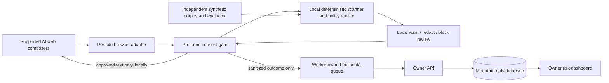

# ShadowLens — Product Implementation Plan V4

**Problem:** Shadow AI Risk Detection and Data Protection for Small Businesses
**Product goal:** Help a small business understand where public AI tools are used, prevent common sensitive-text disclosures before submission, and make its policy and risk visible without collecting employees’ prompts.
**Relationship to V3:** This plan keeps SH-001–SH-020 stable and expands the product roadmap around their original dependency and ownership model. The V3 plan remains the detailed contract/issue specification; this document is the end-to-end product plan and release bar.
**Status:** Product plan and acceptance checklist. Implementation is in progress; this file does not claim production or release readiness.

### Implementation snapshot — 2026-10-31

- Implemented on the current working tree: local extension send gate and provider adapters; provider click, Enter, and associated form-submit interception with exact-text one-use release; provider composer selection follows the active/visible editor and matches its send control by form or unique visible region, refusing ambiguous pairs; provider coverage is refreshed when selector/visibility attributes change; pagehide revokes pending approval while keeping listeners alive for back/forward-cache restores; upload/voice control checks inspect composed event paths; owner-signed business protected terms plus browser-local custom terms and synthetic policy simulation; provider coverage labels; metadata-only API default router composition; separate provider best-effort metrics in the dashboard; 30-day event pruning on API startup; opt-in domain visit and heartbeat observation wired through the validated extension queue; persistent owner-login throttling stores only a keyed address fingerprint.
- SH-024 progress: owners can enroll a browser from the dashboard and receive a high-entropy device bearer credential once; only its hash is stored, it remains in component memory until hidden, and enroll/revoke actions enter metadata-only admin audit. Existing command-line enrollment remains available. Remote HTTPS origins are configurable behind a TLS proxy. A deterministic store-upload ZIP command and managed Chrome/Edge runbook are implemented; browser-store publication, a production extension ID, and a managed-browser pilot remain outstanding.
- Remote service configuration progress: extension settings now accept a single HTTPS API origin, request optional permission only for that host, and clear queued metadata plus old enrollment credentials on service switch. The API launcher honors the configured bind interface, enables forwarded headers only for a configured HTTPS service, and trusts only explicit IP/CIDR proxy entries; it also sets secure owner cookies. This provides transport configuration, not SaaS tenant isolation or managed-force-install deployment.
- SH-025 implementation is present in the working tree: owner policy editing (including up to 100 business protected terms), per-installation P-256 signing, fingerprint pinning during browser setup, local signature verification, revision rollback protection, offline use of the last signed policy, and a signing-key rotation command/browser workflow. Business terms are scanned on enrolled browsers and matched text is not added to event telemetry. The rotation rehearsal and full integration still need end-to-end verification.
- SH-026 implementation: persisted, owner-configurable event retention (1–3650 days), immediate pruning when the setting changes, metadata-only export of events, device enrollment metadata, domain approvals/history, policy and owner audit, plus event-history deletion. Export omits prompt contents and bearer credentials; employee-entered device labels are included. Deletion retains device enrollment and domain approval preferences; administrative retention/deletion actions are recorded without prompt content. API tests and live dashboard E2E cover policy edits, retention updates, export, and deletion. CLI DB backup creates a paired signing-key sidecar; restore requires that sidecar, validates it before replacement, and snapshots the active key before restoring. Isolated tests now exercise backup → key rotation → database/key restore and verify that invalid restore input leaves active state unchanged. A separately scheduled operational restore drill is still needed before a business pilot. Login throttling adds five failed attempts per 15-minute window with a 15-minute lockout; the subject is an HMAC derived from the installation signing key, not a stored IP address, and stale throttle records are pruned after 24 hours.
- Current local verification on 2026-10-31: contract generation/schema/fixture checks pass; API tests pass 62/62; dashboard tests pass 12/12 and production build passes; the dashboard dependency audit reports 0 vulnerabilities; extension tests pass 41/41; engine tests pass 41/41; synthetic evaluation quality gate passes; full local E2E passes 19 extension browser tests plus 3 live API/dashboard tests; deterministic store-upload package builds. These checks use synthetic pages/data and do not prove compatibility with current logged-in ChatGPT, Gemini, or Claude accounts.
- The evaluator now supports an explicit `--quality-gate` mode used in CI. It enforces the plan's initial synthetic regression targets for precision, recall, benign false-block rate, residual/unsafe redactions, and scan latency on the development and generated splits. The current 124-case development and 1,006-case generated reports pass; this is a regression check over synthetic data, not independent release evidence.
- The synthetic evaluation was regenerated with a fixed synthetic owner-protected term and near-match negatives. Current development metrics are 62/62 prompt recall and precision, with 0/37 benign false warnings and 0/37 benign false blocks; generated metrics are 806/806 prompt recall and precision with 0/200 benign false warnings/blocks. These synthetic, template-correlated results are not a production accuracy guarantee or independent release evidence. Reports carry current engine source/build, dataset, and evaluator hashes plus family-cluster intervals and scan latency.
- The unsealed holdout candidate pool has 54 synthetic examples across sensitive, benign and ambiguous classes, including email, phone, payment-test-number, secret-token and confidentiality-marker labels. Reviewer-key generation, corpus signing, and external-directory verification tools are implemented; a genuinely independent reviewer must still author and attest a new corpus. The checked-in candidates are not release evidence.
- GitHub Actions CI passes on PR #25 (head `acd874d`), including API, extension browser, live API/dashboard E2E, module, and synthetic evaluation gates. The run reports an upstream Node 20 action deprecation warning only.
- The browser receiver and local API/dashboard end-to-end checks now pass on the current working tree. Provider browser tests use synthetic provider-shaped pages; live compatibility on provider websites remains unverified.
- Local protected-receiver validation (G3) and API/dashboard reconciliation (G4) pass against synthetic fixtures. Release gates still open: live compatibility for current provider pages (G7), independent holdout authoring/signature/scoring (G5), tagged clean-install and rollback rehearsal (G6), and business deployment/security controls (G8). The existing development evaluation is not a release result.
- SH-026 implementation is covered by isolated backup/restore/rotation tests, but an operator restore drill and recovery runbook rehearsal remain pilot gates; shared multi-tenant hosting isolation is not implemented (deploy separate service/database/key per business). SH-024 managed deployment is documented in `docs/managed-deployment.md` and has a local store-upload ZIP, but still requires browser-store publication and a real managed-browser pilot. SH-025 policy updates are covered by E2E; enrolled-browser key rotation and recovery flows still need a rehearsal.

---

## 1. The promise we can responsibly make

The first useful product is a managed browser extension for Chrome and Edge. On explicitly supported AI web pages, it reads the text in the prompt composer, scans it locally, and applies an owner-configured decision before the page receives the approved text. It sends the owner dashboard sanitized risk metadata, not prompt contents.

The product must show its protection state clearly:

- **Guarded sandbox:** The controlled local receiver confirms exactly what it received. This is the strongest repeatable demo proof.
- **Best-effort provider text guard:** A tested site adapter recognizes a provider’s composer and send controls. Its page structure can change, and it cannot prove every network path is covered.
- **Observed only:** A site visit was detected, but the page is not protected.
- **Unprotected:** The extension is installed but the supported composer cannot be recognized or the guard is unavailable.

Do not claim universal or network-level prevention for ChatGPT, Gemini, or Claude consumer websites. A browser extension can protect supported user-interface paths; it cannot guarantee coverage of desktop/mobile apps, direct API clients, browser devtools, altered pages, or future site changes. If a customer needs stronger enforcement, deploy a managed browser with required extension policy and separately control access to unapproved AI tools. Do not silently MITM personal HTTPS traffic.

---

## 2. Product requirements and release criteria

### Employee experience

1. A visible status says whether the current AI page is guarded, best-effort, unprotected, or observed only.
2. A send attempt is scanned before release. A timeout, malformed analysis, unsupported editor, or scanner error never silently becomes an allow.
3. **ALLOW** proceeds through an explicit second user Send action; **WARN** asks for acknowledgement; **REDACT** shows the exact proposed text, verifies that no in-scope finding remains, and requires approval; **BLOCK** never releases the draft.
4. Editing the draft after review cancels the review and invalidates approval.
5. When upload, voice, or another unsupported input path is detected, explain whether it is blocked or unprotected. Never show the normal “guard active” state for that path.

### Owner experience

1. Show AI site visits separately from prompt attempts. A visit is not evidence that a prompt was sent.
2. Show attempts by site, action, category, and time range; distinguish blocks, warnings, redactions planned, cancelled attempts, failed-safe attempts, and best-effort releases.
3. Show approved-tool status as an owner policy setting, not proof that unapproved sites are technically blocked.
4. Show device freshness only for enrolled devices and only as “recently seen,” “stale,” or “never seen.” Never infer that an extension was removed from a missing heartbeat.
5. If the API is offline, display unavailable/stale data explicitly; never substitute mock data into the live view.

### Minimum release bar

- No prompt, matched value, filename, full URL/query, prompt hash, or custom term leaves the browser in telemetry.
- Unknown fields and invalid event combinations are rejected at the extension queue and API boundary.
- Blocked and failed-safe prompts are not submitted through the guarded path.
- Redaction is verified by rescanning the final text; seeded high-risk redaction cases have zero residual in-scope findings.
- Dashboard event counts reconcile to the synthetic ingestion fixture.
- The synthetic evaluation report records exact numerators/denominators, dataset and engine hashes, policy revision, split methodology, confidence intervals, and caveats.
- A clean install, local demo, rollback point, and known limitations are documented.

---

## 3. Privacy model and threat boundaries

### Data processing rules

| Data | Where it may exist | May leave the browser? | Retention |
|---|---|---:|---|
| Draft prompt and matched spans | Browser memory during local scan/review only | No | Discard after decision/navigation |
| Local owner custom terms | Extension local storage, protected by browser profile | No by default | Owner-controlled; delete on reset |
| Decision metadata | Extension queue and owner API | Yes, allowlisted fields only | Short, documented default (proposed 30 days) |
| Site identity | Domain ID only; no path, query or fragment | Yes when usage observation is enabled | Same as metadata |
| Device identity | Random pseudonymous device ID | Yes for enrolled devices | Owner can revoke/delete |
| Synthetic evaluation text | Versioned corpus in repository | Test-only; never customer data | Repository-controlled |

Telemetry should contain event ID/time, AI site ID, action/disposition, category counts, aggregate tier, policy and engine versions, length band, reason codes, coverage state, and pseudonymous device ID when enrolled. Do not persist content, prompt hashes, snippets, or raw browser URLs.

### Threats and mitigations

| Threat | Required behavior |
|---|---|
| Detector misses or false positives | Explainable local rules, layered detection, independent holdout evaluation, owner-tunable policy, report ambiguity separately |
| Page changes or deceptive DOM | Exact per-site adapters, compatibility health checks, conservative selectors, clear best-effort state, regression fixtures |
| Synthetic events or replayed approval | Require trusted user gestures, bind approval to exact text/revision, consume it once, expire it, cancel on edit/navigation |
| Extension/API unavailable | Local decision does not depend on API; scanner failure blocks the guarded send; telemetry failure queues metadata only |
| Upload, paste-file, drag/drop, voice, or alternate composer path | Block where reliable; otherwise label the path unprotected and do not claim full coverage |
| Malicious prompt/page content | Treat page text as untrusted; render review content using text nodes; keep the review UI isolated; strict sender-origin checks |
| Dashboard/API compromise | Owner authentication, CSRF/session protections, strict schema validation, request limits, no content storage, access audit, retention/delete controls |
| Employee surveillance creep | Aggregate-first reporting; no names or prompt content; disclose observation; make domain observation configurable and visible |
| Browser bypass/API client/direct app | Explicitly out of extension coverage; managed-browser policy or approved AI gateway is a separate deployment control |

---

## 4. Target architecture

Keep module direction one-way: browser and API can consume contracts; the engine stays pure; the API records the already-made decision instead of reinterpreting prompts. A provider adapter detects controls and performs editor operations only. It never chooses policy or uploads prompt text to the service.

### Initial deployment

- One local API and owner dashboard for the demo; loopback-only service is not a multi-device deployment.
- Unpacked extension with host access limited to the sandbox and explicitly supported AI origins.
- Provider access begins as best-effort text-composer coverage, with second-click release and explicit unsupported-path handling.
- Domain observation is opt-in, separate from protection, and reports visits only.

### Small-business pilot deployment

- HTTPS-hosted owner service with tenant separation, secure enrollment/revocation, signed/versioned policy bundles, backups, migrations, retention enforcement, and audit of owner policy changes.
- Force-install extension through managed Chrome/Edge policies where available; tell users what is monitored and what is not.
- Deployment health reports last policy version, extension version, local scanner health, and last metadata sync without sending prompt text.
- A separate approved AI gateway may protect API-based workflows. It must be an explicit business-controlled route using business-owned credentials; it is not a transparent proxy for consumer logins.

---

## 5. Delivery phases and gates

| Phase | Work | Depends on | Exit evidence |
|---|---|---|---|
| 0. Baseline and scope | Freeze supported browsers/sites, in-scope text and categories, event/privacy contract, threat model, clean baseline SHA | None | Signed scope and data-flow review; existing tests/builds inventoried |
| 1. Contract and local engine | SH-001–005: schemas/fixtures, bounded normalization, PII/secrets/confidential/source-code signals, scoring, policy, redaction and verification | SH-001 before final integration | Contract checks; category and negative fixtures; deterministic results; fail-safe behavior |
| 2. Trustworthy guarded path | SH-006–008 and SH-016: extension shell, sandbox receiver, adapter, gate, review, one-shot approval | Phase 1 engine + sandbox protocol | Browser receiver proof for allow, warn, redact, block, edit-after-review, scanner failure; original sensitive text absent after redaction |
| 3. Privacy-safe usage view | SH-009–015 and SH-019: queue, observer, API/database/auth, analytics, dashboard, live transport | Frozen contracts; DB/API seam; guard event contract | E2E with synthetic events, no mock fallback, counts reconciled, no content sentinel in queue/API/DB/log/dashboard |
| 4. Independent evaluation and release | SH-017–018: corpus, held-out evaluation, privacy audit, startup, rollback | Integrated phases 1–3 | G5 report and G6 clean rehearsal on one recorded SHA; all release checks green |
| 5. Provider adapter hardening | SH-020 plus proposed SH-021–023 below: separate adapter and regression coverage for ChatGPT, Gemini and Claude; unsupported workflow handling | Phase 2 G3 green; provider adapters isolated by site | Each site passes its own supported-flow matrix and live compatibility review; best-effort claims remain explicit |
| 6. Small-business pilot | Proposed SH-024–027: managed deployment, policy distribution, privacy/retention controls, operational support | Phases 3–5; security review | Pilot checklist, tenant/isolation review, backup/restore, revocation and deletion evidence |
| 7. Beyond browser text | Approved AI gateway for business API usage, optional text document scanning, more providers, expanded locales | Pilot results and separate privacy/security review | New threat model, user consent, route-specific tests, no weakened browser gate |

Do not start phase 5 to make the demo look more complete while the sandbox receiver gate is red. Do not promote a provider adapter to “guarded” solely because a selector matched once.

---

## 6. Dependency-ordered issue map

The existing issue definitions remain authoritative for SH-001–SH-020. Use this summary to order them; consult `SHADOW_AI_MASTER_IMPLEMENTATION_PLAN_V3_MODULAR.md` for file fences and detailed acceptance.

### P0: complete and prove the core

| Issue | Deliverable | Hard dependency |
|---|---|---|
| SH-001 | Freeze contracts, fixtures, generated types, device DTO and interfaces | None; first integration gate |
| SH-002 | Bounded PII, secret, confidential, source-code and bulk detectors | SH-001 |
| SH-003 | Risk scores and finding explanations | SH-001; can use frozen fixtures before SH-002 merges |
| SH-004 | Deterministic ALLOW/WARN/REDACT/BLOCK policy | SH-001, SH-003 interface |
| SH-005 | Span-safe redaction and mandatory residual verification | SH-001, SH-004 interface; SH-002 for final scan |
| SH-006 | MV3 scaffold, options, popup and truthful statuses | Starts immediately; SH-001 for final messages |
| SH-007 | Cooperative sandbox adapter and exact readback | SH-001, SH-006, SH-016 protocol |
| SH-008 | Protected gate, local review, state machine, safe terminal outcomes | SH-002/004/005 + SH-006/007; SH-016 receiver for proof |
| SH-016 | Controlled fake AI receiver and unprotected baseline | SH-001 protocol; independent of extension code |
| SH-009 | Worker queue, event validation, metadata retry and domain observer integration | SH-001 event contract, SH-006 message seam |
| SH-019 | Known-domain observer and pseudonymous heartbeat | SH-001; pure work parallel; worker composition waits for SH-009 |
| SH-013 | API shell, owner auth, runtime configuration and route registration seam | Can scaffold now; SH-001 for generated contracts |
| SH-011 | SQLite schema, repository and retention primitives | SH-001; can parallel SH-013 |
| SH-010 | Strict authenticated, atomic event ingestion and deduplication | SH-001, SH-011 repository, SH-013 auth seam |
| SH-012 | Analytics, approved-tool inventory and device status endpoints | SH-001, SH-011, SH-013; register routes in the normal app |
| SH-014 | Honest dashboard and typed mock | SH-001 contract; independent of live API |
| SH-015 | Live `DataClient` integration and persistent approvals | SH-014 interface, SH-012/013 routes |
| SH-017 | Independent synthetic evaluation and report | SH-001; final measured report waits for SH-002–005 |
| SH-018 | E2E, privacy audit, release rehearsal and rollback | SH-008/016 for receiver; SH-009/010/012/015/017/019 for full release |

### P1: production-quality provider coverage

| Issue | Deliverable | Dependency |
|---|---|---|
| SH-020 | First bounded real-provider adapter attempt without weakening P0 | G3 green; existing provider integration must be treated as unverified until per-site acceptance passes |
| SH-021 (proposed) | Site-specific ChatGPT, Gemini and Claude adapter fixtures, supported selectors, UI-drift checks, accessibility and versioned compatibility matrix | SH-020 adapter seam; SH-018 browser harness |
| SH-022 (proposed) | Workflow coverage decisions for paste, file upload, drag/drop, voice, multiple composers, mobile and direct API; explicitly block or label each path | SH-021; security review |
| SH-023 (proposed) | Provider release safety review: exact-draft permit, event telemetry classification, failure handling, permission scope, rollback switch | SH-021/022 and G3 regression pass |

### P2: above-and-beyond business readiness

| Issue | Deliverable | Dependency |
|---|---|---|
| SH-024 (proposed) | Managed browser onboarding, force-install guidance, tenant/device enrollment and revocation | P0 stable; HTTPS owner service |
| SH-025 (proposed) | Signed, versioned owner policy bundles with local verification, rollback and effective-date audit | SH-001 contract extension proposal; SH-013/012 service |
| SH-026 (proposed) | Configurable metadata retention, export/delete, backup/restore and tenant isolation evidence | SH-011/013; pilot threat model |
| SH-027 (proposed) | Local-only owner custom markers and policy simulator/dry-run that previews impact on synthetic fixtures | SH-004 policy interface; privacy review |
| SH-028 (proposed) | Approved business AI gateway for API-based tools, using business-owned credentials and content-minimizing logs | Separate gateway architecture and security review; never a dependency for browser extension |
| SH-029 (proposed) | Continuous drift and evaluation process: adapter compatibility alerts, corpus versioning, regression thresholds and signed release evidence | SH-017/018/021 |

---

## 7. Three-person execution split

Each person should keep a separate branch and own their module boundary. The only shared-file changes are merged serially by the integration owner after the relevant dependency lands.

| Person | Owns | Can start immediately | Must wait before final integration |
|---|---|---|---|
| A — Browser protection | SH-006, SH-007, SH-008, SH-009, SH-019, SH-020–023; extension popup/status and provider compatibility | Shell, popup/options, sandbox adapter fixture, provider fixture harness; stub engine and telemetry sink | SH-007 final contract waits SH-001/016; SH-008 release waits SH-002/004/005; worker observer composition waits SH-009+SH-019; provider release waits G3 |
| B — Detection and evaluation | SH-001–005, SH-017; contracts, scanner, policy, redaction, synthetic corpus and metrics | Corpus labeling protocol, detector fixtures, schema review; implement scoring/policy/redaction against frozen finding fixtures | Final engine integration waits SH-001; residual verification waits SH-002+SH-004; final evaluation waits pinned release engine SHA |
| C — API, dashboard and integration | SH-010–016, SH-018; API, database, analytics, dashboard, sandbox, E2E/release | API shell/auth, DB repository seam, dashboard mock, sandbox receiver against protocol draft | Ingestion waits SH-001/011/013; analytics/live dashboard waits SH-012/013/014; E2E release waits SH-009/010/012/015/017/019 |

### Avoid idle time

1. At kickoff, B owns the canonical contract draft. A builds shell and DOM fixtures behind interfaces; C builds API/router stubs, database protocol, typed dashboard mock, and sandbox using the published protocol draft.
2. Once SH-001 is frozen, A/B/C consume generated fixtures; no one hand-invents DTOs.
3. B’s scoring, policy and redaction modules can work from frozen findings while detector implementation proceeds. C’s dashboard is mock-backed while API work proceeds. A’s UI and queue can use deterministic fake scanner/event responses until integration.
4. At each gate, merge only passing modules to a named green SHA. The integrator does not simultaneously edit module-owned files.

---

## 8. Evaluation plan: measure behavior, not a marketing number

### Corpus design

- Synthetic-only, versioned corpus with **sensitive**, **benign**, and **ambiguous** prompts; do not put real customer data into source control.
- Label prompt-level truth and entity-level spans, category, severity, expected action, and whether the example is in the declared scope.
- Include email, phone, payment card, India-specific identifiers where supported, API keys, private keys, bearer tokens, internal/confidential markers, code context, bulk contacts, Unicode/normalization variants, near misses, pasted logs and long/boundary inputs.
- Split by template/family before tuning. Keep a hand-authored holdout and do not tune thresholds against it. Add challenge sets for OCR/files only when those pathways are implemented.
- Have two reviewers independently label a sample and record disagreement; ambiguous cases are analyzed separately, never silently counted as benign.

### Metrics and denominators

| Metric | Formula / denominator | Report by |
|---|---|---|
| Prompt precision | Correctly flagged sensitive prompts / all prompts flagged sensitive | Overall and category |
| Prompt recall | Sensitive prompts detected / all in-scope sensitive prompts | Overall, category, severity |
| Entity precision/recall | Correct span matches / predicted spans; correct span matches / gold spans | Category and normalization variant |
| False-positive rate | Benign prompts with any finding / all benign prompts | Overall and category |
| False-block rate | Benign prompts blocked / all benign prompts | Policy revision and dataset split |
| False-warning rate | Benign prompts warned / all benign prompts | Policy revision and dataset split |
| Redaction residual rate | Redacted prompts with an in-scope residual finding / redacted prompts | Category and policy |
| Fail-safe rate | Inputs failing closed / all attempted guarded scans | Failure cause, size and browser |
| Latency | Local scan time percentiles | Input-length bucket and hardware class |

Predeclare release targets before evaluation (initial proposal: ≥95% prompt recall and ≥90% precision for in-scope seeded PII/secrets; ≤1% benign false-block rate; zero seeded critical-secret leakage after approved redaction; scanner p95 under 300 ms for prompts up to 10,000 characters). Adjust only through a documented product decision before opening the holdout, not after seeing results. Publish measured result, denominator, confidence bound, corpus/engine/policy hashes and limitations. A small sample with 0 observed false blocks does not establish a low real-world false-block rate.

The current checked-in development report is not a release claim: it describes 120 development examples, with 0 false positives and 0 false blocks among 35 benign prompts (each zero-of-35 result still has a Wilson 95% upper bound of about 9.89%). The 1,006-case generated split includes six chunk/input-size boundary probes, but remains template-correlated and synthetic. Family-cluster bootstrap intervals, per-length scan latency, code/corpus/engine hashes, false-warning rates and exact split methodology are reported. A reviewer-authored, disjoint holdout is still required before making a release-readiness claim.

### Bypass and robustness evaluation

In addition to detector metrics, test that protection remains visible and fail-safe for: composer replacement mid-review; duplicate/double send; Enter/IME; unsupported selectors; disabled extension; no API; scanner timeout; malformed engine output; page reload/navigation; edits after approval; contenteditable/textarea variants; SPA route transitions; blocked file controls; and attempted synthetic approval. Record which paths are guarded, blocked, or explicitly outside scope.

---

## 9. Gates and definition of done

| Gate | Pass criteria |
|---|---|
| G0 — Scope/contracts | Threat model, schemas, event variants, origin list, selectors, telemetry fields, policy semantics and ownership frozen; fixture validation passes |
| G1 — Independent modules | Extension builds/loads, scanner builds, API health/auth works, dashboard mock works, sandbox works without network/provider data |
| G2 — Local detection | PII/secrets/marker tests, normalization/size limits, deterministic policy, redaction property and residual verification pass |
| G3 — Protected receiver | Real browser test proves exact receiver text for allow/redact; block/fail-safe never reach receiver; original sensitive sentinel absent; edit cancels consent |
| G4 — Product data | Synthetic visits and outcomes reconcile through queue, API, database and dashboard; no prompt sentinel in any persisted/logged/rendered artifact |
| G5 — Independent evaluation | Frozen holdout metrics, denominators, uncertainty, latency, residual leakage, false-block/false-warning results and provenance recorded |
| G6 — Demo/release | Clean install/run, policy shown, rollback SHA/tag, all claims match measured coverage, local failure rehearsed |
| G7 — Provider pilot | Each provider’s current UI passes site-specific workflow matrix on supported browser versions; uploads/voice/other paths blocked or visibly out of coverage; adapter can be disabled remotely/by release rollback without affecting sandbox |
| G8 — Business pilot | Tenant isolation, HTTPS, enrollment/revocation, managed deployment, retention/delete, backup/restore, support and privacy review complete |

---

## 10. Recommended demo story

1. Show extension status on the local sandbox and owner dashboard’s empty/seeded metadata view.
2. Submit a harmless prompt and show the approved text in the controlled receiver.
3. Submit a synthetic prompt containing a placeholder email; show the local preview, approve the redaction, click Send again, and prove the receiver got only the replacement.
4. Submit a synthetic private-key fixture; show it blocked and prove nothing arrived.
5. Show the dashboard with site visits distinct from attempts, category/outcome totals, and a clear best-effort label.
6. Show the aggregate synthetic evaluation report, including false-positive and false-block denominators and known limitations.
7. If G7 is not green, show provider pages as unprotected/observed-only and do not demo with real customer data. If G7 is green, use only synthetic text and identify that site/version’s coverage.

---

## 11. Scope cuts and non-goals

Keep the first release narrow: English text in supported composers, local rule-based detection, local policy, text redaction, metadata-only dashboard, synthetic evaluation, and explicit coverage reporting.

Do not include in the initial release: hidden network decryption, silent prompt collection, employee productivity scoring, sentiment or intent surveillance, model training on prompts, broad AI-site blocking without owner disclosure, file OCR, image/audio transcription, universal browser coverage, or an unreviewed remote policy editor. These can be reconsidered only with a separate need, consent model, threat review and evaluation set.

**Above-and-beyond value comes from trustworthy enforcement and evidence:** local-first inspection, visible user control, exact redaction verification, owner policy simulation, no-content telemetry, transparent per-site coverage, small-business deployment and retention tools, and independently measured false-positive/false-block behavior—not from claiming to support every AI app.
