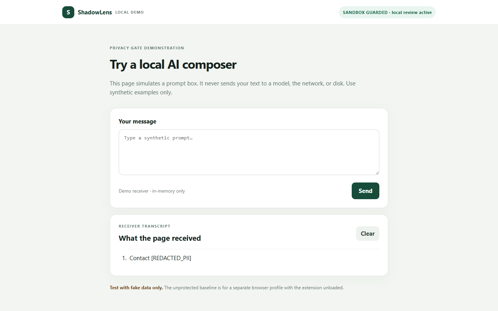

# Person A extension verification

Verified on Windows 11, 2026-10-30. Scope: SH-006, SH-007, SH-008 and the independent SH-019 observer. The user explicitly retained SH-009 and the API/dashboard dependencies with teammates. These integration requirements remain open; this record does not close all four issues.

## Commands and results

| Command | Result |
| --- | --- |
| `npm run contracts:check` | Passed: generated TypeScript/Python modules and normative schema fixtures |
| `npm run test:engine` | 40 passed, 0 failed |
| `npm run test:extension` | 37 passed, 0 failed |
| `npm run check:extension` | Passed: manifest scope and packaged entry files |
| `npm run test:extension:browser` | 11 passed, 0 failed, 0 skipped |

Browser: Playwright 1.58.2, bundled Chrome for Testing 145.0.7632.6, fresh persistent test profile, real unpacked MV3 extension, real engine and real sandbox receiver. This is automated Chromium acceptance; a manual check in the user's current Chrome has not passed yet. Computer-use Chrome app approval timed out before inspection.

Run from the repository root after `npm ci` and `npx playwright install chromium`. The browser suite starts/stops the local sandbox itself; port 4173 must be free. On Windows it stages an unchanged copy of the bundled browser in ignored `.browser-runtime/` because activating browser assemblies from the external Playwright cache failed on this machine. An optional `SHADOWLENS_CHROMIUM_EXECUTABLE` may point to another Chromium test executable. No branded Chrome command-line extension loading is assumed.

Raw browser output and profiles are under ignored `apps/extension/test-results/`. The JSON reporter records each test. The receiver screenshot below is retained using synthetic data only.

## Acceptance evidence

| Issue / requirement | Evidence | Status |
| --- | --- | --- |
| SH-006: MV3, isolated document_start, exact origin and packaged entrypoints | `manifest.test.mjs`, `validate-manifest.mjs`, actual unpacked browser load | Passed in bundled Chromium |
| SH-006: runtime rejects other origins; API/dashboard not injected | `shell.test.mjs` origin cases; browser API/dashboard page assertions | Passed |
| SH-006: Options credential is worker-mediated, cleared immediately and session storage restricted to trusted contexts | Options message tests; worker sender/storage tests; browser Options flow and DOM checks | Passed |
| SH-006: coverage and reconnect state are truthful | Popup/Options display disconnected state; worker returns unconfigured connection; compatibility browser test | Connection implementation still depends on SH-009 |
| SH-006: manual current Chrome unpacked load/user flow | Not executed: Chrome app access approval timed out | Pending manual verification |
| SH-007: fixed selectors/types, native textarea setter and bubbling input, exact readback | `adapter.test.mjs`; browser reads actual receiver contents | Passed |
| SH-007: dynamic replacement changes revision; failed readback cannot release; duplicate release IDs rejected | Adapter fixture tests; gate identity/revision checks | Passed |
| SH-007: click/Enter through gate; unknown selectors report UNPROTECTED | Browser ALLOW and compatibility tests; origin fixture cases | Passed |
| SH-007: receipt correlates a release and never authorizes it | Adapter unsolicited receipt test; gate listener only installed after local decision | Passed |
| SH-008: BLOCK, REDACT and FAILED_SAFE receiver safety | Real-engine browser cases: blocked private key absent; email delivered as exact `Contact [REDACTED_PII]`; oversized original absent | Passed in bundled Chromium |
| SH-008: trusted consent in a closed Shadow DOM | Browser scripts cannot read the root; CDP test can inspect it without opening it; scripted approve/ack clicks rejected; real mouse approval succeeds | Passed |
| SH-008: IME, Shift+Enter, duplicate/synthetic gestures, cancelled review and editing | Gate unit tests; browser Shift+Enter, duplicate review, synthetic send and editing cases | Passed |
| SH-008: invalid policy, malformed response, long input, scan/verifier timeout, late callbacks | Gate fixtures plus oversized-input real browser case | Passed |
| SH-008: absent/late receipt, offline telemetry, no retry, state reset | Gate tests use controlled timers and receiver spies; BLOCK followed by clean send works in browser | Passed |
| SH-008: schema-compatible metadata events | Every gate-test event is checked against the canonical event schema after adding a fake device ID; no raw prompt in event draft | Producer passed; worker persistence pending SH-009 |
| SH-019: exact canonical hosts, top-frame filtering, queries discarded, document dedup and bounded history | `observer.test.mjs`, including concurrent duplicates and failed enqueue retry | Passed |
| SH-019: browser registration, opt-in lifecycle and heartbeat scheduling | Injected browser listener/alarm tests; defaults off, known hosts only, five-minute heartbeat, opt-out/disposal stops activity | Independent module passed |
| SH-019: heartbeat does not claim stale means uninstalled | Heartbeat only emits canonical metadata and no stale assertion | Producer passed; server freshness projection pending |
| SH-019: known-domain visit reaches dashboard separately from protected attempts | No queue/API/dashboard implementation is present in this checkout | Blocked by teammate integrations |

## Integration handoff

1. SH-009 owns the production `enqueueSanitizedEvent` sink, queue/auth/retry behavior and device identity. In `worker.ts`, construct `installDomainObserver` with `chrome.webNavigation.onCommitted`, `chrome.alarms`, the device-ID getter and the sanitized sink. Persist opt-in settings in that issue's restricted settings flow and call the returned `setEnabled` when they change. This module is intentionally not activated against the existing queue placeholder.
2. For content-script `ENQUEUE_EVENT` submission drafts, SH-009 must add its device ID, strictly validate the full canonical `RiskEventV2`, then persist it. No prompt, preview, findings/spans, full URL or raw score is included. The current scaffold responds `{ok:false,queued:false}`; no persistence or delivery is claimed. Gate protection does not wait for the backend.
3. SH-009 should connect the Options and popup status to its actual transport/auth/reconnect state. The current scaffold truthfully reports the transport as unconfigured and accepts credentials only from its own Options page.
4. After SH-010/012/015 and the dashboard are available, verify a synthetic known-domain visit appears in domain usage, leaves protected-submission counters unchanged, and reports UNSUPPORTED accurately. Verify freshness using server ingestion timestamps; stale must not imply an uninstalled extension.
5. Complete the current-Chrome manual load, popup and Options flow using `apps/extension/dist` through Extensions → Load unpacked. Verify sandbox coverage, exact receiver text, blocked original absence and no injection into API/dashboard. Do not mark SH-006 or full release acceptance complete before this check.

The only changes to the SH-009 scaffold are the Options-page credential sender restriction and its `getURL` declaration. The sandbox change fixes `/` mapping to `index.html` on Windows; browser tests exposed the original 404. Queue, API, dashboard and sandbox business logic ownership remain with the assigned teammates.
